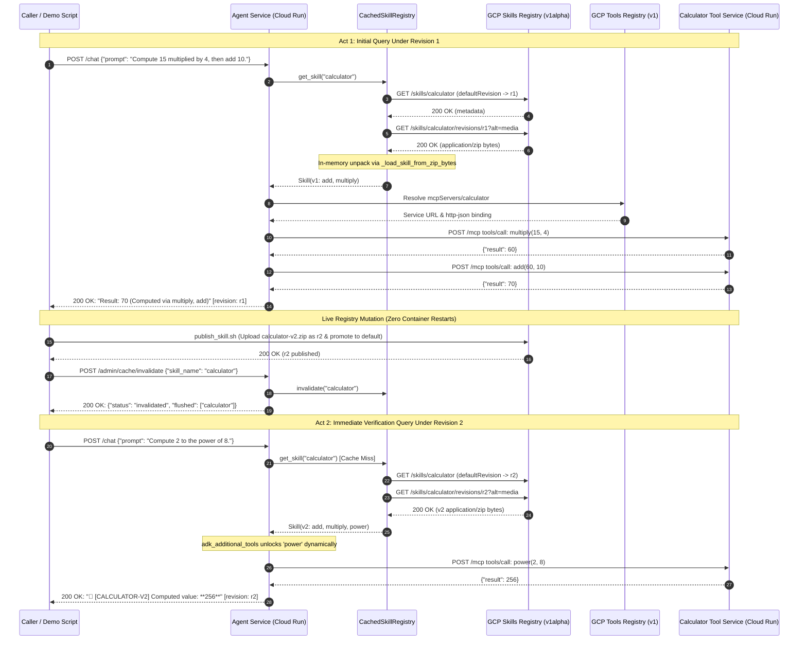

# Google Cloud Agent Registry Demo: Dynamic Skills & Remote Tools

[](LICENSE)
[](https://www.python.org/)
[](https://www.terraform.io/)
[](https://cloud.google.com/vertex-ai)

An enterprise prototype demonstrating dynamic discovery, runtime loading, and zero-downtime hot-reloading of agent skills (`SKILL.md`) and remote tools (`mcpServers`) using **Google Cloud Agent Registry** (`agentregistry.googleapis.com`) and the **Google Agent Development Kit (ADK)** on Cloud Run.

---

## Table of Contents

- [1. System Overview & Problem Statement](#1-system-overview--problem-statement)
- [2. System Architecture & Request Lifecycle](#2-system-architecture--request-lifecycle)
- [3. Why Agent Registry & Pure In-Memory Packaging](#3-why-agent-registry--pure-in-memory-packaging)
- [4. Remote Tool Execution & IAM Security Boundaries](#4-remote-tool-execution--iam-security-boundaries)
- [5. Component Breakdown](#5-component-breakdown)
- [6. Prerequisites & Environment Setup](#6-prerequisites--environment-setup)
- [7. Infrastructure Deployment Walkthrough](#7-infrastructure-deployment-walkthrough)
- [8. Hot-Reload Demonstration Scenarios](#8-hot-reload-demonstration-scenarios)
  - [Act 1: Initial Query Under Skill Revision 1](#act-1-initial-query-under-skill-revision-1)
  - [Live Registry Mutation: Zero-Downtime Skill Publication](#live-registry-mutation-zero-downtime-skill-publication)
  - [Act 2: Verification Query Under Skill Revision 2](#act-2-verification-query-under-skill-revision-2)
  - [Continuous Liveness & Zero Container Restarts](#continuous-liveness--zero-container-restarts)
- [9. Automated Demo Tooling & Verification](#9-automated-demo-tooling--verification)
- [10. Testing Guide & Quality Gates](#10-testing-guide--quality-gates)
- [11. Repository Layout](#11-repository-layout)

---

## 1. System Overview & Problem Statement

### The Problem: Static Container Coupling
Existing Google Cloud agent prototypes (such as `gha-deploy-investigator` and `incident-sre-agent`) bundle prompt runbooks and skills statically into Docker container images at build time:

```dockerfile
# Traditional static pattern:
COPY app/ /app/app/
COPY skills/ /app/skills/
```

Skills are parsed from local disk by directory-scanning loaders (`load_skills_from_dir`). While simple, this static coupling introduces critical operational bottlenecks:
1. **Redeployment Latency**: Every instruction update, triage tweak, prompt formatting revision, or runbook addition requires rebuilding the container image, pushing to Artifact Registry, and deploying a new Cloud Run revision (5–10 minutes).
2. **Authoring Decoupling**: Domain experts, SREs, and prompt authors cannot publish or iterate on skills independently of the software engineering release lifecycle.
3. **Rigid Tool Scoping**: Tools are statically hardcoded into the agent runtime. Upgrading or unlocking new tools requires modifying application source code rather than dynamically binding tools declared in the active skill.

### The Solution: Native Google Cloud Agent Registry
This prototype eliminates container-level skill bundling entirely. The agent container boots with **zero local disk persistence for skills**. Skills and tools are decoupled into native Google Cloud registry services:
- **Skills Registry (`agentregistry.googleapis.com/v1alpha`)**: Catalogs immutable, versioned skill packages (`skills/{name}/revisions/{rev}`). The agent downloads binary ZIP archives directly into memory and unpacks them into typed ADK `Skill` models.
- **Tools Registry (`agentregistry.googleapis.com/v1`)**: Catalogs remote tools as Model Context Protocol (MCP) servers (`mcpServers/{name}`). The agent dynamically discovers and connects to remote tool endpoints over Streamable HTTP.
- **Zero-Downtime Hot-Reload Engine**: An in-memory, thread-safe TTL cache (`CachedSkillRegistry`) combined with an instant invalidation endpoint (`POST /admin/cache/invalidate`) enables live prompt and tool upgrades in under 5 milliseconds—without restarting the Cloud Run container.

### Baseline Comparison

| Architectural Dimension | Reference Baseline (`gha-deploy-investigator`) | Agent Registry Prototype |
| :--- | :--- | :--- |
| **Skill Storage** | Local container filesystem (`/app/skills/`) | Google Cloud Agent Registry (`v1alpha`) |
| **Skill Packaging** | Loose markdown files on disk | Immutable binary ZIP bundle (`SKILL.md` + references) |
| **Skill Loading** | Disk scan (`load_skills_from_dir`) | In-memory download & unpack (`_load_skill_from_zip_bytes`) |
| **Tool Catalog** | In-process Python functions decorated with `@readonly_tool` | Remote Tools Registry (`agentregistry.googleapis.com/v1`) |
| **Tool Execution** | In-process Python code execution | Remote FastMCP service over Streamable HTTP |
| **Tool Activation** | Fixed set bound in Python code at startup | Dynamic activation via `adk_additional_tools` frontmatter |
| **Update Cycle** | Commit $\rightarrow$ Build $\rightarrow$ Cloud Run Deploy (5–10 mins) | Registry publish $\rightarrow$ In-memory hot-reload ($\le$ 5ms) |
| **Container Mutation** | Container rebuild required for every prompt/skill change | **Zero container redeployments or restarts** |

---

## 2. System Architecture & Request Lifecycle

### High-Level Component Architecture

```
                                      +------------------------------------+
                                      |          Developer / Caller        |
                                      +-----------------+------------------+
                                                        |
                                                        | HTTP POST /chat
                                                        v
+----------------------------------------------------------------------------------------------------------+
|  Cloud Run: Agent Service (`agent-service`)                                                              |
|                                                                                                          |
|   +--------------------------------------------------------------------------------------------------+   |
|   | FastAPI Application (main.py)                                                                    |   |
|   |  - POST /chat (User queries)                                                                     |   |
|   |  - POST /admin/cache/invalidate (Instantaneous in-memory cache flush)                            |   |
|   |  - GET /health (Health & liveness probe)                                                         |   |
|   +-------------------------------------------------+------------------------------------------------+   |
|                                                     |                                                    |
|                                                     v                                                    |
|   +--------------------------------------------------------------------------------------------------+   |
|   | Google GenAI ADK Runtime (v2.11+)                                                                |   |
|   |                                                                                                  |   |
|   |   +------------------------------------------------------------------------------------------+   |   |
|   |   | SkillToolset                                                                             |   |   |
|   |   |  - Dynamic tool activation via metadata: adk_additional_tools                            |   |   |
|   |   +-------------------------------------+----------------------------------------------------+   |   |
|   |                                         |                                                        |   |
|   +-----------------------------------------|--------------------------------------------------------+   |
|                                             |                                                            |
|       +-------------------------------------+---------------------------------------+                    |
|       |                                                                             |                    |
|       v                                                                             v                    |
|   +-----------------------------------------------+             +------------------------------------+   |
|   | CachedSkillRegistry (Thread-Safe In-Memory)   |             | ToolRegistryManager                |   |
|   |  - Key: skill_name                            |             |  - Queries v1 /mcpServers catalog  |   |
|   |  - Value: (Skill, timestamp, hash)            |             |  - Remote FastMCP Streamable HTTP  |   |
|   |  - Configurable TTL: 60s (sub-ms cache hits)  |             |  - In-flight Google OIDC ID token  |   |
|   +-----------------------+-----------------------+             +-----------------+------------------+   |
+---------------------------|-------------------------------------------------------|----------------------+
                            |                                                       |
                            | GET /skills/{name}?alt=media                          | JSON-RPC Tool Calls
                            | (In-memory ZIP download)                              | (Streamable HTTP /mcp)
                            v                                                       |
+-----------------------------------------------------------+                       |
| Google Cloud Agent Registry API                           |                       |
| (agentregistry.googleapis.com)                            |                       |
|                                                           |                       |
| [1] Skills Registry (v1alpha):                            |                       |
|     projects/{project}/locations/{location}/skills/       |                       |
|       └── calculator/                                     |                       |
|             ├── revisions/r1 (calculator-v1.zip)          |                       |
|             ├── revisions/r2 (calculator-v2.zip)          |                       |
|             └── defaultRevision -> r1 / r2                |                       |
|                                                           |                       |
| [2] Tools Registry (v1):                                  |                       |
|     projects/{project}/locations/{location}/mcpServers/   |                       |
|       └── calculator                                      |                       |
|             ├── protocolBinding: http-json                |                       |
|             └── url: https://calculator-tool-...run.app   |                       |
+-----------------------------------------------------------+                       |
                                                                                    v
                                                                 +-----------------------------------------+
                                                                 | Cloud Run: Tool Provider                |
                                                                 | (`calculator-tool-service`)             |
                                                                 |                                         |
                                                                 | FastMCP Server (Python 3.12)            |
                                                                 | - POST /mcp (JSON-RPC 2.0 tools/call)   |
                                                                 | - Tools exposed:                        |
                                                                 |     * add(a, b)                         |
                                                                 |     * multiply(a, b)                    |
                                                                 |     * power(base, exponent)             |
                                                                 +-----------------------------------------+
```

### End-to-End Live Sequence (Mermaid)



---

## 3. Why Agent Registry & Pure In-Memory Packaging

### 1. Atomic Multi-Resource Bundling
A production skill in Google Cloud is rarely a solitary markdown file. Real-world agent skills bundle:
- `SKILL.md`: Frontmatter schema, parameters, allowed tools, and step-by-step reasoning directives.
- `references/`: Rich domain runbooks, mathematical proof rules, triage heuristics, and decision trees.
- `assets/` / `schemas/`: Machine-readable schemas, configuration templates, or few-shot examples.

Packaging the entire skill directory into a ZIP archive guarantees that instructions and domain references are versioned and fetched together **atomically**. There is zero possibility of partial reads or inconsistent multi-file state.

### 2. Native GCP Agent Registry Media Contract
The Google Cloud Agent Registry API (`agentregistry.googleapis.com/v1alpha`) natively defines a skill revision's stored content as an immutable binary media resource:
```http
GET /v1alpha/projects/{project}/locations/{location}/skills/{skill}/revisions/{revision}?alt=media
```
The binary payload returned by this endpoint is natively a standard ZIP archive.

### 3. Pure In-Memory Unpacking (Zero Disk Persistence)
In Google Cloud Run and serverless containers, writing temporary files to local disk incurs write-lock contention, container state mutation, and filesystem cleanup overhead.

This prototype unpacks ZIP payloads **strictly in memory** via ADK's native `google.adk.skills._utils._load_skill_from_zip_bytes(zip_bytes)`. The archive is streamed directly from the HTTP response into memory, parsed into typed ADK `Skill`, `Frontmatter`, and `Resources` models, and cached in RAM. No temporary directories or files are ever created on container storage.

---

## 4. Remote Tool Execution & IAM Security Boundaries

### FastMCP Remote Tool Model
Rather than executing arbitrary Python code inside the agent container, remote tools are implemented using **FastMCP** (Model Context Protocol over Streamable HTTP). FastMCP provides:
- Standardized tool discovery via JSON-RPC `tools/list`.
- Strongly typed tool execution via JSON-RPC `tools/call`.
- Clear isolation between the reasoning agent and the tool execution environment.

### IAM Service-to-Service Security Boundaries
The architecture enforces strict least-privilege security boundaries using Google Cloud IAM:

```
+------------------------------------+             +------------------------------------+
|  Agent Service                     |             |  Calculator Tool Service           |
|  Identity: `agent-sa`              |             |  Identity: `calculator-tool-sa`    |
|                                    |             |                                    |
|  Roles:                            |  Google     |  Roles:                            |
|  - roles/agentregistry.viewer      |  OIDC Token |  - Minimal execution roles         |
|  - roles/run.invoker (on tool svc) +------------>+  - AuthMiddleware verifies:        |
|                                    |             |    * Bearer token signature        |
|                                    |             |    * Audience == Tool Service URL  |
|                                    |             |    * Caller SA == agent-sa         |
+------------------------------------+             +------------------------------------+
```

1. **Dedicated Service Accounts**:
   - `agent-sa`: Granted `roles/agentregistry.viewer` to query skills and tool catalogs, and `roles/run.invoker` targeting `calculator-tool-service`.
   - `calculator-tool-sa`: Dedicated identity for the tool provider with minimal runtime privileges.
2. **OpenID Connect (OIDC) Verification**:
   - In-flight HTTP requests between the agent and tool provider include a Google-signed ID token (`Authorization: Bearer <ID_TOKEN>`).
   - The tool service's `AuthMiddleware` verifies token signatures, validates audience against its Cloud Run URL, and asserts the calling email matches `agent-sa`.
3. **Zero In-Container Code Execution**:
   - Dynamic Python `exec()` or loading of executable `scripts/` directories inside skill packages is **strictly prohibited and blocked by security guardrails**.
   - If any skill package contains a `scripts/` directory, both `scripts/publish_skill.sh` and the agent's `SkillsLoader` immediately reject the package with a security violation.
4. **Dynamic Tool Access Control (`adk_additional_tools`)**:
   - Tools are not globally exposed to the model.
   - The agent strictly enforces `metadata.adk_additional_tools`. When Skill Revision 1 is active, only `add` and `multiply` are exposed. Any prompt attempting to execute undeclared tools (e.g., `power`) is rejected before invocation.

---

## 5. Component Breakdown

| Component | Path | Description |
| :--- | :--- | :--- |
| **FastAPI Agent Service** | `app/main.py` | Exposes `/chat`, `/admin/cache/invalidate`, and `/health`. Coordinates dynamic skill resolution and tool execution. |
| **Configuration** | `app/config.py` | Pydantic Settings managing endpoints, project identifiers, and cache TTL (default: 60s). |
| **Cached Skill Registry** | `app/registry/cache.py` | Thread-safe in-memory cache wrapping `GCPSkillRegistryClient`. Sub-millisecond reads on hits, atomic flush via `invalidate()`. |
| **GCP Skill Registry Client** | `app/registry/client.py` | Client targeting `agentregistry.googleapis.com/v1alpha` for skill metadata and media ZIP downloads. |
| **Skills Loader** | `app/skills_loader.py` | Bridges Agent Registry into ADK `SkillToolset` and enforces zero-scripts guardrails. |
| **Tool Registry Manager** | `app/tools/registry.py` | Queries Tools Registry `mcpServers/calculator`, resolves `McpToolset`, and handles JSON-RPC execution. |
| **FastMCP Tool Service** | `demo/calculator_service/` | Standalone FastAPI/FastMCP Cloud Run microservice exposing `add`, `multiply`, and `power` tools over `/mcp`. |
| **Skill Packages** | `demo/registry_packages/` | Canonical skill packages: `v1` (Revision 1 arithmetic) and `v2` (Revision 2 with `power` and emoji directives). |
| **Publish Automation** | `scripts/publish_skill.sh` | CLI automation to validate, package, and publish skill revisions to GCP Agent Registry `v1alpha`. |
| **Tool Registration** | `scripts/register_tool.sh` | CLI automation to register FastMCP services into GCP Agent Registry `v1` `mcpServers` catalog. |
| **Live Demo Script** | `scripts/run_demo.sh` | Orchestrates the end-to-end hot-reload demonstration with color-coded logging and automated assertions. |
| **Terraform Stack** | `infra/terraform/` | Enterprise Infrastructure-as-Code modules for APIs, Artifact Registry, IAM, Cloud Run, and Agent Registry. |

---

## 6. Prerequisites & Environment Setup

### Required Google Cloud APIs
The following APIs must be enabled in your target Google Cloud project (`<PROJECT_ID>`):
- `run.googleapis.com` (Cloud Run Admin API)
- `agentregistry.googleapis.com` (Google Cloud Agent Registry API)
- `artifactregistry.googleapis.com` (Artifact Registry API)
- `iam.googleapis.com` (Identity and Access Management API)

### Google Cloud CLI (`gcloud`) Components
Install and configure the `alpha` component required for Agent Registry commands:
```bash
gcloud components install alpha
gcloud config set project <PROJECT_ID>
gcloud config set compute/region us-central1
```

### Local Development Tools
- **Python**: 3.12 or higher with `uv` or standard virtual environment.
- **Terraform**: `>= 1.5.0`
- **Utilities**: `curl`, `jq`, `bash`

---

## 7. Infrastructure Deployment Walkthrough

### Step 1: Clone Repository and Setup Virtual Environment
```bash
cd /scion-volumes/scratchpad/projects/agent-registry-demo/repo/agent-registry-demo
source ../.venv/bin/activate
```

### Step 2: Build & Push Container Images to Artifact Registry
```bash
export PROJECT_ID="<PROJECT_ID>"
export REGION="us-central1"
export REPO="ard-images"

# Authenticate Docker to Google Artifact Registry
gcloud auth configure-docker ${REGION}-docker.pkg.dev

# 1. Build and push Calculator Tool Service
docker build -t ${REGION}-docker.pkg.dev/${PROJECT_ID}/${REPO}/calculator-tool-service:latest \
  -f demo/calculator_service/Dockerfile demo/calculator_service/
docker push ${REGION}-docker.pkg.dev/${PROJECT_ID}/${REPO}/calculator-tool-service:latest

# 2. Build and push Agent Service
docker build -t ${REGION}-docker.pkg.dev/${PROJECT_ID}/${REPO}/agent-service:latest \
  -f Dockerfile .
docker push ${REGION}-docker.pkg.dev/${PROJECT_ID}/${REPO}/agent-service:latest
```

### Step 3: Deploy Infrastructure via Terraform
```bash
cd infra/terraform

# Initialize Terraform modules and providers
terraform init

# Review and apply infrastructure plan
terraform apply \
  -var="project_id=${PROJECT_ID}" \
  -var="region=${REGION}" \
  -var="agent_image=${REGION}-docker.pkg.dev/${PROJECT_ID}/${REPO}/agent-service:latest" \
  -var="tool_image=${REGION}-docker.pkg.dev/${PROJECT_ID}/${REPO}/calculator-tool-service:latest"

# Save outputs
export AGENT_SERVICE_URL="$(terraform output -raw agent_service_url)"
export TOOL_SERVICE_URL="$(terraform output -raw calculator_tool_service_url)"
cd ../..
```

### Step 4: Register Tool in Tools Registry
```bash
./scripts/register_tool.sh \
  --project="${PROJECT_ID}" \
  --location="${REGION}" \
  --tool-url="${TOOL_SERVICE_URL}" \
  calculator
```

### Step 5: Publish Baseline Skill Revision 1
```bash
./scripts/publish_skill.sh \
  --project="${PROJECT_ID}" \
  --location="${REGION}" \
  calculator r1 demo/registry_packages/v1/calculator
```

---

## 8. Hot-Reload Demonstration Scenarios

The live demonstration showcases zero-downtime hot-reloading through a two-act presentation without restarting or redeploying the Cloud Run container.

### Act 1: Initial Query Under Skill Revision 1

**Context**: Skill Revision 1 (`r1`) is active in the registry. Directives mandate standard formatting and authorize tools `add` and `multiply`.

**Execution**:
```bash
curl -X POST "${AGENT_SERVICE_URL}/chat" \
  -H "Content-Type: application/json" \
  -d '{"prompt": "Compute 15 multiplied by 4, then add 10."}'
```

**Expected JSON Response**:
```json
{
  "response": "Result: 70 (Computed via multiply, add)",
  "skill_revision": "r1",
  "tools_invoked": [
    "multiply",
    "add"
  ]
}
```

**Log Evidence**:
- `CachedSkillRegistry`: Fetches `calculator-v1.zip` from Agent Registry on initial miss; parses into memory.
- `ToolRegistryManager`: Invokes remote tools `multiply(15, 4) -> 60` and `add(60, 10) -> 70` over `/mcp`.
- Output strictly formatted per Revision 1 rules: `"Result: 70 (Computed via multiply, add)"`.

---

### Live Registry Mutation: Zero-Downtime Skill Publication

**Action**: Without touching or redeploying the Cloud Run container, publish Revision 2 to Google Cloud Agent Registry and invalidate the agent's in-memory cache:

```bash
# 1. Publish Revision 2 to Agent Registry (adds power tool, updates prompt directives)
./scripts/publish_skill.sh \
  --project="${PROJECT_ID}" \
  --location="${REGION}" \
  calculator r2 demo/registry_packages/v2/calculator

# 2. Flush agent in-memory cache instantaneously
curl -X POST "${AGENT_SERVICE_URL}/admin/cache/invalidate" \
  -H "Content-Type: application/json" \
  -d '{"skill_name": "calculator"}'
```

**Expected Invalidation Response**:
```json
{
  "status": "invalidated",
  "flushed": [
    "calculator"
  ]
}
```

---

### Act 2: Verification Query Under Skill Revision 2

**Context**: Skill Revision 2 (`r2`) is now promoted as `defaultRevision`. Directives mandate emoji styling (`🧮 [CALCULATOR-V2] Computed value: **<value>**`) and authorize the newly unlocked `power` tool.

**Execution**:
```bash
curl -X POST "${AGENT_SERVICE_URL}/chat" \
  -H "Content-Type: application/json" \
  -d '{"prompt": "Compute 2 to the power of 8."}'
```

**Expected JSON Response**:
```json
{
  "response": "🧮 [CALCULATOR-V2] Computed value: **256**",
  "skill_revision": "r2",
  "tools_invoked": [
    "power"
  ]
}
```

**Log Evidence**:
- `CachedSkillRegistry`: Detects cache invalidation; downloads `calculator-v2.zip` from Agent Registry.
- `SkillToolset`: Dynamically unlocks `power` tool from `metadata.adk_additional_tools`.
- `ToolRegistryManager`: Invokes remote tool `power(2, 8) -> 256` over `/mcp`.
- Output formatted per Revision 2 rules with emoji tags: `"🧮 [CALCULATOR-V2] Computed value: **256**"`.

---

### Continuous Liveness & Zero Container Restarts

Verify that the Cloud Run service never experienced downtime, container restarts, or instance recycling:

```bash
curl -X GET "${AGENT_SERVICE_URL}/health"
```
**Expected Response**: `{"status": "healthy"}` (Continuous 100% availability).

---

## 9. Automated Demo Tooling & Verification

The repository includes a push-button automation suite for running and verifying the live demo.

### 1. Offline Verification via `--mock-mode`
Run the complete end-to-end hot-reload scenario locally without requiring live GCP credentials or cloud deployments:

```bash
./scripts/run_demo.sh --mock-mode
```

**Output**:
```text
======================================================================
  STARTING AGENT REGISTRY HOT-RELOAD DEMONSTRATION
======================================================================
Target Agent URL: http://127.0.0.1:8089

>>> 1. Health & Readiness Probe (GET /health)
  [PASS] Health check succeeded (HTTP 200, status: healthy)

>>> 2. Act 1: Initial Query Under Skill Revision 1
  [PASS] Active skill revision verified as 'r1'
  [PASS] Response matches Revision 1 formatting: 'Result: 70 (Computed via multiply, add)'
  [PASS] Tools invoked dynamically verified: [add,multiply]

>>> 3. Live Registry Mutation & Instant Invalidation
  [PASS] Skill Revision 2 published to registry catalog (Revision r2 promoted to default)
  [PASS] In-memory cache atomically flushed for skill 'calculator'

>>> 4. Act 2: Immediate Verification Query Under Revision 2
  [PASS] Active skill revision verified as 'r2'
  [PASS] Response matches Revision 2 emoji formatting: '🧮 [CALCULATOR-V2] Computed value: **256**'
  [PASS] Newly unlocked tool 'power' successfully invoked

>>> 5. Zero Container Restarts & Continuous Liveness Verification
  [PASS] Agent process PID remained continuous with zero restarts
  [PASS] Agent health status verified as continuous (status: healthy)

======================================================================
  HOT-RELOAD DEMONSTRATION SUMMARY: ALL ASSERTIONS PASSED
======================================================================
```

### 2. Execution Planning via `--dry-run`
Inspect planned commands, HTTP payloads, and assertions without executing requests:

```bash
./scripts/run_demo.sh --dry-run
./scripts/publish_skill.sh --dry-run calculator r1 demo/registry_packages/v1/calculator
./scripts/register_tool.sh --dry-run calculator https://calculator-tool-service.run.app
```

### 3. Live Cloud Run Execution
Run the automated demonstration against your deployed Cloud Run service:

```bash
./scripts/run_demo.sh --agent-url="${AGENT_SERVICE_URL}"
```

---

## 10. Testing Guide & Quality Gates

The project enforces strict automated quality gates with 100% test pass rate and zero linter warnings.

### Run Automated Test Suite
```bash
# Run all unit and end-to-end integration tests
pytest tests/ -v
```

**Test Coverage**:
- `tests/test_skill_registry.py`: `GCPSkillRegistryClient` download, in-memory unpack, metadata parsing, and path validation.
- `tests/test_calculator_service.py`: FastMCP JSON-RPC `/mcp` endpoints, tool boundaries, and IAM OIDC auth middleware.
- `tests/test_hot_reload.py`: `CachedSkillRegistry` TTL expiration, atomic invalidation, and dynamic tool binding.
- `tests/test_e2e_hot_reload.py`: End-to-end Act 1 $\rightarrow$ Mutation $\rightarrow$ Act 2 hot reload lifecycle, security guardrails, and CLI script execution.

### Run Code Linter
```bash
ruff check .
```

---

## 11. Repository Layout

```
agent-registry-demo/
├── README.md                           # System architecture, deployment & demo documentation
├── Dockerfile                          # Cloud Run container definition for agent service
├── pyproject.toml                      # Python dependencies and packaging configuration
├── app/
│   ├── __init__.py
│   ├── main.py                         # FastAPI service: /chat, /admin/cache/invalidate, /health
│   ├── config.py                       # Pydantic Settings (GCP project, region, registry endpoints, TTL)
│   ├── skills_loader.py                # ADK SkillToolset factory & security guardrails
│   ├── registry/
│   │   ├── __init__.py
│   │   ├── cache.py                    # Thread-safe in-memory CachedSkillRegistry with atomic flush
│   │   └── client.py                   # GCPSkillRegistryClient targeting agentregistry.googleapis.com
│   └── tools/
│       ├── __init__.py
│       └── registry.py                 # ToolRegistryManager resolving remote FastMCP McpToolset
├── demo/
│   ├── calculator_service/             # Standalone FastMCP tool provider on Cloud Run
│   │   ├── Dockerfile
│   │   ├── pyproject.toml
│   │   ├── main.py                     # Entrypoint & CLI launcher
│   │   └── server.py                   # FastMCP app exposing add, multiply, power over /mcp
│   └── registry_packages/              # Canonical skill packages for demonstration
│       ├── v1/
│       │   └── calculator/
│       │       ├── SKILL.md            # Revision 1: add, multiply; standard output format
│       │       └── references/         # Arithmetic reference guide
│       └── v2/
│           └── calculator/
│               ├── SKILL.md            # Revision 2: add, multiply, power; emoji output format
│               └── references/         # Exponentiation reference guide
├── infra/
│   └── terraform/                      # Complete Terraform IaC stack for Google Cloud
│       ├── main.tf                     # Root Terraform module
│       ├── variables.tf                # Input variable definitions
│       ├── outputs.tf                  # Service URLs and resource identifiers
│       ├── versions.tf                 # Provider requirements (google >= 5.0.0, terraform >= 1.5.0)
│       ├── terraform.tfvars.example    # Sample configuration values
│       └── modules/
│           ├── apis/                   # Enables GCP APIs (run, agentregistry, artifactregistry, iam)
│           ├── agent_registry/         # Agent Registry services and projected mcpServers
│           ├── artifact_registry/      # Docker repository for agent and tool images
│           ├── cloud_run/              # Cloud Run v2 services for agent and calculator provider
│           └── iam/                    # Service accounts, IAM bindings, and OIDC invoker roles
├── scripts/
│   ├── mock_server.py                  # Ephemeral mock agent server for offline verification
│   ├── publish_skill.sh                # Packages and publishes skill revisions to Agent Registry
│   ├── register_tool.sh                # Registers FastMCP service into Tools Registry catalog
│   └── run_demo.sh                     # Push-button live demonstration and verification orchestrator
└── tests/
    ├── conftest.py                     # Pytest fixtures and mock ZIP builders
    ├── test_calculator_service.py      # Unit tests for FastMCP calculator service
    ├── test_e2e_hot_reload.py          # End-to-end hot-reload, security guardrails & CLI tests
    ├── test_hot_reload.py              # Hot-reload engine, TTL cache, and tool activation tests
    └── test_skill_registry.py          # Skill registry client & minimal agent tests
```

---

## 12. Teardown & Resource Cleanup

To avoid ongoing charges and cleanly decommission prototype resources from `<PROJECT_ID>`, follow these teardown steps:

### 1. Destroy Cloud Run Services & Infrastructure
The Terraform configuration uses a dedicated GCS backend prefix (e.g. `prefix = "agent-registry-demo/default.tfstate"`), ensuring strict isolation from other prototypes:

```bash
cd infra/terraform

# Destroy all provisioned ard-* Cloud Run services, IAM bindings, and repositories
terraform destroy \
  -var="project_id=${PROJECT_ID}" \
  -var="region=${REGION}" \
  -var="agent_image=${REGION}-docker.pkg.dev/${PROJECT_ID}/${REPO}/agent-service:latest" \
  -var="tool_image=${REGION}-docker.pkg.dev/${PROJECT_ID}/${REPO}/calculator-tool-service:latest"

cd ../..
```

### 2. Remove Registered Services & Skills from Agent Registry
Clean up the registered MCP service and demo skills:

```bash
# Delete the registered Calculator service from Tools Registry
gcloud agent-registry services delete calculator \
  --project="${PROJECT_ID}" \
  --location="${REGION}" \
  --quiet

# Delete the demo Calculator skill from Skills Registry
gcloud alpha agent-registry skills delete private-calculator \
  --project="${PROJECT_ID}" \
  --location=global \
  --quiet
```

All prototype resources prefixed with `ard-` are now completely removed without affecting any `gdi-*`, `cymbal-*`, or `alm-*` resources.
