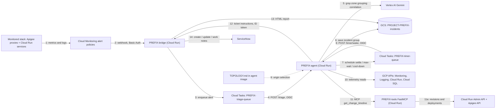
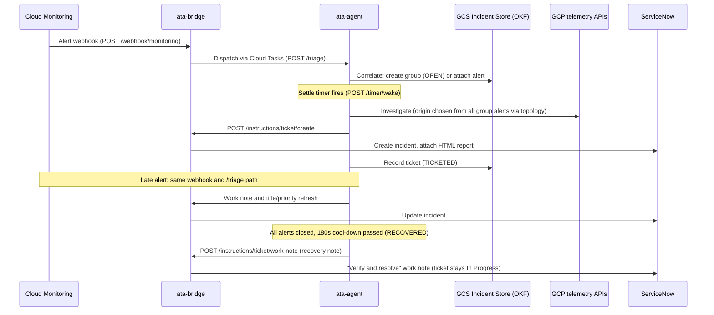

# Alert Triage Agent for Google Cloud Platform

[](../LICENSE)
[](https://www.python.org/)
[](https://www.terraform.io/)

An autonomous Site Reliability Engineering (SRE) diagnostic and incident triage platform for Google Cloud Platform environments. When Google Cloud Monitoring fires alerts across multi-tier topologies, the Alert Triage Agent (ATA) ingests events via a thin, stateless webhook bridge, correlates related alerts into unified incident groups, orchestrates deterministic telemetry specialists across Cloud Run, Cloud SQL, Apigee X, and recent changes/deployments, synthesizes evidence-grounded root cause findings, and creates and updates ServiceNow incident records with structured executive summaries and standalone responsive HTML dossiers.

---

## Table of Contents

- [1. System Overview & Problem Statement](#1-system-overview--problem-statement)
- [2. Quick Start](#2-quick-start)
- [Prerequisites: deployer IAM roles](#prerequisites-deployer-iam-roles)
- [3. System Architecture & Request Lifecycle](#3-system-architecture--request-lifecycle)
  - [Topology as Single Source of Truth (TOPOLOGY.md)](#topology-as-single-source-of-truth-topologymd)
- [4. Component Breakdown](#4-component-breakdown)
- [5. Configuration](#5-configuration)
- [6. Customizing the Agent with Skills](#6-customizing-the-agent-with-skills)
- [7. Security Model & Production Guardrails](#7-security-model--production-guardrails)
- [8. Prototype Status & Known Limitations](#8-prototype-status--known-limitations)
- [9. Full Step-by-Step GCP Deployment Walkthrough](#9-full-step-by-step-gcp-deployment-walkthrough)
- [10. Master Automated Deployment Script](#10-master-automated-deployment-script)
- [11. Terraform Remote State & GCS Backend](#11-terraform-remote-state--gcs-backend)
- [12. Enterprise Organization Policy Considerations](#12-enterprise-organization-policy-considerations)
- [13. Local Development & Quality Gates](#13-local-development--quality-gates)
- [14. Testing Guide & Post-Deploy Smoke Tests](#14-testing-guide--post-deploy-smoke-tests)
- [15. Teardown & Clean Up](#15-teardown--clean-up)
- [16. Repository Layout](#16-repository-layout)

---

## 1. System Overview & Problem Statement

### The Problem
During production outages in complex cloud environments, on-call engineers face an immediate onslaught of cascading alerts. A single infrastructure root cause—such as a database connection pool exhaustion or a bad configuration rollout—frequently triggers dozens of downstream failure symptoms across API gateways (Apigee), container services (Cloud Run), and backend datastores (Cloud SQL).

This causes severe operational bottlenecks:
- **Alert Fatigue & Ticket Storms**: Disconnected monitoring policies open duplicate, fragmented incident tickets across ticketing platforms like ServiceNow, obscuring the primary incident.
- **Manual Telemetry Correlation**: Engineers spend critical early triage minutes manually querying Cloud Logging streams, inspecting Cloud Monitoring latency metrics, cross-referencing recent Cloud Run revisions, and piecing together failure sequences under pressure.
- **Flapping & Premature Triage**: Transient anomalies or cascading failures trigger half-baked investigations before dependent services have settled, leading to erroneous diagnoses and responder confusion.

### The Solution
The **Alert Triage Agent (ATA)** automates early-stage alert ingestion, intelligent incident grouping, and telemetry investigation through an asynchronous, decoupled **thin-bridge architecture**:
1. **Stateless Webhook Ingestion**: Ingests Cloud Monitoring alert webhooks via HTTP Basic Auth at `ata-bridge` and immediately enqueues raw alert payloads to a Cloud Tasks queue (`ata-triage-queue`) with HTTP 202 `accepted`. The bridge is completely stateless with zero in-memory windowing, background loops, or alert suppression.
2. **Agent-Owned Grouping & Suppression**: The agent core (`ata-agent`) owns all incident grouping logic. It evaluates multi-factor correlation (topology DAG distance, causal failure chains, temporal proximity, and change alignment) against active Open Knowledge Files (OKF) stored in Google Cloud Storage with atomic generation preconditions (`if_generation_match`).
3. **Self-Scheduled Settle & Cool-Down Timers (Stale-Wake Pattern)**: The agent schedules delayed timer tasks on a dedicated queue (`ata-timer-queue`). When an alert arrives, the agent schedules a 120s settle timer. If subsequent related alerts arrive, the settle deadline extends. Upon waking at `/timer/wake`, the agent compares current time against the OKF `settle_deadline`; stale wakes are discarded without ticket creation.
4. **Parallel Read-Only Telemetry Specialists**: Upon settle deadline or max-wait expiry (300s), the agent fans out four deterministic specialists concurrently (`CloudRunSpecialist`, `ApigeeSpecialist`, `CloudSQLSpecialist`, `ChangeSpecialist`) querying live GCP APIs and FastMCP tool endpoints.
5. **Evidence-Grounded Root Cause Attribution**: Vertex AI Gemini reasoning (`gemini-3.8-flash`) is invoked strictly for gray-zone correlation scoring (35–65 points). The Synthesizer isolates the probable origin component, calculates blast radius, and computes an evidence-derived formulaic confidence score without hallucinations or fabricated data.
6. **Rich ServiceNow Delivery**: The agent instructs the bridge via authenticated endpoints (`POST /instructions/ticket/*`) to create or update ServiceNow incident records with structured 4-bullet summaries (Problem, Systems, Observations, Recommended Actions) and attach self-contained, responsive HTML diagnostic dossiers.

---

## 2. Quick Start

The complete procedure, from an empty project to a verified stack and back to nothing, is **[DEPLOY.md](DEPLOY.md)**. It is the only deployment guide: this README does not repeat its commands.

### Prerequisites
- Operator tools: bash 3.2 or later (the macOS `/bin/bash` works), a recent Google Cloud SDK, **Terraform >= 1.9.0**, python3, curl, the `psql` client and `cloud-sql-proxy` v2. Docker is **not** needed: every image is built with Cloud Build. The full table, with the deployer IAM roles and the organization-policy checks, is in [DEPLOY.md §2.1](DEPLOY.md#21-operator-prerequisites).
- A Google Cloud project with billing enabled, and Owner on it, or the complete role set in [Prerequisites: deployer IAM roles](#prerequisites-deployer-iam-roles).
- An Apigee X organization with an environment attached to an instance and to an environment group hostname (`APIGEE_ORG`, `APIGEE_ENV`, `APIGEE_HOST`). A second stack can reuse an existing organization with a new `NAME_PREFIX` ([DEPLOY.md §2.3](DEPLOY.md#23-second-stack-in-an-existing-project-and-apigee-organization)).
- A ServiceNow instance and an integration user.

### Deployment Overview

The deployment is one script, `scripts/deploy-stage1.sh`, with 14 phases. Run them all at once, or one at a time with `--only <phase>` and check each phase as [DEPLOY.md §3](DEPLOY.md#3-deployment) describes:

```bash
./scripts/deploy-stage1.sh --list-phases   # preflight bootstrap foundation secrets images database schema
                                           # applications inventory-pin triage triage-iam apigee observability verify
./scripts/deploy-stage1.sh                 # all phases; resume after a failure with --from <phase>
```

Before the first run, load the inputs ([DEPLOY.md §2.2](DEPLOY.md#22-inputs)) and do the project and Apigee checks (DEPLOY.md Steps 0-1). After it, run scenarios S1 and S2 and check their ServiceNow tickets (Step 16). `scripts/teardown-stack.sh` removes a stack ([DEPLOY.md §5](DEPLOY.md#5-teardown)), and [§6](DEPLOY.md#6-verify-that-nothing-is-left) confirms that nothing is left.

### ServiceNow Integration Guide Pointer
The system integrates with ServiceNow via the Table and Attachment APIs:
- **ServiceNow Configuration**: Detailed configuration settings, field mappings, and assignment groups are documented in the [Configuration Guide (`CONFIGURATION.md`)](CONFIGURATION.md) and [Deployment Guide (`DEPLOY.md`)](DEPLOY.md).
- **Credentials & Instance URL**:
  - The ServiceNow instance URL is **configuration**, not a secret. `bridge/scripts/deploy.sh` reads it from the environment variable `SERVICENOW_INSTANCE_URL`.
  - ServiceNow API user credentials (`<prefix>-servicenow-username` and `<prefix>-servicenow-password`) reside in Google Secret Manager, populated via `./scripts/set-secrets.sh`.

---

## Prerequisites: deployer IAM roles

The deployer is the principal that runs `scripts/deploy-stage1.sh`, the scenarios and `scripts/teardown-stack.sh`: a user, or a service account. `roles/owner` on the project covers everything. Without Owner, the deployer needs **all** of the roles below. Editor alone is not enough: it cannot set IAM policies on service accounts, Cloud Tasks queues, secrets or Artifact Registry repositories, or create custom roles, and the foundation phase needs all of these. The Cloud Build step also needs nothing extra from you: the build SA's bucket access comes from the foundation. Without these roles, the foundation phase creates the resources but fails on their bindings with 403.

On the project `PROJECT_ID`:

| Role | Needed for |
| :--- | :--- |
| `roles/editor` (or equivalent) | Creating the resources in every phase |
| `roles/resourcemanager.projectIamAdmin` | The project-level grants to the stack's SAs (foundation) |
| `roles/run.admin` | Cloud Run deploys and service-level invoker bindings (`triage`, `triage-iam`, `applications`, `inventory-pin`) |
| `roles/iam.roleAdmin` | `iam.roles.create` / `update` / `delete`: the per-stack custom role `<prefix>ApigeeDeployReader` (foundation, teardown) |
| `roles/iam.serviceAccountAdmin` | `iam.serviceAccounts.setIamPolicy`: `serviceAccountUser` bindings on the stack's SAs (foundation) |
| `roles/cloudtasks.admin` | `cloudtasks.queues.getIamPolicy` / `setIamPolicy`: enqueuer bindings on the two queues (foundation) |
| `roles/artifactregistry.admin` | `artifactregistry.repositories.setIamPolicy`: the build SA's writer binding (foundation) |
| `roles/secretmanager.admin` | `secretmanager.secrets.setIamPolicy`: the bridge SA's accessor bindings (foundation) |
| `roles/cloudsql.admin` | The Cloud SQL instance, IAM database user and postgres password (`database`, `schema`). Editor already covers these phases (the `atat` proof ran them with Editor); grant it if you replace Editor with narrower roles. |

On the Apigee organization's project `APIGEE_ORG` (often the same project):

| Role | Needed for |
| :--- | :--- |
| `roles/apigee.admin` | TargetServers, proxies, product, developer and app (`apigee`, teardown). Editor on the Apigee project also covers this (the `atat` proof deployed with Editor). It is needed when `APIGEE_ORG` is a project where the deployer is not Editor. |

Also list the deployer in the foundation variable `deployer_members` (`infra/terraform/foundation/terraform.tfvars`), which grants it `roles/iam.serviceAccountUser` on the build and Apigee SAs ([DEPLOY.md Step 4](DEPLOY.md#step-4-foundation)).

Grant them in one command (someone with Owner or `projectIamAdmin` runs it). `DEPLOYER` is `user:<email>` or `serviceAccount:<email>`:

```bash
DEPLOYER="user:you@example.com"
for ROLE in roles/editor roles/resourcemanager.projectIamAdmin roles/iam.roleAdmin roles/run.admin \
            roles/iam.serviceAccountAdmin roles/cloudtasks.admin roles/artifactregistry.admin \
            roles/secretmanager.admin roles/cloudsql.admin; do
  gcloud projects add-iam-policy-binding "${PROJECT_ID}" --member="${DEPLOYER}" --role="${ROLE}" --condition=None --format=none \
    && echo "granted ${ROLE}"
done
gcloud projects add-iam-policy-binding "${APIGEE_ORG}" --member="${DEPLOYER}" --role=roles/apigee.admin --condition=None --format=none \
  && echo "granted roles/apigee.admin on ${APIGEE_ORG}"
```

Check what the deployer has:

```bash
gcloud projects get-iam-policy "${PROJECT_ID}" --flatten='bindings[].members' \
  --filter="bindings.members:${DEPLOYER#*:}" --format='value(bindings.role)'
```

---

## 3. System Architecture & Request Lifecycle

Resource names use the stack's `NAME_PREFIX` (shown as `<prefix>`, and as `PREFIX` in the diagram; the live stack uses `ata`). The agent reads service dependencies from the bundled [`topology/TOPOLOGY.md`](topology/TOPOLOGY.md). It calls GCP APIs directly through client libraries and REST, except for the change timeline, which it gets from `<prefix>-tools` over MCP. The bridge creates and updates ServiceNow incidents and adds work notes; it does not resolve them by default (`AUTO_RESOLVE_ON_RECOVERY=false`).



### Sequence Flow (Mermaid)



Paths not shown in the diagram:

- **Transport and auth**: Cloud Monitoring calls `ata-bridge` with HTTP Basic Auth, and the bridge answers 202 once the alert is enqueued on `ata-triage-queue`. Cloud Tasks calls the agent with an OIDC token. Delayed wakes come from `ata-timer-queue`. The agent calls the bridge's `/instructions/ticket/*` endpoints with a Google ID token. Correlation uses Gemini only for gray-zone scores (35-65). Group writes use GCS generation preconditions (`if_generation_match`). A new group gets a settle timer (120s) and a max-wait timer (300s). A wake before the deadline, or for a group that is no longer open, is ignored. Otherwise the group becomes `INVESTIGATING` and the specialists (Cloud Run, Apigee, Cloud SQL, Change) run in parallel. If every alert has already closed when the ticket is created, the group is set to `COOLING_DOWN` instead of `TICKETED`.
- **Filtering and duplicates**: `ata-bridge` drops non-`ata` alerts with HTTP 200 and does no deduplication. `ata-agent` suppresses repeat alerts for an already-active policy and resource by appending them to the existing incident group.
- **Timer extension**: Each alert that attaches to an open group resets the settle deadline to 120s after that alert's arrival, capped at the 300s max-wait deadline. A wake that arrives more than 2.0s before the group's current deadline is ignored.
- **Origin selection**: The investigation does not start from the first alert. It picks the origin from all of the group's alerts using [`topology/TOPOLOGY.md`](topology/TOPOLOGY.md). A service is explained by a degraded service it depends on, unless that service's onset is more than `ORIGIN_ONSET_TOLERANCE_SECONDS` (default 300) later than its own. Candidates are ranked: unexplained services first, then by how many other alerting services they explain, then by earliest onset, then by arrival order. Gateway-enforced rejections (HTTP 429, client auth) are never explained by a backend. Specialist evidence can still move the origin further upstream, for example to the database.
- **Change attribution**: A Cloud Run deploy in the 2-hour change window is named as the cause (Issue Type `change_induced`, "Change-Induced: Yes", a rollback action to the previous serving revision) only if (a) the alert onset is at most `CHANGE_ONSET_WINDOW_MINUTES` (default 15) after the deploy, or (b) the new revision had no healthy period before the onset: not one healthy minute with requests, and at least one failing minute. A healthy period is a span of at least `CHANGE_HEALTHY_PERIOD_MINUTES` (default 10), from the first to the last healthy minute, with requests on that revision in at least `CHANGE_HEALTHY_MIN_ACTIVE_MINUTES` (default 3) of its minutes, in which every minute with requests on that revision was healthy: HTTP 5xx share under `CHANGE_HEALTHY_MAX_5XX_SHARE` (default 0.05) and mean latency under `CHANGE_HEALTHY_MAX_LATENCY_MS` (default 2000 ms), from Cloud Monitoring `request_count` and `request_latencies` for that revision, per minute. These are agent heuristics, not the alert-policy thresholds (the policies fire on a 5xx rate over 0.05/s and a p99 latency over 2000 ms); the ticket states the values used. Minutes without requests neither count nor break the span; a minute without a latency point is judged on the 5xx share alone, and the ticket says how many. When that data cannot be read (including a timeout of the Cloud Monitoring read), no request reached the revision, or there is no latency data for it at all, only (a) is applied and the ticket says so ("healthy-period data unavailable (...), so only the onset-window rule was applied"). The floor counts healthy minutes only: failing minutes, including the fault's own lead-in just before the onset, never count toward health. "No healthy period" (rule (b)) means the revision had not one healthy minute with requests and at least one failing minute before the onset (it failed from its first request, S5, even after sitting idle). With 1 to `CHANGE_HEALTHY_MIN_ACTIVE_MINUTES` - 1 healthy minutes and no qualifying span (two requests 40 minutes apart), only (a) is applied and the ticket says "insufficient traffic to establish a healthy period (k healthy active minutes < 3, ...)"; with more healthy minutes but still no qualifying span, it says "healthy period inconclusive (...)" and again only (a) is applied. So adding healthy minutes never makes a deploy more likely to be blamed. Every other deploy is listed with its deploy time and the healthy-period evidence: no causation is claimed and no rollback is recommended. A deploy with an established healthy period is listed under "Recent changes (likely unrelated)", and Change-Induced is "No (recent changes likely unrelated: ...; checked: ...)". A deploy whose healthy period is undetermined (insufficient traffic, inconclusive, or the data unavailable) is listed under "Recent changes (not attributed: healthy period undetermined)", Change-Induced is "No (not attributed: ..., so only the onset-window rule was applied; checked: ...)", and it is not listed as a ruled-out alternative. Example (live INC0010343): the 21:51Z re-pin of ata-inventory-api served 57 requests without errors from 21:51Z to 22:44Z before the 22:45Z 5xx fault, so it is listed as likely unrelated. A bad revision that fails at once (S5) is still change-induced with the rollback. The rule applies to the alerting service, its upstream dependencies and the other candidate services of a multi-service group. Apigee proxy revisions are attributed only from access-log evidence, as before: the new revision brought SpikeArrest faults and the previous one served requests without any (S3). The Apigee deployment history is always stated.
- **Low traffic**: On a latency incident, if the origin received fewer than `LOW_TRAFFIC_RPM` (default 5) requests per minute in the investigation window, the report says the latency may come from a few slow requests, such as a cold start, rather than a service-wide degradation. No statement is made when the request volume was not measured.
- **Late alerts**: An alert that attaches to an already-ticketed (or cooling-down) group is added to the ServiceNow ticket as a work note (`POST /instructions/ticket/work-note`). A cooling-down group returns to `TICKETED`. The ticket is then refreshed with `POST /instructions/ticket/update-fields`:
  - The title is rebuilt from the group, so its alert count matches the group.
  - The priority is raised when a group alert's `severity` label is higher than the priority already applied. It is never lowered automatically.
  - Each change is logged and comes with a work note naming the new alerts, the old and new title, and any escalation.

  An alert attached while the investigation ran, but not listed in the created ticket, also gets a work note once the ticket exists. An alert of a signal type the ticketed group does not have yet opens a new group instead, if its onset is more than `LATE_NEW_SIGNAL_MAX_ONSET_GAP_SECONDS` (default 600) after the group's first alert. A recent repeat (within 30 minutes) of a policy and resource already in the group is caught by the duplicate check instead: it is appended to the incident group only, with no work note.
- **Cool-down and resolution**: When every alert in a ticketed group has closed (or all are already closed when the ticket is created), the group enters `COOLING_DOWN` and a 180s cooling timer is scheduled. A new alert that attaches during cool-down returns the group to `TICKETED`. If none arrives before that timer fires, what happens depends on `AUTO_RESOLVE_ON_RECOVERY`:
  - `false` (default): the agent does **not** resolve the ticket. Monitoring recovery is not proof of a fix: an alert also closes when its service stops receiving traffic. The agent moves the group to the terminal `RECOVERED` state, then posts one work note (`POST /instructions/ticket/work-note`): "Monitoring alerts closed: all <N> alerts of this incident closed by <time> and none reopened during the 180s cool-down. An alert also closes when its service stops receiving traffic, so a close is not proof of a fix; the agent recorded no remediation. <traffic facts> A human must verify the remediation (...) before resolving this incident." The traffic facts come from Cloud Monitoring `run.googleapis.com/request_count` for each affected Cloud Run service, from `RECOVERY_TRAFFIC_LOOKBACK_SECONDS` before the last close until the note is written. They read either "recorded no requests ... (missing data)", or the request and HTTP 5xx counts, or "not checked" with the reason. The alert state itself carries no close reason. After the note is posted, `recovery_note_posted_at` is recorded; if posting fails, the group goes back to `COOLING_DOWN` so the timer retries the wake. The ServiceNow incident stays In Progress. Like `RESOLVED`, a `RECOVERED` group takes no new alerts, so a later alert opens a new group. A retried cooling wake posts no second note.
  - When alerts close in the demo: latency and 5xx alerts close after a scenario's traffic stops, because the policies treat missing data as not violating (Terraform `alert_evaluation_missing_data`, `EVALUATION_MISSING_DATA_INACTIVE`). Without that setting, a latency series without data waits for the policy's `auto_close`. S4's connections alert closes only after `reset-scenarios.sh` releases the leaked connections. Expected timing per scenario: [DEMO.md §1.2](DEMO.md#12-scenario-by-scenario-guide-s1-through-s5).
  - `true`: the agent calls `POST /instructions/ticket/resolve` and marks the group `RESOLVED`.

  An unticketed group with an explicit suppression reason has no ServiceNow incident, so it is marked `RESOLVED` whatever the flag says. An unticketed group without one is marked `DEGRADED` instead of resolved.
- **Investigation fallback**: If the multi-agent investigation raises an error, the agent falls back to a single-pass report (`generate_investigation_report`) on the topology-selected origin alert. That report is marked degraded, and the ticket is still created.

### Topology as Single Source of Truth (`TOPOLOGY.md`)

The system topology, service catalog, and dependency relationships are defined in [`alert-triage-agent/topology/TOPOLOGY.md`](topology/TOPOLOGY.md) as the single source of truth. The document is structured into two canonical Markdown tables:

- **Components Table**: Defines all monitored services, gateways, datastores, and aliases:
  ```markdown
  | Component | Type | Also known as | Notes |
  ```
- **Dependencies Table**: Encodes directional call paths and transport protocols between services:
  ```markdown
  | From | To | How |
  ```

This topology specification is ingested at runtime via the agent's `get_topology` tool and guided by the `topology` skill. The resulting directed acyclic graph (DAG) is leveraged across the incident triage lifecycle to:
1. **Calculate Topology Hop Distance**: Determines the shortest path between alerting resources in the multi-factor correlation scoring engine (0 hops = 35 pts, 1 hop = 28 pts, 2 hops = 17.5 pts, $\ge$ 3 hops / disjoint = 0 pts).
2. **Isolate Root Cause Origin**: Traverses upstream dependency edges from symptomatic downstream services back to the true failure origin.
3. **Compute Blast Radius**: Identifies all directly and transitively impacted downstream dependencies for inclusion in Open Knowledge Files and ServiceNow incident dossiers.

---

## 4. Component Breakdown

### 1. `ata-bridge` (`bridge/`)
- **Role**: Public-facing, lean ingestion and integration layer.
- **Technology**: Python 3.12+, FastAPI, Pydantic v2, Google Cloud Tasks client, Google Secret Manager client, HTTPX.
- **Responsibilities**:
  - Webhook authentication for Cloud Monitoring via HTTP Basic Auth (`webhook_basicauth` channel).
  - Scope validation: verifies project scoping and filters out foreign or non-`ata` alert notifications.
  - Asynchronous task enqueue: enqueues normalized `AlertEvent` payloads directly to Cloud Tasks (`ata-triage-queue`) returning HTTP 202 `accepted`.
  - ServiceNow instruction endpoints (`POST /instructions/ticket/*`): exposes authenticated routes (`create`, `work-note`, `update-report`, `update-fields`, `resolve`) invoked by `ata-agent`.
  - **Thin-Bridge Guarantee**: Completely stateless with zero in-memory windowing, background polling loops, or alert suppression.

### 2. `ata-agent` (`agent/`)
- **Role**: Private, autonomous SRE diagnostic and incident triage engine.
- **Technology**: Python 3.12+, FastAPI, Google Cloud Storage client, Google Cloud Tasks client, Google GenAI / Vertex AI (`gemini-3.8-flash`), Google Cloud Logging, Google Cloud Monitoring.
- **Responsibilities**:
  - **Grouping & Suppression (`agent/app/grouping/`)**: Evaluates incoming alerts against open incidents, enforces in-group duplicate suppression, and updates Open Knowledge Files (OKF) in GCS using atomic generation preconditions (`if_generation_match`).
  - **Delayed Timer Management (`agent/app/timers/`)**: Self-schedules delayed settle (120s), max-wait (300s), and cool-down (180s) wakeups on a dedicated Cloud Tasks queue (`ata-timer-queue`).
  - **Stale-Wake Handler**: On wakeup at `POST /timer/wake`, compares current timestamp against `okf.settle_deadline` (with a 2.0s tolerance). Stale wakes caused by subsequent alert extensions are ignored as no-ops without minting duplicate tickets.
  - **Multi-Factor Correlation (`agent/app/correlation/`)**: Evaluates candidate alerts using a 4-factor scoring matrix (Topology Distance, Causal Failure Chains, Temporal Proximity, Change Alignment). Calls Gemini strictly for gray-zone alerts (scores 35–65).
  - **Deterministic Specialists (`agent/app/specialists/`)**: Concurrently executes live read-only queries:
    - `CloudRunSpecialist`: Queries container restarts, CPU/memory saturation, request latency percentiles, and application error logs (filtering `/admin/*`). Recursively traces upstream DAG dependencies using the topology graph.
    - `ApigeeSpecialist`: Queries proxy access logs (`ata-apigee-access`), extracts status codes and client IPs, and analyzes SpikeArrest policy limits.
    - `CloudSQLSpecialist`: Queries backend database connection counts (warning threshold 20 / max 25 on `db-f1-micro`), CPU utilization, and PostgreSQL deadlock/lock wait logs.
    - `ChangeSpecialist`: Reads Cloud Run revisions and Apigee deployment history within a 2-hour window prior to alert onset from the deployed `ata-tools` service (`get_change_timeline` over MCP at `TOOLS_URL`, ID-token auth). If that read fails, the ticket says `change timeline unavailable: <reason>` and Change-Induced is `Not assessed`; there is no fallback. See CONFIGURATION.md §1.3.1. A deploy in the window is the cause only under the change attribution rule above (`CHANGE_ONSET_WINDOW_MINUTES`, `CHANGE_HEALTHY_PERIOD_MINUTES`, `CHANGE_HEALTHY_MIN_ACTIVE_MINUTES`); the others are listed as "Recent changes (likely unrelated)" (healthy period established) or "Recent changes (not attributed: healthy period undetermined)".
  - **Topology-Guided Analysis**: Ingests system architecture and dependencies from [`topology/TOPOLOGY.md`](topology/TOPOLOGY.md) via the `get_topology` tool guided by the `topology` skill, computing shortest-path DAG distances and downstream blast radius.
  - **Evidence-Based Synthesizer**: Formulates structured 4-bullet executive summaries, calculates blast radius and formulaic confidence, and generates standalone HTML dossiers.

### 3. `ata-tools` (`tools/`)
- **Role**: FastMCP read-only telemetry and topology service.
- **Technology**: FastMCP, Starlette/Uvicorn, Google Cloud SDKs.
- **Responsibilities**:
  - Exposes structured MCP tools at `POST /mcp`: `list_open_alerts`, `get_topology`, `get_topology_graph`, `get_blast_radius`, `get_apigee_metrics`, `get_apigee_logs`, `get_proxy_bundle`, `get_change_timeline`.
  - Called at runtime by the agent's ChangeSpecialist (`get_change_timeline`); requires `roles/run.invoker` on `<prefix>-tools` for `<prefix>-agent-sa`.
  - Ingests and parses system architecture from `topology/TOPOLOGY.md` to construct in-memory DAG representations.
  - Strictly read-only IAM viewer boundary.
  - Optional OIDC ID token validation on tool endpoints (`ENFORCE_AUTH`/`VERIFY_OIDC`; audience and allowed callers derived from config).

### 4. `demo/` Microservices Stack
- **Role**: Realistic multi-tier e-commerce architecture for incident simulation and fault injection.
- **Components**:
  - `demo/ata-inventory-api`: Cloud Run service backed by Cloud SQL PostgreSQL with IAM database authentication (`pg8000`) and mock fallback. Houses `/admin/fault/*` endpoints.
  - `demo/ata-orders-api`: Cloud Run service calling `ata-inventory-api` using ambient Google ID tokens.
  - `demo/apigee/`: Apigee X API proxies (`ata-orders-v1`, `ata-inventory-v1`) with API key verification, SpikeArrest rate limiting, and Cloud Logging.
  - `demo/db/`: Cloud SQL PostgreSQL schema (`schema.sql`) and catalog seed data.
  - **Fault Exclusion Guardrail**: Fault injection endpoints (`/admin/fault/*`) are decoupled from operational telemetry and excluded from Cloud Logging analysis. The agent diagnoses failures strictly from authentic operational symptoms.

---

## 5. Configuration

Configuration is managed strictly through typed Pydantic models (`config.py`) loaded from environment variables and Terraform variables (`terraform.tfvars`), with **zero hardcoding** in application code:

### Key System Settings

| Setting | Environment Variable | Default Value | Description & Rationale |
| :--- | :--- | :--- | :--- |
| **GCP Project** | `PROJECT_ID` | *Set by the deploy scripts* | Target Google Cloud project identifier. The deploy scripts require it (no default). |
| **Resource Prefix** | `NAME_PREFIX` | required (no default; the live stack uses `ata`) | Namespace prefix for isolating resources (`${NAME_PREFIX}-${base_name}`). |
| **Compute Region** | `REGION` | required (no default) | Target GCP region hosting Cloud Run, Cloud Tasks, and Cloud SQL. |
| **Environment** | `ENVIRONMENT` | `prod` | Runtime environment name read by the service. The deploy scripts do not pass it to Cloud Run, so the default applies. Not the `env` resource label, which comes from the shell `ENVIRONMENT` used by the deploy scripts and the Terraform `environment` variable (live value: `demo`; see [CONFIGURATION.md §7.1](CONFIGURATION.md#71-label-scheme--value-requirements)). |
| **Incidents Bucket** | `INCIDENTS_BUCKET` | `${PROJECT_ID}-${NAME_PREFIX}-incidents` | GCS bucket for persistent Open Knowledge File (OKF) storage. |
| **Incident Store Path** | `INCIDENT_STORE_PATH` | `/knowledge/incident-manager` | Local or mounted directory path for active OKF incident files. |
| **Fallback Store Path**| `FALLBACK_STORE_PATH` | `/tmp/knowledge/incident-manager` | Fallback path when primary mount is unavailable. |
| **Bridge Service URL** | `BRIDGE_URL` | `http://localhost:8080` | On `ata-agent`: URL of `ata-bridge` for instruction endpoints (`/instructions/ticket/*`). On `ata-bridge`: its own `status.url`, an accepted ID-token audience (required unless `IS_LOCAL=true`; see [CONFIGURATION.md §1.1](CONFIGURATION.md#11-bridge-service-ata-bridge)). |
| **Agent Service URL**  | `AGENT_URL` | `http://localhost:8080` | URL of `ata-agent` called by Cloud Tasks at `POST /triage`. |
| **Tools Service URL**  | `TOOLS_URL` | *None (required unless `IS_LOCAL=true`)* | On `ata-agent`: URL of `ata-tools` (https, no path) for the change timeline over MCP. A non-local agent does not start without it. |
| **Triage Queue Name**  | `TASKS_QUEUE` | `${NAME_PREFIX}-triage-queue` | Cloud Tasks queue for serialized alert dispatches. |
| **Timer Queue Name**   | `TIMER_QUEUE_NAME` | `${NAME_PREFIX}-timer-queue` (set by `agent/scripts/deploy.sh`) | Dedicated Cloud Tasks queue for delayed settle/cool-down timers. |
| **Gemini Reasoning**   | `MODEL_NAME` | `gemini-3.8-flash` | Gemini model used strictly for gray-zone correlation (scores 35–65). |
| **ServiceNow URL**     | `SERVICENOW_INSTANCE_URL` | *None* | **Configuration (NOT a secret)**: Base URL of ServiceNow instance (e.g. `https://<instance>.service-now.com`). |
| **ServiceNow Caller**  | `SERVICENOW_CALLER` | `ATA Integration` | Caller ID populated on created ServiceNow incident records. |
| **Assignment Group**   | `SERVICENOW_ASSIGNMENT_GROUP` | `Cloud SRE Tier-2` | Assignment group for triage routing in ServiceNow. |
| **IAM Database User**  | `ATA_INVENTORY_DB_USER` | `${NAME_PREFIX}-inventory-sa@...` | IAM database user for Cloud SQL IAM authentication. |
| **Database Name**      | `ATA_INVENTORY_DB_NAME` | `inventory` | PostgreSQL database name on Cloud SQL. |
| **DB Connection Name** | `ATA_INVENTORY_INSTANCE_CONNECTION_NAME` | `${PROJECT_ID}:${REGION}:${NAME_PREFIX}-inventory-db` | Cloud SQL instance connection string. |
| **IAM DB Auth Flag**   | `ATA_INVENTORY_DB_IAM_AUTH` | `true` | Enables IAM database authentication via pg8000 connector. |
| **Mock Database Flag** | `ATA_INVENTORY_MOCK_DB` | `false` | Serves the in-memory catalog instead of Cloud SQL. |
| **Local Mode Flag**    | `IS_LOCAL` | `false` | Enables mock storage and local adapters for offline testing. |
| **Auto-Resolve on Recovery** | `AUTO_RESOLVE_ON_RECOVERY` | `false` | When all alerts close and the 180s cool-down passes: `false` leaves the ServiceNow ticket In Progress and adds a work note stating that the alerts closed (with the measured traffic around the close) and that a human must verify the remediation before resolving it. `true` resolves the ticket. See "Cool-down and resolution" under [Sequence Flow](#sequence-flow-mermaid). |

### Secret Manager Secret Names
Sensitive credentials reside exclusively in Google Secret Manager (names shown with the live stack's prefix `ata`):
- `ata-webhook-token`: HTTP Basic Auth password for Cloud Monitoring alert webhook channel.
- `ata-servicenow-username`: API integration username for ServiceNow Table & Attachment APIs.
- `ata-servicenow-password`: Password for ServiceNow integration user.

> [!NOTE]
> **ServiceNow Instance URL is CONFIG, not a secret.** It is passed to `ata-bridge` as the environment variable `SERVICENOW_INSTANCE_URL` by `bridge/scripts/deploy.sh`, which reads it from the environment. It is not stored in Secret Manager.

For complete variable lists and schema details, see the [Configuration Guide (`CONFIGURATION.md`)](CONFIGURATION.md).

---

## 6. Customizing the Agent with Skills

The repository includes domain knowledge and diagnostic runbooks located in [`skills/`](skills/):

```
skills/
├── alert-triage/                   # Settle window, stale-wake handling, and correlation scoring
│   └── SKILL.md
├── apigee-troubleshooting/         # Apigee X access log queries, SpikeArrest 429, and target timeouts
│   └── SKILL.md
├── change-correlation/             # Cloud Run revision and Apigee deployment correlation rules
│   └── SKILL.md
├── cloud-run-troubleshooting/      # Container lifecycle, CPU/memory saturation, and latency percentiles
│   └── SKILL.md
├── cloud-sql-troubleshooting/      # PostgreSQL connection pool exhaustion (max 25, warn 20) and locks
│   └── SKILL.md
├── report-style/                   # SRE 4-bullet executive summaries, confidence formulas, HTML dossiers
│   └── SKILL.md
└── topology/                       # Interprets topology/TOPOLOGY.md components and dependency tables
    └── SKILL.md
```

### Skills Directory Overview
- **`skills/alert-triage/SKILL.md`**: Defines incident grouping mechanics, settle deadline extension rules, stale-wake evaluation, and multi-factor scoring thresholds.
- **`skills/apigee-troubleshooting/SKILL.md`**: Documents Apigee access log parsing (`ata-apigee-access`), SpikeArrest policy limits, and gateway timeout patterns.
- **`skills/change-correlation/SKILL.md`**: Outlines revision-to-error timeline alignment rules within the 2-hour window prior to alert onset.
- **`skills/cloud-run-troubleshooting/SKILL.md`**: Details container restart diagnostic queries, memory limits, and upstream DAG inspection.
- **`skills/cloud-sql-troubleshooting/SKILL.md`**: Specifies Cloud SQL connection saturation thresholds (warning at 20 connections on `db-f1-micro`) and deadlock queries.
- **`skills/report-style/SKILL.md`**: Prescribes the structured 4-bullet SRE summary format (Problem, Systems, Observations, Recommended Actions) and evidence-grounded confidence rules.
- **`skills/topology/SKILL.md`**: Guides the parsing and interpretation of [`topology/TOPOLOGY.md`](topology/TOPOLOGY.md) (the single source of truth for system components and dependencies). Specifies how the agent uses the `get_topology` tool to parse the Components table (`| Component | Type | Also known as | Notes |`) and Dependencies table (`| From | To | How |`) to evaluate topological proximity, trace upstream failure paths, and project downstream blast radius.

### Operational Reality & Runtime Architecture
In the current prototype, the agent's diagnostic pipeline is executed via **deterministic Python specialist modules** (`agent/app/specialists/`) calling live GCP APIs, rather than dynamic LLM prompt/tool injection or an ADK `SkillToolset` at runtime:
- The Markdown skill files serve as **human and AI assistant architectural runbooks and design specifications** that establish the diagnostic queries, thresholds, and report formatting implemented in code.
- Gemini is invoked strictly for gray-zone correlation scoring (scores between 35 and 65).
- The active domain skill areas (`cloud-run-diagnostics`, `apigee-telemetry`, `cloud-sql-triage`, `report-style`, `topology`) are recorded in the `InvestigationReport` metadata contract (`skills_loaded`).

---

## 7. Security Model & Production Guardrails

The Alert Triage Agent enforces zero-trust security and defense-in-depth across all tiers:

- **Strictly Read-Only IAM Boundaries**:
  - `ata-agent-sa` (which also runs `ata-tools`) holds read-only viewer roles (`roles/logging.viewer`, `roles/monitoring.viewer`, `roles/run.viewer`, `roles/cloudsql.viewer`, and the custom role `${NAME_PREFIX}ApigeeDeployReader` with only `apigee.deployments.list` and `apigee.proxyrevisions.get`) and `roles/aiplatform.user` for the Gemini gray-zone calls.
  - It has no mutating privileges on the monitored infrastructure. Its writes are confined to the incident GCS bucket (`roles/storage.objectUser` on `gs://${PROJECT_ID}-${NAME_PREFIX}-incidents`) and to enqueueing its own timer tasks (`roles/cloudtasks.enqueuer` on `${NAME_PREFIX}-timer-queue`).
- **Zero Secrets in Repository or Code**: All passwords and tokens reside in Google Secret Manager; the ServiceNow instance URL is configuration.
- **Mutual Authentication & OIDC Verification**:
  - Inbound alert webhooks require HTTP Basic Auth validation against Secret Manager credentials.
  - Cloud Tasks invokes `ata-agent` (`POST /triage`, `POST /timer/wake`) with Google-signed OIDC ID tokens (as `ata-bridge-sa` and `ata-agent-sa`). Cloud Run IAM checks them: only those two SAs hold `roles/run.invoker` on the agent (`triage-iam` root). The agent application does not check the caller again.
  - `ata-agent` calls `ata-tools` (`/mcp`) with a Google ID token; only `ata-agent-sa` may invoke the tools service.
  - `ata-agent` calls `ata-bridge` (`POST /instructions/ticket/*`) using Google ID tokens verified against `ata-agent-sa`.
  - Apigee proxies invoke Cloud Run demo services using Google ID tokens.
- **IAM Database Authentication**: `ata-inventory-api` connects to Cloud SQL PostgreSQL using IAM database authentication via `pg8000` (zero static database passwords).
- **Atomic Concurrency Protection**: Open Knowledge File updates in GCS use atomic generation preconditions (`if_generation_match`) with exponential backoff and jitter, preventing race conditions and lock clobbering.
- **Evidence-Bound Synthesis**: Root cause findings cite concrete observed metrics, logs, and deployment revisions. Hardcoded confidence floats and fabricated candidate names are strictly prohibited.
- **Fault Injection Telemetry Exclusion**: All administrative fault endpoints (`/admin/fault/*`) are decoupled from operational telemetry and excluded from Cloud Logging analysis.

---

## 8. Prototype Status & Known Limitations

The Alert Triage Agent has been evaluated against live GCP infrastructure across 5 realistic failure scenarios (**S1 through S5**), as detailed in the [Demonstration Guide (`DEMO.md`)](DEMO.md):

### Scenario Evaluation Scorecard

| Scenario | Title | Target Infrastructure | Expected Incident Groups & Tickets | Root Cause Origin | Result |
| :---: | :--- | :--- | :---: | :--- | :---: |
| **S1** | **Backend 5xx Cascade** | Cloud Run (`ata-inventory-api`) | 1 Group, 1 Ticket | `ata-inventory-api` | **PASS** |
| **S2** | **Backend Latency** | Cloud Run (`ata-inventory-api`) | 1 Group, 1 Ticket | `ata-inventory-api` (Upstream origin via DAG) | **PASS** |
| **S3** | **Concurrent Disjoint Incidents** | Apigee X & Cloud Run | 2 Groups, 2 Tickets | `ata-orders-v1` and `ata-inventory-api` (Disjoint groups, multi-factor score < 35) | **PASS** |
| **S4** | **DB Connection Exhaustion** | Cloud SQL (`ata-inventory-db`) | 1 Group, 1 Ticket | `ata-inventory-db` (earliest onset, connection count > 20) | **PASS** |
| **S5** | **Bad Deploy / Config Failure** | Cloud Run (`ata-inventory-api`) | 1 Group, 1 Ticket | Specific Cloud Run revision (e.g. `ata-inventory-api-00062-6pj`) | **PASS** |

### Known Limitations
1. **Cloud SQL `db-f1-micro` Connection Limits**: The test tier uses `db-f1-micro` with `max_connections = 25`. The alert threshold is calibrated at 20 connections (~80% capacity). Under heavy production traffic, production instances (`db-custom-*`) require recalibration.
2. **Pre-Existing Apigee X Dependency**: Requires an existing Apigee X organization, environment and environment group hostname (`APIGEE_ORG`, `APIGEE_ENV`, `APIGEE_HOST`). The repository does not provision them; see [DEPLOY.md Step 1](DEPLOY.md#step-1-apigee-organization-environment-and-hostname).
3. **Local Mock Mode vs Live GCP**: While `IS_LOCAL=true` provides in-memory mock adapters for offline unit tests, full end-to-end evaluation requires live GCP credentials and APIs.
4. **Serialized Triage Queue**: `ata-triage-queue` runs with `max_concurrent_dispatches = 1`, so alerts are processed one at a time. This keeps correlation and grouping deterministic and prevents one incident from being split across groups, at the cost of throughput during large alert bursts. Failed dispatches are retried for a bounded window (`triage_queue_max_retry_duration`). The window is measured from each alert's first delivery attempt, so after a long outage the alerts whose first attempt was more than one window before recovery are dropped. Alerts that arrived later are still delivered. See [CONFIGURATION.md §4](CONFIGURATION.md#4-cloud-tasks-queue-configuration).

---

## 9. Full Step-by-Step GCP Deployment Walkthrough

The step-by-step walkthrough is [DEPLOY.md](DEPLOY.md): inputs, operator prerequisites, one step per `deploy-stage1.sh` phase with the expected output, verification and failure handling of each, the scenario check, teardown and the final checks. It also covers a second stack in an existing project and Apigee organization.

---

## 10. Master Automated Deployment Script

`scripts/deploy-stage1.sh` is the single deploy entrypoint, for any project, region and prefix:

```
scripts/deploy-stage1.sh [--yes] [--from <phase>] [--to <phase>] [--only <phase>]
scripts/deploy-stage1.sh --list-phases
```

| Phase | Runs |
| :--- | :--- |
| `preflight` | Tool, credential and project checks (read-only) |
| `bootstrap` | `scripts/bootstrap-tfstate.sh`: bootstrap APIs, state bucket `${PROJECT_ID}-${NAME_PREFIX}-tfstate`, `backend.hcl` for the five roots |
| `foundation` | Terraform foundation |
| `secrets` | `scripts/set-secrets.sh --yes --skip-if-set` (before the bridge) |
| `images` | `scripts/build-image.sh` for inventory, orders, agent, bridge and tools (as `<prefix>-build-sa`); refs by digest in `.deploy-state/` |
| `database` | Terraform database |
| `schema` | `demo/db/schema.sql` with the GRANT, via `cloud-sql-proxy` and `psql` |
| `applications` | Terraform applications |
| `inventory-pin` | `scripts/repin-inventory.sh prepare --initial`, `write-pin --initial`, `switch` |
| `triage` | `tools/`, `bridge/`, `agent/scripts/deploy.sh` |
| `triage-iam` | Terraform triage-iam |
| `apigee` | `scripts/deploy-apigee-proxies.sh` |
| `observability` | Terraform observability |
| `verify` | `scripts/verify-stage1.sh`, then `scripts/verify-demo-infra.sh` |

Other operator scripts:

| Script | Purpose |
| :--- | :--- |
| `scripts/teardown-stack.sh` | Removes one stack (dry run unless `--apply`; `--delete-state` also deletes the state bucket) |
| `scripts/teardown-apigee.sh` | Removes one stack's `<prefix>-*` Apigee resources (part of the teardown) |
| `scripts/build-image.sh` | Builds one image and prints `IMAGE=<repo>/<name>@sha256:<hex>` |
| `scripts/repin-inventory.sh`, `scripts/prune-revisions.sh`, `scripts/set-demo-instance-caps.sh` | Inventory re-pin, revision pruning and instance caps ([DEPLOY.md §4](DEPLOY.md#4-operations-reference)) |
| `scripts/deploy-demo-infra.sh` | Kept for compatibility: runs `deploy-stage1.sh --from database` |
| `scripts/scenarios/preflight.sh`, `scripts/run-all-scenarios.sh`, `scripts/reset-scenarios.sh` | Scenarios and reset ([DEMO.md](DEMO.md)) |

---

## 11. Terraform Remote State & GCS Backend

All five Terraform roots in `infra/terraform/` (foundation, database, applications, observability, triage-iam) define a partial Google Cloud Storage backend:

```hcl
terraform {
  backend "gcs" {}
}
```

- **Bootstrapping**: Initialized via `scripts/bootstrap-tfstate.sh` which provisions `gs://${PROJECT_ID}-${NAME_PREFIX}-tfstate` with uniform bucket-level access, public access prevention, and object versioning.
- **Prefix Isolation**: Each stack isolates its state using distinct GCS prefixes specified via `backend.hcl`:
  - Foundation: `prefix = "${NAME_PREFIX}/foundation"`
  - Database: `prefix = "${NAME_PREFIX}/database"`
  - Applications: `prefix = "${NAME_PREFIX}/applications"`
  - Observability: `prefix = "${NAME_PREFIX}/observability"`
  - Triage IAM: `prefix = "${NAME_PREFIX}/triage-iam"`
- **One clone per stack**: each root has one `backend.hcl` and one `.terraform/` per checkout. Use a separate clone for each `NAME_PREFIX`, and always `terraform init -reconfigure -backend-config=backend.hcl`.
- **CI & Pre-deployment Validation**: Quality gates and local linters use `terraform init -backend=false && terraform validate`, validating syntax and structure without requiring cloud credentials or remote backend access.

---

## 12. Enterprise Organization Policy Considerations

In enterprise Google Cloud organizations, standard Organization Policies may require specific configuration adjustments:

1. **Domain Restricted Sharing (`constraints/iam.allowedPolicyMemberDomains`)**:
   - May prevent binding `allUsers` on public ingress services such as `ata-bridge`.
   - *Remediation*: Deploy an external Google Cloud Load Balancer with Cloud Armor in front of `ata-bridge` and set Cloud Run ingress to `internal-and-cloud-load-balancing`, or request a project-level policy exemption.
2. **Cloud Run Ingress Controls (`constraints/run.allowedIngress`)**:
   - Every service is deployed with ingress `all`: the deploy scripts do not set `--ingress`, and the applications root sets `INGRESS_TRAFFIC_ALL`. Access is controlled by Cloud Run IAM. Only `ata-bridge` allows unauthenticated calls (the webhook authenticates with HTTP Basic Auth); `ata-agent`, `ata-tools` and the demo services require an ID token from an SA holding `roles/run.invoker`.
   - A policy that restricts ingress to `internal` or `internal-and-cloud-load-balancing` blocks the deployment as it is.
3. **Public IP Restriction on Cloud SQL (`constraints/sql.restrictPublicIp`)**:
   - Enterprise policies frequently block public IP assignments on Cloud SQL.
   - The database root creates an instance **with a public IP** (`ipv4_enabled = true`); the inventory API connects through the Cloud SQL connector with IAM database authentication. There is no private IP or Private Service Connect option in this repository, so this policy blocks the deployment unless the project has an exception.

---

## 13. Local Development & Quality Gates

### Local Environment Setup
Set up a Python virtual environment and install development dependencies:

```bash
# Create and activate virtual environment
python3 -m venv .venv
source .venv/bin/activate

# Install component packages in editable mode with development dependencies
# (the same set as CI, .github/workflows/alert-triage-agent-ci.yml; the packages have no [dev] extra)
pip install -e ./bridge -e ./agent -e ./tools \
  pytest==9.1.1 pytest-asyncio==1.4.1 shellcheck-py==0.11.0.1 \
  sqlalchemy "cloud-sql-python-connector[pg8000]" pg8000 \
  -r demo/ata-inventory-api/requirements.txt -r demo/ata-orders-api/requirements.txt \
  ruff mypy
```

### Offline & Mock Development Mode
Set `IS_LOCAL=true` to enable offline mock mode:
- `ata-bridge` uses mock webhook verification and records ticket operations locally.
- `ata-agent` reads and writes incident Open Knowledge Files (OKF) to local temporary storage (`/tmp/knowledge/incident-manager`) without requiring GCS bucket credentials.
- `ata-inventory-api` falls back to in-memory catalog data without requiring a live Cloud SQL connection (`ATA_INVENTORY_MOCK_DB=true`).

### Quality Gates & Presubmit Verification
All pull requests must pass the following checks cleanly:

```bash
# 1. Run full test suite using project virtualenv
pytest tests/ -v

# 2. Run core correlation and scenario test suites
pytest tests/test_scenarios_e2e.py
pytest tests/test_correlation_scoring.py
pytest tests/test_agent_grouping_and_timers.py
pytest tests/test_no_fabricated_data.py
pytest tests/test_container_import_layout.py

# 3. Linting and formatting checks
ruff check bridge agent tools
ruff format --check bridge agent tools

# 4. Terraform validation across all modules
for dir in foundation database applications observability triage-iam; do
  (cd "infra/terraform/$dir" && terraform init -backend=false && terraform validate)
done
```

**CI:** [`.github/workflows/alert-triage-agent-ci.yml`](../.github/workflows/alert-triage-agent-ci.yml) runs on pull requests and pushes to `main` that touch `alert-triage-agent/**`. It has a read-only token, no secrets, and actions pinned to commit SHAs. It runs:
- the full `pytest tests` suite on Linux (bash 5);
- the script tests (`test_bash32_compat.py`, `test_macos_userland.py`, `test_run_all_*.py`, `test_deploy_scripts_env_vars.py`) on macOS with `/bin/bash` 3.2 and the BSD userland;
- ShellCheck on every script (fails on errors; warnings are listed);
- `terraform fmt -check -recursive` and `validate` for each stack (Terraform 1.9.8).

Ruff and mypy are not part of CI.

To run the scripts under bash 3.2 locally, put a bash 3.2 binary first on `PATH` (named `bash`) and set `ATA_TEST_BASH` to it, then run `pytest tests`.

---

## 14. Testing Guide & Post-Deploy Smoke Tests

The repository provides comprehensive automated testing tools across multiple layers:

### 1. Preflight Health Verification
Before triggering scenarios, run `scripts/scenarios/preflight.sh` to validate microservice health, admin endpoints, Apigee ingress, and alert policies:
```bash
./scripts/scenarios/preflight.sh
```

### 2. Failure Scenarios (S1–S5)
The system is evaluated against 5 realistic production failure scenarios:
- **Scenario S1: Backend 5xx Cascade**
  ```bash
  ./scripts/scenarios/s1_backend_5xx.sh
  ```
  Injects 85% HTTP 500 error rate into `ata-inventory-api`. Verifies 1 incident group and 1 ServiceNow ticket with origin `ata-inventory-api`.
- **Scenario S2: Backend Latency Degradation**
  ```bash
  ./scripts/scenarios/s2_backend_latency.sh
  ```
  Injects 6500ms latency delay into `ata-inventory-api`. Verifies 1 incident group and 1 ServiceNow ticket tracing root cause to inventory delay.
- **Scenario S3: Concurrent Disjoint Incidents**
  ```bash
  ./scripts/scenarios/s3_concurrent_disjoint.sh
  ```
  Simultaneously triggers Scenario S1 on `ata-inventory-api` and strict SpikeArrest rate limiting on `ata-orders-v1`. Evaluates multi-factor correlation score (<35 pts) and verifies **exactly 2 distinct incident groups and 2 distinct ServiceNow tickets**.
- **Scenario S4: Database Connection Pool Exhaustion**
  ```bash
  ./scripts/scenarios/s4_db_connection_pool.sh
  ```
  Simulates PostgreSQL connection leak exhausting backends (`>20` connections). Verifies 1 incident group and 1 ServiceNow ticket with origin `ata-inventory-db`.
- **Scenario S5: Bad Deploy / Config Failure**
  ```bash
  ./scripts/scenarios/s5_bad_deploy.sh
  ```
  Deploys a Cloud Run revision with invalid IAM database credentials. Verifies 1 incident group and 1 ServiceNow ticket citing the explicit failing revision ID.

### 3. Master Scenario Runner
Execute scenarios with logging and automated assertions:
```bash
# Run prioritized scenarios (S4, S1, S3, S5)
./scripts/run-all-scenarios.sh --priority

# Run full scenario suite (S1 through S5)
./scripts/run-all-scenarios.sh --all

# Run a single scenario
./scripts/run-all-scenarios.sh --scenario s3

# Dry-run validation mode (no network modification)
./scripts/run-all-scenarios.sh --dry-run
```

### 4. Resetting Between Scenarios
Reset injected faults, clear database sleep connections, restore Apigee proxies, wait for open alerts to close, then, at the same time, for a 3 min quiet period (Apigee's 1-3 min metric lag; restarts if an alert reopens) and for every incident group to reach a terminal state (`resolved`/`archived`/`degraded`, or `recovered` with `recovery_note_posted_at` set, so the agent's recovery note is posted first), and move active incidents to `archive/` once both are done (about 3 min after the last close, not 6). If a group is still active when `--timeout` (30 min; S4's reset can take up to ~27 min) expires, the reset fails and lists it; nothing is archived. For a group that will never become terminal, `--ignore-group <file>` leaves only that group out of the wait (risky: it is archived as it is). Admin calls use a fresh ID token each and fail the reset on any non-2xx response. Every request to the demo services (fault reset, warm-up `GET /health`, Apigee health, admin probes) runs before the alert wait and is timed; one slower than 2000 ms, with HTTP 5xx or without a response (e.g. a cold start) makes the wait watch for the alert it can open for `--alert-lag` (10 min) after it, so such an alert is waited for (closed, incident group terminal) and archived inside the reset instead of opening after it (stray ticket INC0010327). With the latency policies' old 60s retest window the alert still gets a ticket; only the Terraform `latency_duration_secs` change stops that. A slow request with a non-5xx response (the reset's own cold start, every reset after a scenario in QA) arms that window only provisionally: after the warm-up the reset reads the live latency policies (read-only) and releases it when the slow burst is too short to keep p99 > 2000 ms for their 240s retest window, printing the risk that remains; `--thorough` always waits. Step 5c (the `num_backends` check) runs alongside the alert wait. A reset after S1/S2/S3/S5 takes about 4 min (QA 2026-10-28 before this change: 645–662 s). After `verify-demo-infra.sh` reported a slow request, run the reset with `--alert-window-from-start`. For S4, run the reset right after the scenario: the leaked connections keep `ata-cloudsql-connections-critical` open until the reset releases them:
```bash
# Standard reset (waits for open ata-* alerts to close, then for terminal incident groups and the 3m quiet period together).
# Fails if Cloud Monitoring cannot be queried. The alert check uses an ADC token by default
# (run: gcloud auth application-default login; or --monitoring-token-source gcloud).
# On macOS CERTIFICATE_VERIFY_FAILED: export SSL_CERT_FILE=/etc/ssl/cert.pem
./scripts/reset-scenarios.sh

# Quick dev reset (bypasses the alert, incident group and quiet period waits;
# risky: can archive a group whose recovery note is still pending)
./scripts/reset-scenarios.sh --no-wait

# A group that will never become terminal (e.g. stuck 'investigating'): skip only that group;
# the alert wait, the quiet period and the wait for every other group still run (risky)
./scripts/reset-scenarios.sh --ignore-group incident-<group-id>.md

# Right after verify-demo-infra.sh listed a slow request (cold start): also watch for its alert
./scripts/reset-scenarios.sh --alert-window-from-start

# Wait the full 10 min alert window after any slow request, even a cold start the
# latency policies' retest window cannot turn into an alert (~11 min instead of ~4)
./scripts/reset-scenarios.sh --thorough
```

---

## 15. Teardown & Clean Up

The teardown is [DEPLOY.md §5](DEPLOY.md#5-teardown), in the order that completes: the Apigee resources (`scripts/teardown-apigee.sh`), then the observability, triage-iam, applications, database and foundation roots (emptying the incidents bucket first), and the state bucket last. Before the applications destroy, it turns off the Cloud Run services' deletion protection with a targeted apply. The plan of that apply may change only `deletion_protection`. The applications root defaults `deletion_protection` to `true`; a test or throwaway stack can set `TF_VAR_deletion_protection=false` ([DEPLOY.md §2.3](DEPLOY.md#23-second-stack-in-an-existing-project-and-apigee-organization)). [DEPLOY.md §6](DEPLOY.md#6-verify-that-nothing-is-left) lists the commands that confirm nothing of the stack is left.

---

## 16. Repository Layout

```
alert-triage-agent/
├── agent/                         # Autonomous SRE diagnostic and triage engine
│   ├── app/                       # Grouping, timers, correlation, specialists, synthesizer
│   │   ├── contracts/             # Pydantic data contracts (alert, incident, report)
│   │   ├── correlation/           # Multi-factor correlation scoring engine & DAG traversal
│   │   ├── grouping/              # GroupingManager, OKF store, and duplicate suppression
│   │   ├── specialists/           # Deterministic specialists (Cloud Run, Apigee, Cloud SQL, Change)
│   │   ├── timers/                # Cloud Tasks delayed timer scheduler (settle, max-wait, cool)
│   │   ├── bridge_client.py       # Client for Bridge Instruction API (/instructions/ticket/*)
│   │   ├── config.py              # Agent typed configuration (AgentConfig)
│   │   └── main.py                # FastAPI endpoints (/health, /triage, /timer/wake)
│   ├── Dockerfile                 # Container build specification for ata-agent
│   └── scripts/deploy.sh          # Cloud Run deployment script for ata-agent
├── bridge/                        # Stateless webhook ingestion & ServiceNow adapter
│   ├── app/                       # FastAPI application, auth, dispatcher, adapters
│   │   ├── adapters/              # ServiceNow Table & Attachment API adapter
│   │   ├── contracts/             # AlertEvent and instruction request contracts
│   │   ├── core/                  # TaskDispatcher for Cloud Tasks enqueue
│   │   ├── templates/             # HTML report rendering templates
│   │   ├── auth.py                # HTTP Basic Auth & Google OIDC verification
│   │   ├── config.py              # Bridge typed configuration (BridgeConfig)
│   │   └── main.py                # Webhook (/webhook/monitoring) & Instruction endpoints
│   ├── Dockerfile                 # Container build specification for ata-bridge
│   └── scripts/deploy.sh          # Cloud Run deployment script for ata-bridge
├── demo/                          # Realistic e-commerce microservices & fault injection
│   ├── apigee/                    # Apigee X proxy bundles, deployed as <prefix>-orders-v1, <prefix>-inventory-v1
│   ├── ata-inventory-api/         # Cloud Run inventory service (Cloud SQL IAM DB auth)
│   ├── ata-orders-api/            # Cloud Run orders service (calls inventory via Google ID token)
│   └── db/schema.sql              # Cloud SQL PostgreSQL schema & catalog seed data
├── infra/terraform/               # Infrastructure as Code (Terraform)
│   ├── applications/              # Cloud Run demo microservices and their invoker IAM
│   ├── database/                  # Cloud SQL PostgreSQL 15 instance with IAM DB auth
│   ├── foundation/                # APIs, SAs, IAM, buckets, queues, registry, secrets, webhook channel
│   ├── observability/             # Cloud Monitoring alert policies
│   └── triage-iam/                # run.invoker bindings between agent, bridge and tools (after their deploy)
├── scripts/                       # Deployment, verification, and scenario scripts
│   ├── scenarios/                 # Realistic failure scenario scripts (S1 through S5)
│   │   ├── common.sh              # Shared logging, token resolution, and utility functions
│   │   ├── open_alerts.py         # Read-only Cloud Monitoring OPEN-alert query used by reset (CA bundle resolution)
│   │   ├── preflight.sh           # Pre-scenario health & endpoint verification
│   │   ├── s1_backend_5xx.sh      # Scenario 1: Backend 500 error spike
│   │   ├── s2_backend_latency.sh  # Scenario 2: Backend latency degradation
│   │   ├── s3_concurrent_disjoint.sh # Scenario 3: Concurrent disjoint incidents
│   │   ├── s4_db_connection_pool.sh  # Scenario 4: Database connection pool exhaustion
│   │   └── s5_bad_deploy.sh       # Scenario 5: Bad deploy / config failure
│   ├── bootstrap-tfstate.sh       # Bootstraps GCS remote state bucket
│   ├── deploy-apigee-proxies.sh   # Deploys Apigee X proxies, products, and developer app
│   ├── deploy-demo-infra.sh       # Compatibility wrapper: deploy-stage1.sh --from database
│   ├── build-image.sh             # Builds one image with the build SA; prints IMAGE=<repo>@sha256:...
│   ├── deploy-stage1.sh           # The deploy entrypoint: 14 phases (--only/--from/--to/--list-phases)
│   ├── prune-revisions.sh         # Deletes unpinned, untagged demo revisions (dry run unless --apply)
│   ├── repin-inventory.sh         # Inventory pin: prepare/write-pin (--initial), switch, rollback, status
│   ├── set-demo-instance-caps.sh  # Service-level instance caps of the demo services
│   ├── teardown-apigee.sh         # Removes one stack's <prefix>-* Apigee resources
│   ├── teardown-stack.sh          # Removes one stack (dry run unless --apply)
│   ├── reset-scenarios.sh         # Clears faults, waits for alerts/quiet period, archives incident files
│   ├── run-all-scenarios.sh       # Master scenario driver (--all, --priority, --scenario)
│   ├── set-secrets.sh             # Interactive Secret Manager configuration for ServiceNow
│   ├── verify-demo-infra.sh       # Verifies demo microservices and Apigee routing
│   ├── verify-scenarios.sh        # Automated scenario verification test harness
│   └── verify-stage1.sh           # Read-only triage-tier check (health, webhook auth, agent config, OKF schema); --with-ticket for end to end
├── skills/                        # SRE diagnostic runbooks and architectural specifications
│   ├── alert-triage/              # Incident grouping, settle deadlines, and stale-wake rules
│   ├── apigee-troubleshooting/    # Apigee X proxy diagnostics and SpikeArrest patterns
│   ├── change-correlation/        # Cloud Run revision and deployment correlation rules
│   ├── cloud-run-troubleshooting/ # Container lifecycle, CPU/memory saturation, latency metrics
│   ├── cloud-sql-troubleshooting/ # Database connection exhaustion and lock contention
│   ├── report-style/              # SRE 4-bullet executive summaries and HTML dossier styling
│   └── topology/                  # Component catalog and dependency table parser guidance
├── tests/                         # Automated pytest test suites (30+ test modules)
├── tools/                         # FastMCP read-only telemetry and topology server
│   ├── app/                       # MCP server, tool definitions, bundle parser
│   ├── Dockerfile                 # Container build specification for ata-tools
│   └── scripts/deploy.sh          # Cloud Run deployment script for ata-tools
├── topology/                      # Topology DAG definitions and dependency relationships
│   ├── TOPOLOGY.md                # Single source of truth for components and dependencies
│   └── topology_graph.py          # In-memory DAG parser and blast radius calculator
├── AGENTS.md                      # Developer and AI assistant architecture reference
├── CONFIGURATION.md               # Complete configuration, environment variables, secrets reference
├── DEMO.md                        # Operator demonstration guide for scenarios S1 through S5
├── DEPLOY.md                      # The deployment guide: from scratch, any prefix, teardown
└── README.md                      # Primary project documentation
```

### In-Depth Documentation Links
- [Production Deployment Guide (`DEPLOY.md`)](DEPLOY.md)
- [Operator & Scenario Demonstration Guide (`DEMO.md`)](DEMO.md)
- [Configuration & Environment Reference (`CONFIGURATION.md`)](CONFIGURATION.md)
- [Developer & AI Assistant Guide (`AGENTS.md`)](AGENTS.md)
