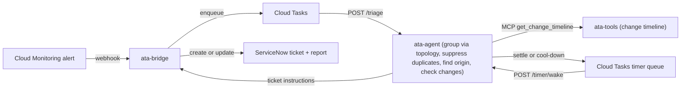
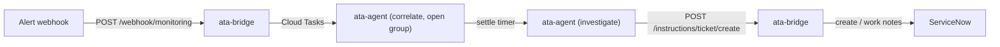

# Alert Triage Agent for Google Cloud Platform

[](../LICENSE)
[](https://www.python.org/)
[](https://www.terraform.io/)

An autonomous Site Reliability Engineering (SRE) diagnostic platform for Google Cloud Platform. When Google Cloud Monitoring fires alerts, the Alert Triage Agent (ATA) ingests events via a stateless webhook bridge, groups related alerts into incident groups, executes telemetry specialists across Cloud Run, Cloud SQL, Apigee X, and recent deployments, synthesizes evidence-based root causes, and delivers structured summaries and HTML dossiers to ServiceNow.

---

## Table of Contents

- [1. System Overview & Problem Statement](#1-system-overview--problem-statement)
- [2. Quick Start](#2-quick-start)
- [Prerequisites: deployer IAM roles](#prerequisites-deployer-iam-roles)
- [3. System Architecture & Request Lifecycle](#3-system-architecture--request-lifecycle)
  - [Topology as Single Source of Truth (TOPOLOGY.md)](#topology-as-single-source-of-truth-topologymd)
- [4. Component Breakdown](#4-component-breakdown)
- [5. Configuration](#5-configuration)
- [6. Customizing the Agent with Skills](#6-customizing-the-agent-with-skills)
- [7. Security Model & Production Guardrails](#7-security-model--production-guardrails)
- [8. Prototype Status & Known Limitations](#8-prototype-status--known-limitations)
- [9. Full Step-by-Step GCP Deployment Walkthrough](#9-full-step-by-step-gcp-deployment-walkthrough)
- [10. Master Automated Deployment Script](#10-master-automated-deployment-script)
- [11. Terraform Remote State & GCS Backend](#11-terraform-remote-state--gcs-backend)
- [12. Enterprise Organization Policy Considerations](#12-enterprise-organization-policy-considerations)
- [13. Local Development & Quality Gates](#13-local-development--quality-gates)
- [14. Testing Guide & Post-Deploy Smoke Tests](#14-testing-guide--post-deploy-smoke-tests)
- [15. Teardown & Clean Up](#15-teardown--clean-up)
- [16. Repository Layout](#16-repository-layout)

---

## 1. System Overview & Problem Statement

### The Problem
During outages in multi-tier cloud environments, cascading alerts create operational bottlenecks:
- **Alert Fatigue & Ticket Storms**: Disconnected monitoring policies open duplicate, fragmented incident tickets.
- **Manual Telemetry Correlation**: Engineers spend critical triage minutes querying logs, metrics, and revisions across tiers.
- **Flapping & Premature Triage**: Transient anomalies trigger investigations before dependent services settle.

### The Solution
ATA automates early triage through an asynchronous, decoupled thin-bridge architecture:
- **Stateless Webhook Ingestion**: `ata-bridge` validates alerts via HTTP Basic Auth and enqueues normalized payloads to Cloud Tasks (`ata-triage-queue`) with HTTP 202 `accepted`.
- **Agent-Owned Grouping**: `ata-agent` groups alerts using topology DAG distance, causal chains, and temporal proximity, managing Open Knowledge Files (OKF) in GCS with generation preconditions.
- **Settle Timers (Stale-Wake Pattern)**: Evaluates settle (120s), max-wait (300s), and cool-down (180s) timers on `ata-timer-queue`, discarding stale wakeups without ticket duplication.
- **Parallel Read-Only Specialists**: Dispatches concurrent telemetry specialists (`CloudRunSpecialist`, `ApigeeSpecialist`, `CloudSQLSpecialist`, `ChangeSpecialist`) querying live GCP APIs and FastMCP tools.
- **Grounded Attribution**: Vertex AI Gemini (`gemini-3.8-flash`) resolves gray-zone correlation (35–65 points). The Synthesizer isolates origin, calculates blast radius, and computes formulaic confidence.
- **Rich ServiceNow Delivery**: Instructs `ata-bridge` to create or update ServiceNow incidents with structured 4-bullet summaries and attached HTML dossiers.

---

## 2. Quick Start

The complete deployment procedure from scratch to teardown is documented in **[DEPLOY.md](DEPLOY.md)**.

### Prerequisites
- Operator tools: bash 3.2+, Google Cloud SDK, Terraform >= 1.9.0, python3, curl, `psql`, `cloud-sql-proxy` v2 ([DEPLOY.md §2.1](DEPLOY.md#21-operator-prerequisites)). Docker is not required.
- GCP project with billing enabled and Owner role, or the roles listed in [Prerequisites: deployer IAM roles](#prerequisites-deployer-iam-roles).
- Apigee X organization with environment attached to an instance and hostname group ([DEPLOY.md §2.3](DEPLOY.md#23-second-stack-in-an-existing-project-and-apigee-organization)).
- ServiceNow instance and integration user credentials.

### Deployment Overview
Run all 14 phases at once or incrementally with `scripts/deploy-stage1.sh` ([DEPLOY.md §3](DEPLOY.md#3-deployment)):

```bash
./scripts/deploy-stage1.sh --list-phases   # list all phases
./scripts/deploy-stage1.sh                 # run full deployment
```

Load inputs first ([DEPLOY.md §2.2](DEPLOY.md#22-inputs)), verify with scenarios S1–S2 ([DEPLOY.md Step 16](DEPLOY.md#step-16-service-now-and-scenario-validation)), and tear down via `scripts/teardown-stack.sh` ([DEPLOY.md §5](DEPLOY.md#5-teardown)).

### ServiceNow Integration Guide Pointer
ServiceNow configuration, field mappings, and credentials are in [CONFIGURATION.md](CONFIGURATION.md) and [DEPLOY.md](DEPLOY.md):
- **ServiceNow Instance URL**: Configuration, not a secret (`SERVICENOW_INSTANCE_URL`).
- **Credentials**: `<prefix>-servicenow-username` and `<prefix>-servicenow-password` in Secret Manager via `./scripts/set-secrets.sh`.

---

## Prerequisites: deployer IAM roles

The principal running `scripts/deploy-stage1.sh` requires `roles/owner` or all of the following roles:

On project `PROJECT_ID`:

| Role | Needed for |
| :--- | :--- |
| `roles/editor` (or equivalent) | Creating resources across all phases |
| `roles/resourcemanager.projectIamAdmin` | Project-level IAM bindings for stack service accounts |
| `roles/run.admin` | Cloud Run service deploys and invoker bindings |
| `roles/iam.roleAdmin` | Creating/updating custom role `<prefix>ApigeeDeployReader` |
| `roles/iam.serviceAccountAdmin` | Service account IAM bindings |
| `roles/cloudtasks.admin` | Cloud Tasks queue policies |
| `roles/artifactregistry.admin` | Artifact Registry repository permissions |
| `roles/secretmanager.admin` | Secret Manager secret access policies |
| `roles/cloudsql.admin` | Cloud SQL instance and IAM database user setup |

On Apigee project `APIGEE_ORG`:

| Role | Needed for |
| :--- | :--- |
| `roles/apigee.admin` | Apigee target servers, proxies, products, and developer apps |

Also list the deployer in `deployer_members` (`infra/terraform/foundation/terraform.tfvars`) for `roles/iam.serviceAccountUser` on build and Apigee SAs ([DEPLOY.md Step 4](DEPLOY.md#step-4-foundation)).

Grant all project roles in one command:

```bash
DEPLOYER="user:you@example.com"
for ROLE in roles/editor roles/resourcemanager.projectIamAdmin roles/iam.roleAdmin roles/run.admin \
            roles/iam.serviceAccountAdmin roles/cloudtasks.admin roles/artifactregistry.admin \
            roles/secretmanager.admin roles/cloudsql.admin; do
  gcloud projects add-iam-policy-binding "${PROJECT_ID}" --member="${DEPLOYER}" --role="${ROLE}" --condition=None --format=none \
    && echo "granted ${ROLE}"
done
gcloud projects add-iam-policy-binding "${APIGEE_ORG}" --member="${DEPLOYER}" --role=roles/apigee.admin --condition=None --format=none \
  && echo "granted roles/apigee.admin on ${APIGEE_ORG}"
```

Verify assigned roles:

```bash
gcloud projects get-iam-policy "${PROJECT_ID}" --flatten='bindings[].members' \
  --filter="bindings.members:${DEPLOYER#*:}" --format='value(bindings.role)'
```

---

## 3. System Architecture & Request Lifecycle

Resource names use the stack prefix `<prefix>` (live stack default: `ata`). The agent resolves dependencies from [`topology/TOPOLOGY.md`](topology/TOPOLOGY.md) and calls GCP APIs and `<prefix>-tools` over MCP.



### Sequence Flow (Mermaid)



Key lifecycle mechanics:
- **Transport & Auth**: Alerts arrive at `ata-bridge` via HTTP Basic Auth. Cloud Tasks calls `ata-agent` via OIDC. Delayed wakeups use `ata-timer-queue`. GCS updates use generation preconditions (`if_generation_match`).
- **Filtering & Deduplication**: Non-matching alerts are dropped. Repeat alerts for active policies and resources are appended to existing incident groups without duplicate tickets.
- **Timer Extension**: New alerts reset the settle deadline (120s, capped at 300s max-wait). Wakes arriving more than 2.0s before deadline are ignored.
- **Origin Selection**: Evaluates group alerts against [`topology/TOPOLOGY.md`](topology/TOPOLOGY.md), ranking root causes by dependency explanation, earliest onset, and arrival order.
- **Change Attribution**: Cloud Run deploys in `CHANGE_WINDOW_MINUTES` (default 120) are attributed if onset is within `CHANGE_ONSET_WINDOW_MINUTES` (default 15) or revision has no healthy period (`CHANGE_HEALTHY_PERIOD_MINUTES`, default 10; `CHANGE_HEALTHY_MIN_ACTIVE_MINUTES`, default 3). Deploys with an established healthy period are listed under "Recent changes (likely unrelated)". See [CONFIGURATION.md §1.3.1](CONFIGURATION.md#131-change-attribution-rules).
- **ServiceNow Updates & Recovery**: Late alerts append work notes. Once alerts close and 180s cool-down passes, the agent adds a recovery work note with traffic metrics (`AUTO_RESOLVE_ON_RECOVERY=false`, default) or resolves the incident (`true`) ([DEMO.md §1.2](DEMO.md#12-scenario-by-scenario-guide-s1-through-s5)). Falls back to single-pass degraded reports if multi-agent analysis fails.

### Topology as Single Source of Truth (`TOPOLOGY.md`)

System topology and service dependencies are defined in [`alert-triage-agent/topology/TOPOLOGY.md`](topology/TOPOLOGY.md):
- **Components Table**: Lists services, gateways, datastores, and aliases (`| Component | Type | Also known as | Notes |`).
- **Dependencies Table**: Encodes directional call paths and protocols (`| From | To | How |`).

The runtime DAG is ingested via `get_topology` and guided by the `topology` skill to calculate hop distances, isolate root cause origins, and compute blast radius.

---

## 4. Component Breakdown

### 1. `ata-bridge` (`bridge/`)
Stateless FastAPI webhook ingestion layer. Validates alerts via HTTP Basic Auth, filters non-matching events, and enqueues normalized `AlertEvent` payloads directly to Cloud Tasks (`ata-triage-queue`) with HTTP 202 `accepted`. Exposes authenticated ServiceNow instruction endpoints (`POST /instructions/ticket/*`) called by `ata-agent`.

### 2. `ata-agent` (`agent/`)
Autonomous SRE diagnostic engine. Manages incident grouping and atomic OKF persistence in GCS (`if_generation_match`), schedules settle/max-wait/cool-down timers on `ata-timer-queue` with stale-wake filtering, runs parallel read-only specialists (`CloudRunSpecialist`, `ApigeeSpecialist`, `CloudSQLSpecialist`, `ChangeSpecialist`), invokes Gemini for gray-zone correlation (scores 35–65), and generates ServiceNow summaries and HTML dossiers.

### 3. `ata-tools` (`tools/`)
FastMCP read-only telemetry and topology service. Exposes tools at `POST /mcp` (`get_topology`, `get_change_timeline`), queried by the agent's `ChangeSpecialist`. Runs in a strictly read-only viewer IAM boundary with optional OIDC authentication.

### 4. `demo/` Microservices Stack
Multi-tier e-commerce architecture for fault simulation: `ata-inventory-api` (Cloud Run with Cloud SQL IAM auth and `/admin/fault/*` endpoints), `ata-orders-api` (Cloud Run), Apigee X proxies (`ata-orders-v1`, `ata-inventory-v1`), and Cloud SQL schema (`demo/db/schema.sql`). Fault endpoints are excluded from diagnostic analysis.

---

## 5. Configuration

Configuration is managed via typed Pydantic models loaded from environment variables and Terraform variables, with zero hardcoding:

### Key System Settings

| Setting | Environment Variable | Default Value | Description & Rationale |
| :--- | :--- | :--- | :--- |
| **GCP Project** | `PROJECT_ID` | *Set by deploy scripts* | Target GCP project identifier. |
| **Resource Prefix** | `NAME_PREFIX` | required (e.g. `ata`) | Namespace prefix for isolating resources. |
| **Compute Region** | `REGION` | required | Target GCP region for Cloud Run, Tasks, and SQL. |
| **Environment** | `ENVIRONMENT` | `prod` | Runtime environment name ([CONFIGURATION.md §7.1](CONFIGURATION.md#71-label-scheme--value-requirements)). |
| **Incidents Bucket** | `INCIDENTS_BUCKET` | `${PROJECT_ID}-${NAME_PREFIX}-incidents` | GCS bucket for persistent OKF storage. |
| **Bridge Service URL** | `BRIDGE_URL` | `http://localhost:8080` | URL of `ata-bridge` for instruction endpoints. |
| **Agent Service URL**  | `AGENT_URL` | `http://localhost:8080` | URL of `ata-agent` called by Cloud Tasks. |
| **Tools Service URL**  | `TOOLS_URL` | *None (required)* | URL of `ata-tools` for MCP change timeline. |
| **Triage Queue Name**  | `TASKS_QUEUE` | `${NAME_PREFIX}-triage-queue` | Cloud Tasks queue for serialized alert dispatches. |
| **Timer Queue Name**   | `TIMER_QUEUE_NAME` | `${NAME_PREFIX}-timer-queue` | Cloud Tasks queue for delayed timers. |
| **Gemini Reasoning**   | `MODEL_NAME` | `gemini-3.8-flash` | Model used for gray-zone correlation scoring. |
| **ServiceNow URL**     | `SERVICENOW_INSTANCE_URL` | *None* | Base ServiceNow instance URL (config, not secret). |
| **Auto-Resolve on Recovery** | `AUTO_RESOLVE_ON_RECOVERY` | `false` | If false, adds recovery work note; if true, resolves ticket. |

For database settings, local mock flags, and full variable lists, see [CONFIGURATION.md](CONFIGURATION.md).

### Secret Manager Secret Names
Sensitive credentials reside in Google Secret Manager (`<prefix>` shown as default `ata`):
- `ata-webhook-token`: HTTP Basic Auth password for alert webhooks.
- `ata-servicenow-username`: API integration username for ServiceNow.
- `ata-servicenow-password`: Password for ServiceNow integration user.

> [!NOTE]
> `SERVICENOW_INSTANCE_URL` is configuration, not a secret. Passed as an environment variable to `ata-bridge`.

---

## 6. Customizing the Agent with Skills

Domain knowledge and diagnostic runbooks reside in [`skills/`](skills/):

### Skills Directory Overview
- **`skills/alert-triage/SKILL.md`**: Grouping rules, settle deadlines, stale-wake handling, correlation scoring.
- **`skills/apigee-troubleshooting/SKILL.md`**: Apigee access log queries (`ata-apigee-access`) and SpikeArrest limits.
- **`skills/change-correlation/SKILL.md`**: Revision-to-error timeline alignment in the change window.
- **`skills/cloud-run-troubleshooting/SKILL.md`**: Container restarts, memory limits, and upstream DAG inspection.
- **`skills/cloud-sql-troubleshooting/SKILL.md`**: Connection saturation (warning at 20 on `db-f1-micro`) and lock contention.
- **`skills/report-style/SKILL.md`**: SRE 4-bullet summaries (Problem, Systems, Observations, Actions) and confidence scoring.
- **`skills/topology/SKILL.md`**: Guidance for parsing [`topology/TOPOLOGY.md`](topology/TOPOLOGY.md) components and dependency tables.

### Operational Reality & Runtime Architecture
Diagnostics execute via deterministic Python specialist modules calling live GCP APIs rather than dynamic LLM prompt injection. Skill Markdown files serve as architectural runbooks establishing query specifications, thresholds, and report formatting.

---

## 7. Security Model & Production Guardrails

- **Read-Only IAM Boundaries**: `ata-agent-sa` holds viewer roles (`logging.viewer`, `monitoring.viewer`, `run.viewer`, `cloudsql.viewer`, custom role `${NAME_PREFIX}ApigeeDeployReader`) and `aiplatform.user`. Mutating privileges are restricted to the incidents bucket and timer queue.
- **Zero Secrets in Code**: All credentials reside in Secret Manager; ServiceNow instance URL is configuration.
- **Mutual Authentication & OIDC**: Webhooks require Basic Auth. Cloud Tasks invokes the agent with signed OIDC tokens. Inter-service calls use Google ID tokens.
- **IAM Database Authentication**: `ata-inventory-api` connects to Cloud SQL via IAM authentication with `pg8000`.
- **Atomic Concurrency**: OKF updates in GCS use generation preconditions (`if_generation_match`) with exponential backoff.
- **Evidence-Bound Synthesis**: Diagnoses require observed metric, log, or revision evidence without hallucinations.
- **Fault Telemetry Isolation**: Admin fault endpoints (`/admin/fault/*`) are excluded from diagnostic analysis.

---

## 8. Prototype Status & Known Limitations

### Scenario Evaluation Scorecard
Evaluated across 5 production failure scenarios ([DEMO.md](DEMO.md)):

| Scenario | Title | Target Infrastructure | Expected Groups & Tickets | Root Cause Origin | Result |
| :---: | :--- | :--- | :---: | :--- | :---: |
| **S1** | **Backend 5xx Cascade** | Cloud Run (`ata-inventory-api`) | 1 Group, 1 Ticket | `ata-inventory-api` | **PASS** |
| **S2** | **Backend Latency** | Cloud Run (`ata-inventory-api`) | 1 Group, 1 Ticket | `ata-inventory-api` (Upstream via DAG) | **PASS** |
| **S3** | **Concurrent Disjoint Incidents** | Apigee X & Cloud Run | 2 Groups, 2 Tickets | `ata-orders-v1` and `ata-inventory-api` | **PASS** |
| **S4** | **DB Connection Exhaustion** | Cloud SQL (`ata-inventory-db`) | 1 Group, 1 Ticket | `ata-inventory-db` (connections > 20) | **PASS** |
| **S5** | **Bad Deploy / Config Failure** | Cloud Run (`ata-inventory-api`) | 1 Group, 1 Ticket | Failing Cloud Run revision | **PASS** |

### Known Limitations
1. **Cloud SQL Connection Limits**: Test tier uses `db-f1-micro` (`max_connections = 25`, alert threshold 20). Production instances (`db-custom-*`) require recalibration.
2. **Apigee X Dependency**: Requires an existing Apigee X organization and environment ([DEPLOY.md Step 1](DEPLOY.md#step-1-apigee-organization-environment-and-hostname)).
3. **Local Mock vs Live GCP**: Offline unit tests use mock adapters (`IS_LOCAL=true`); end-to-end runs require live GCP APIs.
4. **Serialized Triage Queue**: `ata-triage-queue` uses `max_concurrent_dispatches = 1` for deterministic correlation ([CONFIGURATION.md §4](CONFIGURATION.md#4-cloud-tasks-queue-configuration)).
5. **Stale OPEN Alerts**: Latency alerts on inactive revisions remain open until closed manually ([DEMO.md §4](DEMO.md#4-resetting-faults-between-scenarios)).

---

## 9. Full Step-by-Step GCP Deployment Walkthrough

The complete walkthrough is in **[DEPLOY.md](DEPLOY.md)**: inputs, prerequisites, phase execution, verification, scenario validation, second stack setup, and teardown.

---

## 10. Master Automated Deployment Script

`scripts/deploy-stage1.sh` is the single deployment entrypoint:

```bash
scripts/deploy-stage1.sh [--yes] [--from <phase>] [--to <phase>] [--only <phase>]
scripts/deploy-stage1.sh --list-phases
```

| Phase | Runs |
| :--- | :--- |
| `preflight` | Tool, credential, and project checks (read-only) |
| `bootstrap` | Bootstrap APIs, state bucket `${PROJECT_ID}-${NAME_PREFIX}-tfstate`, `backend.hcl` |
| `foundation` | Terraform foundation |
| `secrets` | Secret Manager configuration (`scripts/set-secrets.sh`) |
| `images` | Container builds for inventory, orders, agent, bridge, and tools |
| `database` | Terraform database |
| `schema` | PostgreSQL schema and grants via Cloud SQL proxy |
| `applications` | Terraform applications |
| `inventory-pin` | Initial inventory revision pinning |
| `triage` | Service deployments for tools, bridge, and agent |
| `triage-iam` | Terraform triage-iam invoker bindings |
| `apigee` | Apigee X proxy deployments (`scripts/deploy-apigee-proxies.sh`) |
| `observability` | Terraform observability alert policies |
| `verify` | Health and routing verification scripts |

Other operator scripts: `scripts/teardown-stack.sh` (stack removal; `--apply`), `scripts/teardown-apigee.sh` (Apigee cleanup), `scripts/build-image.sh` (Cloud Build image compilation), `scripts/repin-inventory.sh` (revision pin management; [DEPLOY.md §4](DEPLOY.md#4-operations-reference)), and `scripts/run-all-scenarios.sh` / `scripts/reset-scenarios.sh` (scenario execution and reset; [DEMO.md](DEMO.md)).

---

## 11. Terraform Remote State & GCS Backend

All five Terraform roots in `infra/terraform/` configure a partial GCS backend:

```hcl
terraform {
  backend "gcs" {}
}
```

- **Bootstrapping**: Created by `scripts/bootstrap-tfstate.sh` at `gs://${PROJECT_ID}-${NAME_PREFIX}-tfstate`.
- **Prefix Isolation**: Separate state keys via `backend.hcl` (`${NAME_PREFIX}/foundation`, etc.).
- **Stack Clones**: Use distinct checkouts per stack and run `terraform init -reconfigure -backend-config=backend.hcl`.
- **Validation**: Local gates use `terraform init -backend=false && terraform validate`.

---

## 12. Enterprise Organization Policy Considerations

Adjustments for enterprise GCP organization policies:
1. **Domain Restricted Sharing (`constraints/iam.allowedPolicyMemberDomains`)**: Ingress on `ata-bridge` requires external load balancing with Cloud Armor or a policy exemption.
2. **Cloud Run Ingress (`constraints/run.allowedIngress`)**: Services deploy with ingress `all` and IAM controls; internal-only policies require exemption.
3. **Public IP on Cloud SQL (`constraints/sql.restrictPublicIp`)**: Instance uses public IP with IAM DB authentication; requires policy exemption.

---

## 13. Local Development & Quality Gates

### Local Environment Setup

```bash
python3 -m venv .venv && source .venv/bin/activate
pip install -e ./bridge -e ./agent -e ./tools pytest==9.1.1 pytest-asyncio==1.4.1 \
  shellcheck-py==0.11.0.1 sqlalchemy "cloud-sql-python-connector[pg8000]" pg8000 \
  -r demo/ata-inventory-api/requirements.txt -r demo/ata-orders-api/requirements.txt ruff mypy
```

### Offline & Mock Development Mode
Set `IS_LOCAL=true` for offline development:
- `ata-bridge`: Uses mock webhook verification and local ticket records.
- `ata-agent`: Stores OKF files in local `/tmp/knowledge/incident-manager`.
- `ata-inventory-api`: Serves in-memory catalog with `ATA_INVENTORY_MOCK_DB=true`.

### Quality Gates & Presubmit Verification
Run quality gates prior to submitting changes:

```bash
pytest tests/ -v
ruff check bridge agent tools && ruff format --check bridge agent tools
for dir in foundation database applications observability triage-iam; do
  (cd "infra/terraform/$dir" && terraform init -backend=false && terraform validate)
done
```

CI workflow ([`.github/workflows/alert-triage-agent-ci.yml`](../.github/workflows/alert-triage-agent-ci.yml)) runs pytest, ShellCheck, and Terraform formatting/validation across Linux and macOS.

---

## 14. Testing Guide & Post-Deploy Smoke Tests

### 1. Preflight Health Verification
Validate service health, endpoints, and alert policies:

```bash
./scripts/scenarios/preflight.sh
```

### 2. Failure Scenarios (S1–S5)
Run scenario injection scripts ([DEMO.md](DEMO.md)): S1 (`./scripts/scenarios/s1_backend_5xx.sh`), S2 (`./scripts/scenarios/s2_backend_latency.sh`), S3 (`./scripts/scenarios/s3_concurrent_disjoint.sh`), S4 (`./scripts/scenarios/s4_db_connection_pool.sh`), and S5 (`./scripts/scenarios/s5_bad_deploy.sh`).

### 3. Master Scenario Runner

```bash
./scripts/run-all-scenarios.sh --priority   # run priority suite (S4, S1, S3, S5)
./scripts/run-all-scenarios.sh --all        # run full suite (S1 through S5)
```

### 4. Resetting Between Scenarios
Reset faults, wait for alerts to close, and archive incident files ([DEMO.md §4](DEMO.md#4-resetting-faults-between-scenarios)):

```bash
./scripts/reset-scenarios.sh                # standard reset (waits for close and quiet period)
./scripts/reset-scenarios.sh --no-wait      # quick dev reset (skips wait periods)
```

---

## 15. Teardown & Clean Up

Teardown is documented in [DEPLOY.md §5](DEPLOY.md#5-teardown):
1. Remove Apigee resources via `scripts/teardown-apigee.sh`.
2. Destroy Terraform roots in reverse order: observability, triage-iam, applications, database, foundation.
3. Applications teardown disables Cloud Run deletion protection via a targeted apply. Throwaway test stacks can set `TF_VAR_deletion_protection=false` ([DEPLOY.md §2.3](DEPLOY.md#23-second-stack-in-an-existing-project-and-apigee-organization)).
4. Confirm teardown completeness using commands in [DEPLOY.md §6](DEPLOY.md#6-verify-that-nothing-is-left).

---

## 16. Repository Layout

```
alert-triage-agent/
├── agent/                         # Autonomous SRE diagnostic and incident triage engine
├── bridge/                        # Stateless webhook ingestion and ServiceNow adapter
├── demo/                          # Multi-tier e-commerce microservices and fault injection
├── infra/terraform/               # Terraform roots (foundation, database, applications, observability, triage-iam)
├── scripts/                       # Deployment, verification, and scenario runner scripts
├── skills/                        # SRE diagnostic runbooks and architectural specifications
├── tests/                         # Automated pytest test suites
├── tools/                         # FastMCP read-only telemetry and topology server
├── topology/                      # TOPOLOGY.md single source of truth and DAG utilities
├── AGENTS.md                      # Developer and AI assistant architecture reference
├── CONFIGURATION.md               # Configuration, environment variables, secrets reference
├── DEMO.md                        # Operator demonstration guide for scenarios S1 through S5
├── DEPLOY.md                      # Complete deployment and teardown guide
└── README.md                      # Primary project documentation
```

### In-Depth Documentation Links
- [Production Deployment Guide (`DEPLOY.md`)](DEPLOY.md)
- [Operator & Scenario Demonstration Guide (`DEMO.md`)](DEMO.md)
- [Configuration & Environment Reference (`CONFIGURATION.md`)](CONFIGURATION.md)
- [Developer & AI Assistant Guide (`AGENTS.md`)](AGENTS.md)
