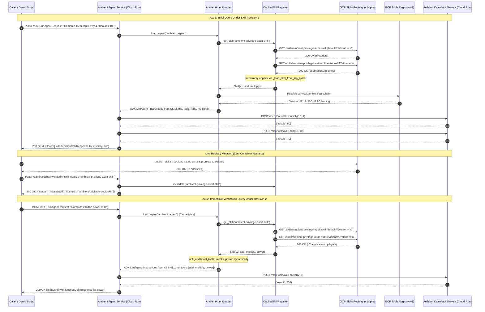

# Google Cloud Ambient Agent Registry Demo: Dynamic Skills & Native ADK `/run` Runtime

[](../LICENSE)
[](https://www.python.org/)
[](https://www.terraform.io/)
[](https://cloud.google.com/vertex-ai)

An enterprise prototype demonstrating dynamic discovery, runtime loading, and zero-downtime hot-reloading of agent skills (`SKILL.md`) and remote tools (`mcpServers`) using **Google Cloud Agent Registry** (`agentregistry.googleapis.com`) and the **Google Agent Development Kit (ADK)** native synchronous `/run` runtime on Cloud Run.

---

## Table of Contents

- [1. System Overview & Problem Statement](#1-system-overview--problem-statement)
- [2. System Architecture & Request Lifecycle](#2-system-architecture--request-lifecycle)
  - [High-Level Component Architecture](#high-level-component-architecture)
  - [Native ADK Synchronous `/run` Runtime](#native-adk-synchronous-run-runtime)
  - [End-to-End Sequence Diagram](#end-to-end-sequence-diagram)
- [3. Dynamic GCP Agent Registry Discovery & Pure In-Memory Packaging](#3-dynamic-gcp-agent-registry-discovery--pure-in-memory-packaging)
  - [Atomic Multi-Resource Bundling](#atomic-multi-resource-bundling)
  - [Pure In-Memory Unpacking (Zero Disk Persistence)](#pure-in-memory-unpacking-zero-disk-persistence)
  - [Zero-Downtime Hot-Reload Engine](#zero-downtime-hot-reload-engine)
- [4. Remote Tool Execution & IAM Security Boundaries](#4-remote-tool-execution--iam-security-boundaries)
  - [FastMCP Remote Tool Protocol](#fastmcp-remote-tool-protocol)
  - [Least Privilege IAM Security Boundaries](#least-privilege-iam-security-boundaries)
  - [Zero-Fallback Architecture](#zero-fallback-architecture)
- [5. Component Breakdown & Directory Layout](#5-component-breakdown--directory-layout)
- [6. Local Development, Testing & Mocking Guide](#6-local-development-testing--mocking-guide)
  - [Prerequisites](#prerequisites)
  - [Local Environment Setup](#local-environment-setup)
  - [Running Unit & Integration Tests](#running-unit--integration-tests)
  - [Local Offline Mocking Mode](#local-offline-mocking-mode)
  - [Code Linting & Guard Checks](#code-linting--guard-checks)
- [7. GCP Infrastructure Deployment (Terraform)](#7-gcp-infrastructure-deployment-terraform)
  - [Step 1: Configure Terraform](#step-1-configure-terraform)
  - [Step 2: Build and Push Container Images](#step-2-build-and-push-container-images)
  - [Step 3: Provision Infrastructure with Terraform](#step-3-provision-infrastructure-with-terraform)
  - [Step 4: Register Remote Tools in Agent Registry](#step-4-register-remote-tools-in-agent-registry)
  - [Step 5: Publish Versioned Skills to Agent Registry](#step-5-publish-versioned-skills-to-agent-registry)
- [8. Live Demonstration Execution](#8-live-demonstration-execution)
- [9. Teardown & Cleanup](#9-teardown--cleanup)

---

## 1. System Overview & Problem Statement

### The Problem: Static Container Coupling
Traditional containerized agent architectures bundle prompts, runbooks, and skills statically into Docker images:

```dockerfile
# Static coupling antipattern:
COPY app/ /app/app/
COPY skills/ /app/skills/
```

This model suffers from severe operational constraints:
1. **Redeployment Latency**: Updating prompt instructions, triage logic, or runbook documentation requires rebuilding container images, pushing to Artifact Registry, and deploying new Cloud Run revisions (5–10 minutes).
2. **Authoring Decoupling**: Prompt engineers and domain specialists cannot publish or iterate on skills independently of software engineering release pipelines.
3. **Rigid Tool Scoping**: Tools are statically hardcoded in Python code at boot. Dynamically introducing or locking tools according to active skill permissions is impossible.

### The Solution: Ambient Native ADK Runtime + Agent Registry
This prototype resolves these limitations by combining:
- **Native Google ADK Synchronous `/run` Runtime**: Directly serves Google Agent Development Kit's native API (`google.adk.cli.fast_api.get_fast_api_app`), accepting standard `RunAgentRequest` payloads and emitting complete `list[Event]` execution traces.
- **Dynamic Google Cloud Agent Registry Discovery**: Skills (`agentregistry.googleapis.com/v1alpha`) and tools (`agentregistry.googleapis.com/v1`) are discovered and loaded at runtime directly from GCP.
- **Pure In-Memory Unpacking**: The container has **zero disk persistence for skills**. ZIP packages are fetched over HTTP, unpacked in RAM, and parsed into typed ADK `Skill` models.
- **Zero-Downtime Hot-Reloading**: A thread-safe TTL cache (`CachedSkillRegistry`) combined with an instant invalidation endpoint (`POST /admin/cache/invalidate`) enables live prompt and tool upgrades without restarting the Cloud Run container.
- **Zero Local Fallback Computing**: Arithmetic and external operations are strictly delegated to remote FastMCP microservices. If upstream tools fail, the agent fails loudly (HTTP 502/503), preventing silent incorrect computations.

### Architectural Comparison

| Dimension | Static Container Baseline | ARD Custom Wrapper (`/chat`) | Ambient Agent Registry (`/run`) |
| :--- | :--- | :--- | :--- |
| **API Framework** | Custom FastAPI wrapper | Custom FastAPI wrapper | **Native ADK Runtime** (`get_fast_api_app`) |
| **Execution Endpoint** | `POST /chat` | `POST /chat` | **`POST /run`** (`RunAgentRequest` $\rightarrow$ `list[Event]`) |
| **Streaming Endpoint** | Custom SSE | Custom SSE | **`POST /run_sse`** (Native ADK SSE) |
| **Health Probe** | Custom `/health` | Custom `/health` | **`GET /health`** (Native ADK probe) |
| **Model Runtime** | Hardcoded client | ADK `LlmAgent` + `Runner` | **ADK `LlmAgent` + `Runner` via `AgentLoader`** |
| **Skill Storage** | Local container disk | GCP Agent Registry (`v1alpha`) | **GCP Agent Registry (`v1alpha`)** |
| **Skill Loading** | Filesystem scan | In-memory ZIP unpack | **In-memory ZIP unpack** |
| **Tool Registry** | In-process Python functions | Remote GCP Tools Registry | **Remote GCP Tools Registry** (`v1`) |
| **Hot-Reload Hook** | Container restart | `POST /admin/cache/invalidate` | Mounted **`POST /admin/cache/invalidate`** |
| **Execution Provenance** | Custom JSON fields | Structured JSON fields | **Full `list[Event]` ADK trace** (`functionCall` / `functionResponse`) |
| **Resource Naming** | Project specific | `ard-` prefix | **`ambient-` prefix** |

---

## 2. System Architecture & Request Lifecycle

### High-Level Component Architecture

```
                                      +------------------------------------+
                                      |          Caller / Demo Script      |
                                      +-----------------+------------------+
                                                        |
                                                        | POST /run (RunAgentRequest)
                                                        v
+----------------------------------------------------------------------------------------------------------+
|  Cloud Run: Ambient Agent Service (`ambient-agent-service`)                                              |
|                                                                                                          |
|   +--------------------------------------------------------------------------------------------------+   |
|   | ADK Native FastAPI Application (google.adk.cli.fast_api.get_fast_api_app)                         |   |
|   |  - POST /run (Synchronous agent execution -> list[Event])                                        |   |
|   |  - POST /run_sse (Server-sent events streaming)                                                  |   |
|   |  - GET /health (Native ADK health probe)                                                         |   |
|   |  - POST /admin/cache/invalidate (Mounted hot-reload cache flush hook)                            |   |
|   +-------------------------------------------------+------------------------------------------------+   |
|                                                     |                                                    |
|                                                     v                                                    |
|   +--------------------------------------------------------------------------------------------------+   |
|   | AmbientAgentLoader (Subclass of BaseAgentLoader)                                                 |   |
|   |  - Resolves agent name 'ambient_agent'                                                           |   |
|   |  - Instantiates ADK LlmAgent + Runner with Gemini 2.5 Flash                                      |   |
|   |  - Injects system instructions from dynamic active skill                                         |   |
|   |  - Binds discovered MCP tools strictly scoped to skill.metadata.adk_additional_tools             |   |
|   +-------------------------------------------------+------------------------------------------------+   |
|                                                     |                                                    |
|       +---------------------------------------------+-----------------------------------+                |
|       |                                                                                 |                |
|       v                                                                                 v                |
|   +-----------------------------------------------+             +------------------------------------+   |
|   | CachedSkillRegistry (Thread-Safe In-Memory)   |             | ToolRegistryManager                |   |
|   |  - Key: skill_name                            |             |  - Queries v1 /mcpServers catalog  |   |
|   |  - Value: (Skill, timestamp, hash)            |             |  - Remote FastMCP Streamable HTTP  |   |
|   |  - Instant programmatic cache invalidation    |             |  - In-flight Google OIDC ID token  |   |
|   +-----------------------+-----------------------+             +-----------------+------------------+   |
+---------------------------|-------------------------------------------------------|----------------------+
                            |                                                       |
                            | GET /skills/{name}?alt=media                          | JSON-RPC Tool Calls
                            | (In-memory ZIP download)                              | (Streamable HTTP /mcp)
                            v                                                       |
+-----------------------------------------------------------+                       |
| Google Cloud Agent Registry API                           |                       |
| (agentregistry.googleapis.com)                            |                       |
|                                                           |                       |
| [1] Skills Registry (v1alpha):                            |                       |
|     projects/{project}/locations/{location}/skills/       |                       |
|       └── ambient-privilege-audit-skill/                  |                       |
|             ├── revisions/r1 (v1.zip: add, multiply)      |                       |
|             ├── revisions/r2 (v2.zip: + power)            |                       |
|             └── defaultRevision -> r1 / r2                |                       |
|                                                           |                       |
| [2] Tools Registry (v1):                                  |                       |
|     projects/{project}/locations/{location}/services/     |                       |
|       └── ambient-calculator                              |                       |
|             ├── protocolBinding: JSONRPC                  |                       |
|             └── url: https://ambient-calculator-...run.app|                       |
+-----------------------------------------------------------+                       |
                                                                                    v
                                                                 +-----------------------------------------+
                                                                 | Cloud Run: Tool Provider                |
                                                                 | (`ambient-calculator-service`)          |
                                                                 |                                         |
                                                                 | FastMCP Server (Python 3.12)            |
                                                                 | - POST /mcp (JSON-RPC 2.0 tools/call)   |
                                                                 | - Tools exposed:                        |
                                                                 |     * add(a, b)                         |
                                                                 |     * multiply(a, b)                    |
                                                                 |     * power(base, exponent)             |
                                                                 +-----------------------------------------+
```

### Native ADK Synchronous `/run` Runtime

Rather than using an ad-hoc custom schema, `ambient-agent-registry-demo` exposes Google ADK's native execution contract:

#### Request Contract: `POST /run`
```json
{
  "app_name": "ambient_agent",
  "user_id": "demo-user",
  "session_id": "session-12345",
  "new_message": {
    "role": "user",
    "parts": [
      {
        "text": "Compute 15 multiplied by 4, then add 10."
      }
    ]
  }
}
```

#### Response Contract: `list[Event]`
The response is a JSON array of Google GenAI ADK `Event` objects representing the complete execution trace, including model reasoning, tool invocations, and tool results:
```json
[
  {
    "author": "ambient_agent",
    "content": {
      "role": "model",
      "parts": [
        {
          "functionCall": {
            "name": "multiply",
            "args": {"a": 15, "b": 4}
          }
        }
      ]
    }
  },
  {
    "author": "ambient_agent",
    "content": {
      "role": "tool",
      "parts": [
        {
          "functionResponse": {
            "name": "multiply",
            "response": {"result": 60}
          }
        }
      ]
    }
  },
  {
    "author": "ambient_agent",
    "content": {
      "role": "model",
      "parts": [
        {
          "functionCall": {
            "name": "add",
            "args": {"a": 60, "b": 10}
          }
        }
      ]
    }
  },
  {
    "author": "ambient_agent",
    "content": {
      "role": "tool",
      "parts": [
        {
          "functionResponse": {
            "name": "add",
            "response": {"result": 70}
          }
        }
      ]
    }
  },
  {
    "author": "ambient_agent",
    "content": {
      "role": "model",
      "parts": [
        {
          "text": "The result of 15 multiplied by 4, plus 10, is 70."
        }
      ]
    }
  }
]
```

### End-to-End Sequence Diagram



---

## 3. Dynamic GCP Agent Registry Discovery & Pure In-Memory Packaging

### Atomic Multi-Resource Bundling
A production skill in Google Cloud is an atomic package composed of:
- `SKILL.md`: Frontmatter schema, allowed tools, description, and system prompt instructions.
- `references/`: Supporting mathematical definitions, triage heuristics, and reasoning rules.

Packaging the entire skill directory into a ZIP archive guarantees that instructions and reference materials are versioned, signed, and fetched together **atomically**.

### Pure In-Memory Unpacking (Zero Disk Persistence)
Serverless containers operating on Cloud Run should avoid writing transient state to the container filesystem. This prototype unpacks ZIP payloads **strictly in memory** using ADK's `google.adk.skills._utils._load_skill_from_zip_bytes(zip_bytes)`. The archive is read from the HTTP stream into RAM, parsed into typed ADK `Skill`, `Frontmatter`, and `Resources` models, and cached in memory. No temporary files or directories are ever created on disk.

### Zero-Downtime Hot-Reload Engine
1. **Thread-Safe TTL Cache**: In-memory `CachedSkillRegistry` stores the unpacked skill with configurable TTL (default: 60s), ensuring sub-millisecond cache hits during ordinary traffic.
2. **Instant Cache Flush Endpoint**: A dedicated administration endpoint (`POST /admin/cache/invalidate`) flushes the cache entry instantly:
   ```bash
   curl -X POST https://ambient-agent-service-...a.run.app/admin/cache/invalidate \
     -H "Content-Type: application/json" \
     -d '{"skill_name": "ambient-privilege-audit-skill"}'
   ```
3. **Dynamic Re-binding**: On the very next request, `AmbientAgentLoader` fetches the newly promoted revision from Agent Registry, instantiates an updated ADK `LlmAgent`, and binds the newly unlocked tools.

---

## 4. Remote Tool Execution & IAM Security Boundaries

### FastMCP Remote Tool Protocol
Tools are decoupled from the agent container and exposed via **FastMCP** (Model Context Protocol over Streamable HTTP). FastMCP provides:
- Standardized tool metadata via JSON-RPC `tools/list`.
- Strongly typed tool execution via JSON-RPC `tools/call`.
- Strict runtime separation between the agent reasoning core and external execution environments.

### Least Privilege IAM Security Boundaries

```
+------------------------------------+             +------------------------------------+
|  Agent Service                     |             |  Calculator Tool Service           |
|  Identity: `ambient-agent-sa`      |             |  Identity: `ambient-calc-sa`       |
|                                    |             |                                    |
|  Roles:                            |  Google     |  Roles:                            |
|  - roles/aiplatform.user           |  OIDC Token |  - roles/logging.logWriter         |
|  - roles/agentregistry.viewer      +------------>+  - AuthMiddleware verifies:        |
|  - roles/run.invoker (on tool svc) |             |    * Bearer token signature        |
|  - roles/logging.logWriter         |             |    * Audience == Tool Service URL  |
+------------------------------------+             +------------------------------------+
```

- **`ambient-agent-sa`** (16 chars): Permitted to query Agent Registry, invoke Vertex AI Gemini models, and invoke the Calculator Cloud Run service.
- **`ambient-calc-sa`** (15 chars): Minimal execution service account strictly restricted to Cloud Logging.
- Both service accounts respect the Google Cloud 30-character account ID limit.

### Zero-Fallback Architecture
- In-process fallback computation routines (e.g. local Python `eval`, local math routines, regex calculators) are **strictly forbidden and eliminated**.
- If the remote MCP service is unavailable or returns an error, the agent raises a loud `502 Bad Gateway` or `503 Service Unavailable`. Silent retries and fallback computations are prohibited.
- Fail-fast production startup guards prevent booting with `MOCK_REGISTRY=true` in Cloud Run or production environments.

---

## 5. Component Breakdown & Directory Layout

```
ambient-agent-registry-demo/
├── Dockerfile                         # Multi-stage production container for ambient-agent-service
├── README.md                          # Comprehensive architectural and operational documentation
├── pyproject.toml                     # Python package specifications and dependencies
├── app/                               # Core agent application
│   ├── __init__.py
│   ├── main.py                        # ADK get_fast_api_app runtime with mounted /admin/cache/invalidate
│   ├── agent_loader.py                # AmbientAgentLoader resolving ambient_agent and dynamic skills
│   ├── config.py                      # Pydantic configuration with production safety guard
│   ├── skills_loader.py               # In-memory ZIP skill unpacker
│   ├── registry/                      # GCP Agent Registry client & TTL cache
│   │   ├── __init__.py
│   │   ├── client.py                  # GCPSkillRegistry client (v1alpha)
│   │   └── cache.py                   # Thread-safe in-memory CachedSkillRegistry
│   └── tools/                         # FastMCP remote tool manager
│       ├── __init__.py
│       └── registry.py                # ToolRegistryManager (zero local fallback computation)
├── demo/
│   ├── calculator_service/            # FastMCP Remote Tool Provider
│   │   ├── Dockerfile                 # Container image for ambient-calculator-service
│   │   ├── pyproject.toml
│   │   └── server.py                  # FastMCP server exposing add, multiply, power on /mcp
│   └── registry_packages/             # Versioned skill packages for publishing
│       ├── v1/calculator/             # Revision 1 (add, multiply)
│       │   ├── SKILL.md
│       │   └── references/arithmetic_rules.md
│       └── v2/calculator/             # Revision 2 (add, multiply, power)
│           ├── SKILL.md
│           └── references/arithmetic_rules.md
├── infra/
│   └── terraform/                     # Complete Terraform infrastructure stack
│       ├── backend.hcl.example        # State backend configuration template
│       ├── main.tf                    # Root orchestration module
│       ├── outputs.tf                 # Stack outputs (URLs, SAs, resource IDs)
│       ├── terraform.tfvars.example   # Variables example template
│       ├── variables.tf               # Input variables with ambient defaults
│       ├── versions.tf                # Terraform & Google provider constraints
│       └── modules/
│           ├── agent_registry/        # GCP Agent Registry service registration
│           ├── apis/                  # GCP API enablement
│           ├── artifact_registry/     # Docker image repository
│           ├── cloud_run/             # Agent and Calculator Cloud Run services
│           └── iam/                   # Service accounts and least privilege IAM
├── scripts/
│   ├── check-no-literal-projects.sh   # Forbidden literal & model scanner
│   ├── mock_server.py                 # Local offline mock server for Agent Registry & MCP
│   ├── publish_skill.sh               # Packages and publishes versioned skills to Agent Registry
│   ├── register_tool.sh               # Registers MCP service in Agent Registry
│   └── run_demo.sh                    # Automated 2-act live demo script validating /run events
└── tests/                             # Pytest suite
    ├── __init__.py
    ├── conftest.py                    # Test fixtures and mock registry setup
    ├── test_main.py                   # Native /run, /run_sse, and /health tests
    ├── test_hot_reload.py             # Cache invalidation and hot-reload tests
    ├── test_skill_registry.py         # In-memory unpacking and registry client tests
    └── test_calculator_service.py     # FastMCP service tests
```

---

## 6. Local Development, Testing & Mocking Guide

### Prerequisites
- **Python**: 3.12 or higher
- **Package Manager**: `uv` or `pip`
- **Terraform**: 1.5.0 or higher
- **Google Cloud SDK (`gcloud`)**: For GCP deployments

### Local Environment Setup

```bash
# Navigate to the prototype directory
cd ambient-agent-registry-demo

# Create and activate a Python 3.12 virtual environment
uv venv .venv --python 3.12
source .venv/bin/activate

# Install application and development dependencies
uv pip install -e ".[dev]"
```

### Running Unit & Integration Tests

The test suite validates native ADK `/run` request handling, `list[Event]` event generation, thread-safe cache invalidation, and production safety guards:

```bash
pytest tests/ -v
```

### Local Offline Mocking Mode

To develop and test without live GCP credentials or network access:
1. Set `MOCK_REGISTRY=true` and start the local mock registry:
   ```bash
   python scripts/mock_server.py --port 8081 &
   ```
2. Start the ambient agent service pointing to the mock server:
   ```bash
   export PROJECT_ID="demo-project-id"
   export MOCK_REGISTRY="true"
   export AGENT_REGISTRY_ENDPOINT="http://localhost:8081"
   uvicorn app.main:app --port 8080
   ```
3. Run the automated demo script in mock mode:
   ```bash
   bash scripts/run_demo.sh --mock-mode
   ```

### Code Linting & Guard Checks

```bash
# Ruff linter check
ruff check .

# Check for forbidden project literals and un-externalized Gemini model literals
FORBIDDEN_LITERALS="<YOUR_FORBIDDEN_IDENTIFIER>" bash scripts/check-no-literal-projects.sh
```

---

## 7. GCP Infrastructure Deployment (Terraform)

### Step 1: Configure Terraform

```bash
cd infra/terraform

# Configure remote backend (optional for local state testing)
cp backend.hcl.example backend.hcl
# Edit backend.hcl with your GCS state bucket

# Configure deployment variables
cp terraform.tfvars.example terraform.tfvars
# Edit terraform.tfvars:
# - project_id = "<PROJECT_ID>"
# - region     = "us-central1"
# - name_prefix = "ambient"
```

### Step 2: Build and Push Container Images

Authenticate with Google Cloud and Artifact Registry:
```bash
export PROJECT_ID="<PROJECT_ID>"
export REGION="us-central1"

gcloud auth configure-docker ${REGION}-docker.pkg.dev

# 1. Build and push Agent Service
docker build -t ${REGION}-docker.pkg.dev/${PROJECT_ID}/ambient-docker-repo/ambient-agent-service:latest \
  -f Dockerfile .
docker push ${REGION}-docker.pkg.dev/${PROJECT_ID}/ambient-docker-repo/ambient-agent-service:latest

# 2. Build and push Calculator Tool Service
docker build -t ${REGION}-docker.pkg.dev/${PROJECT_ID}/ambient-docker-repo/ambient-calculator-service:latest \
  -f demo/calculator_service/Dockerfile demo/calculator_service/
docker push ${REGION}-docker.pkg.dev/${PROJECT_ID}/ambient-docker-repo/ambient-calculator-service:latest
```

### Step 3: Provision Infrastructure with Terraform

```bash
terraform init -backend-config=backend.hcl
terraform plan -out=tfplan
terraform apply tfplan
```

Terraform outputs will display:
- `agent_service_url`: URL of the Cloud Run Agent Service
- `calculator_tool_service_url`: URL of the Cloud Run Calculator Tool Service
- `agent_sa_email`: `ambient-agent-sa@<PROJECT_ID>.iam.gserviceaccount.com`
- `calculator_tool_sa_email`: `ambient-calc-sa@<PROJECT_ID>.iam.gserviceaccount.com`

### Step 4: Register Remote Tools in Agent Registry

```bash
bash scripts/register_tool.sh \
  --project-id "${PROJECT_ID}" \
  --region "${REGION}" \
  --service-name "ambient-calculator" \
  --url "$(terraform output -raw calculator_tool_service_url)/mcp"
```

### Step 5: Publish Versioned Skills to Agent Registry

Publish Revision 1 (initial state with `add` and `multiply`):
```bash
bash scripts/publish_skill.sh \
  --project-id "${PROJECT_ID}" \
  --skill-name "ambient-privilege-audit-skill" \
  --revision "r1" \
  --source-dir "demo/registry_packages/v1/calculator"
```

---

## 8. Live Demonstration Execution

The automated demonstration script (`scripts/run_demo.sh`) executes the complete 2-act verification against the live Cloud Run deployment:

```bash
export AGENT_URL="$(terraform -chdir=infra/terraform output -raw agent_service_url)"
export PROJECT_ID="<PROJECT_ID>"

bash scripts/run_demo.sh --agent-url "${AGENT_URL}" --project-id "${PROJECT_ID}"
```

### Demonstration Steps:
1. **Act 1: Baseline Execution (Revision 1)**
   - Sends `RunAgentRequest` to `POST ${AGENT_URL}/run`: `"Compute 15 multiplied by 4, then add 10."`
   - Inspects `list[Event]` response for `functionCall` and `functionResponse` events for `multiply` and `add`.
   - Verifies mathematical result is 70.
2. **Live Registry Mutation**
   - Publishes Revision 2 (`demo/registry_packages/v2/calculator`) introducing `power`.
   - Sends cache invalidation request:
     ```bash
     curl -s -X POST "${AGENT_URL}/admin/cache/invalidate" \
       -H "Content-Type: application/json" \
       -d '{"skill_name": "ambient-privilege-audit-skill"}'
     ```
3. **Act 2: Verification Under Revision 2 (Zero Container Restarts)**
   - Sends `RunAgentRequest` to `POST ${AGENT_URL}/run`: `"Compute 2 to the power of 8."`
   - Inspects `list[Event]` response for `functionCall` and `functionResponse` for `power`.
   - Verifies mathematical result is 256.
4. **Continuous Liveness Assertion**
   - Probes `GET ${AGENT_URL}/health` to confirm zero container restarts and 100% continuous uptime.

---

## 9. Teardown & Cleanup

To destroy all cloud resources and prevent ongoing charges:

```bash
# 1. Destroy Terraform-managed infrastructure
cd infra/terraform
terraform destroy -auto-approve

# 2. Delete published skills and tool services from Agent Registry
gcloud alpha agent-registry skills delete ambient-privilege-audit-skill --location=global --quiet || true
gcloud alpha agent-registry services delete ambient-calculator --location=us-central1 --quiet || true

# 3. Clean up container images from Artifact Registry (if needed)
gcloud artifacts repositories delete ambient-docker-repo --location=us-central1 --quiet || true
```
