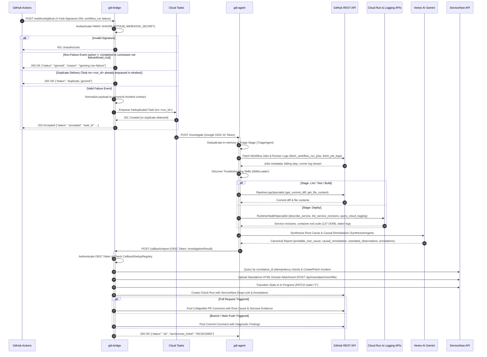

# GitHub Actions Deployment Failure Investigator

[](https://github.com/ssvaidyanathan/autocloud-prototypes/actions/workflows/gha-deploy-investigator-ci.yml)
[](../LICENSE)
[](https://www.python.org/)
[](https://www.terraform.io/)

An SRE diagnostic service for CI/CD pipelines. When a GitHub Actions workflow job or run fails, `gha-deploy-investigator` receives the event through a signed webhook, identifies the failed pipeline stage, correlates build logs and runtime telemetry using Vertex AI Gemini, opens a ServiceNow incident, and writes the findings and ticket link back to GitHub Check Runs and pull requests.

---

## Table of Contents

- [1. System Overview & Problem Statement](#1-system-overview--problem-statement)
- [2. Quick Start](#2-quick-start)
- [3. System Architecture & Request Lifecycle](#3-system-architecture--request-lifecycle)
- [4. Component Breakdown](#4-component-breakdown)
- [5. Configuration](#5-configuration)
- [6. Customizing the Agent with Skills](#6-customizing-the-agent-with-skills)
- [7. Security Model & Production Guardrails](#7-security-model--production-guardrails)
- [8. Prototype Status & Known Limitations](#8-prototype-status--known-limitations)
- [9. Full Step-by-Step GCP Deployment Walkthrough](#9-full-step-by-step-gcp-deployment-walkthrough)
  - [Prerequisites & IAM Requirements](#prerequisites--iam-requirements)
  - [Step 1: Clone Repository and Local Environment Setup](#step-1-clone-repository-and-local-environment-setup)
  - [Step 1b: Bootstrap GCS Remote State & Configure Backend](#step-1b-bootstrap-gcs-remote-state--configure-backend)
  - [Step 2: Deploy Investigator Agent Infrastructure](#step-2-deploy-investigator-agent-infrastructure)
  - [Step 3: Deploy Ingestion Bridge Infrastructure](#step-3-deploy-ingestion-bridge-infrastructure)
  - [Step 4: Configure GitHub App & ServiceNow Integration](#step-4-configure-github-app--servicenow-integration)
  - [Step 5: Deploy Demo Environment & Workload Identity Federation](#step-5-deploy-demo-environment--workload-identity-federation)
  - [Step 6: End-to-End Verification](#step-6-end-to-end-verification)
- [10. Master Automated Deployment Script](#10-master-automated-deployment-script)
- [11. Terraform Remote State & GCS Backend](#11-terraform-remote-state--gcs-backend)
- [12. Enterprise Organization Policy Considerations](#12-enterprise-organization-policy-considerations)
- [13. Local Development & Quality Gates](#13-local-development--quality-gates)
- [14. Testing Guide & Post-Deploy Smoke Tests](#14-testing-guide--post-deploy-smoke-tests)
- [15. Teardown & Clean Up](#15-teardown--clean-up)
- [16. Repository Layout](#16-repository-layout)

---

## 1. System Overview & Problem Statement

### The Problem
When a CI/CD pipeline fails, engineers often spend hours on repetitive manual triage:
- Reading thousands of lines of runner logs to find the failing step and stack trace.
- Correlating container build errors, test assertion mismatches, and deployment failures across separate tools.
- Filing or updating ServiceNow tickets by hand with error quotes, the failing commit, and reproduction context.
- Switching between GitHub, Cloud Run, Cloud Logging, and the ticketing system while pull requests and releases wait.

### The Solution
`gha-deploy-investigator` automates this diagnosis asynchronously, with webhook ingestion and analysis in separate services:
1. **Webhook ingestion and deduplication**: Receives GitHub Actions `workflow_run` and `workflow_job` completion webhooks with HMAC-SHA256 signature verification and delivery deduplication.
2. **Stage triage**: Classifies the failure into one of four pipeline stages (`lint`, `test`, `build`, `deploy`) and assigns specialist agents:
   - Lint / static analysis: syntax errors, unused imports, and formatting rule violations (ruff, flake8, black).
   - Unit / integration tests: failing assertions, expected vs. actual values, and stack traces.
   - Build and packaging: missing build context files, Dockerfile syntax errors, and package installation failures.
   - Deploy and runtime: Cloud Run deployment failures, startup crashes, and container out-of-memory kills (OOM, exit code 137).
3. **Telemetry correlation**: Correlates runner logs, commit diffs, and Cloud Run telemetry using Vertex AI Gemini (`gemini-2.5-flash`), separating the causal fix from incidental warnings.
4. **ServiceNow incident**: Opens a ServiceNow ticket (`POST /api/now/table/incident`) with diagnostic work notes and attaches a standalone HTML report (`POST /api/now/attachment/file`).
5. **GitHub write-back**: Creates or updates a GitHub Check Run that links to the ServiceNow ticket, and posts a commit comment or a collapsible pull request comment with the root cause and copy-paste remediation commands.
6. **Read-only tools**: Every diagnostic tool is registered through `@readonly_tool`. The tool registry refuses to register a mutating tool, and each specialist checks at startup that every registered tool is read-only. Tests in `agent/tests/` check the same invariant.

---

## 2. Quick Start

### Prerequisites
- Google Cloud SDK (`gcloud >= 480.0.0`), installed and authenticated:
  ```bash
  gcloud auth login
  gcloud auth application-default login
  ```
- Terraform (`>= 1.5.0`): `terraform version`
- A local Docker daemon, or Google Cloud Build enabled in the target project.
- Python 3.12+ and the `uv` package manager.
- GitHub CLI (`gh`), authenticated: `gh auth status`
- A target GCP project with billing enabled:
  ```bash
  export PROJECT_ID="<your-target-project-id>"
  export REGION="us-central1"
  export NAME_PREFIX="gdi"
  gcloud config set project "${PROJECT_ID}"
  ```

### Fast Deployment Overview

Deployment is staged because Cloud Run will not deploy a service that references a Secret Manager secret with no enabled version (the Cloud Run Secret Dependency Invariant). [Section 9](#9-full-step-by-step-gcp-deployment-walkthrough) has the full walkthrough; the short version is:

```bash
# 1. Clone repository
git clone https://github.com/ssvaidyanathan/autocloud-prototypes
cd autocloud-prototypes/gha-deploy-investigator

# 2. Create local virtual environment and install dependencies
uv venv .venv --python 3.12
source .venv/bin/activate
uv pip install -e "./bridge[dev]" -e "./agent[dev]" -e "./demo[dev]"

# 3. Configure credentials and secrets via helper scripts
# Replicate ServiceNow secrets from existing deployment if available:
./scripts/copy-secrets.sh --project-id "${PROJECT_ID}" --source-prefix isa --target-prefix "${NAME_PREFIX}"

# Upload GitHub App credentials to Secret Manager:
./scripts/upload-github-app-credentials.sh \
  --project-id "${PROJECT_ID}" \
  --app-id "<your-github-app-id>" \
  --private-key-file "/path/to/github-app-private-key.pem" \
  --webhook-secret "<your-github-webhook-secret>" \
  --prefix "${NAME_PREFIX}"
```

### Integration Guides (GitHub App & ServiceNow)

After deployment, configure the two external integrations:
- **GitHub App**: Configure your personal or organization GitHub App as described in [docs/CONFIGURATION.md](docs/CONFIGURATION.md). Subscribe to `workflow_run`, `workflow_job`, and `check_run` events. Set the Webhook URL to `${BRIDGE_URL}/webhook/github` (the `bridge_url` Terraform output already includes `https://`) and the secret to the value stored in `${NAME_PREFIX}-github-webhook-secret`.
- **ServiceNow**: Give the integration user the `itil` role and attachment upload permissions. To prevent ticket recursion, configure a Business Rule exclusion filter (`correlation_display != "gha-deploy-investigator"`) as described in [docs/DEPLOY.md](docs/DEPLOY.md).

### Try the Demo

After deployment and integration, follow the [Interactive Demo Runbook (`demo/DEMO-RUNBOOK.md`)](demo/DEMO-RUNBOOK.md) to inject each of the four pipeline failures (lint, test, build, deploy), observe the ServiceNow and GitHub write-back and the auto-fix PR, and reset between scenarios.

---

## 3. System Architecture & Request Lifecycle

```
┌─────────────────────────────────────────────────────────────────────────────────────────────────┐
│                                       GitHub Platform                                           │
│  - GitHub Actions Workflow Run (lint, test, build, deploy failure)                              │
│  - GitHub Webhook Event (workflow_job.completed / workflow_run.completed)                      │
└───────────────────────────────────────────────┬─────────────────────────────────────────────────┘
                                                │ 1. POST /webhook/github (HMAC SHA-256)
                                                ▼
┌─────────────────────────────────────────────────────────────────────────────────────────────────┐
│ gdi-bridge (Public Ingress Cloud Run Service)                                                   │
│  • Validates X-Hub-Signature-256 using Secret Manager GITHUB_WEBHOOK_SECRET                     │
│  • Deduplicates events using deterministic Cloud Tasks task IDs (HTTP 200 duplicate_ignored)     │
│  • Normalizes GitHub Actions payload into canonical Incident contract                           │
│  • Enqueues asynchronous task to Cloud Tasks queue                                              │
└───────────────────────────────────────────────┬─────────────────────────────────────────────────┘
                                                │ 2. OIDC Authenticated Cloud Tasks Task
                                                ▼
┌─────────────────────────────────────────────────────────────────────────────────────────────────┐
│ gdi-agent (Internal Ingress Cloud Run Service)                                                  │
│  • Dispatcher triages incident & identifies failed pipeline stage (TriageAgent)                 │
│  • Dynamic Skill Discovery loads domain troubleshooting playbooks (SkillsLoader)                │
│  • Diagnostic Specialists inspect telemetry using read-only tools:                              │
│    ├─ PipelineLogsSpecialist: parses GitHub step logs, extracts errors & stack traces           │
│    ├─ RuntimeHealthSpecialist: inspects Cloud Run revisions, OOM exit 137 & container stderr    │
│    └─ IaCConfigSpecialist: analyzes Terraform and build configuration                           │
│  • RootCauseSynthesizer: Vertex AI Gemini reasoning formulates DiagnosticReport                 │
│  • Delivers completed investigation back to Bridge                                              │
└───────────────────────────────────────────────┬─────────────────────────────────────────────────┘
                                                │ 3. POST /callback/report (OIDC Token)
                                                ▼
┌─────────────────────────────────────────────────────────────────────────────────────────────────┐
│ gdi-bridge (Callback Handler & Reverse Write-Back)                                              │
│  • Validates OIDC caller authentication and dedup registry                                      │
│  • ServiceNow Incident Creation (POST /api/now/table/incident) with correlation_id              │
│  • HTML Dossier Attachment (POST /api/now/attachment/file)                                      │
│  • Transitions ServiceNow incident state to In Progress (state="2")                             │
│  • GitHub Check Run Creation (POST /repos/{owner}/{repo}/check-runs) linking to ServiceNow      │
│  • PR / Commit Comment Posting with collapsible root cause & decisive evidence                  │
└───────────────────────────────────────────────┬─────────────────────────────────────────────────┘
                                                │ 4. Deep Links & Ticket Updates
                                                ▼
┌─────────────────────────────────────────────────────────────────────────────────────────────────┐
│ Developer Surfaces: ServiceNow Incident INC0019482 Enriched & GitHub Check Run Linked           │
└─────────────────────────────────────────────────────────────────────────────────────────────────┘
```

### Sequence Flow (Mermaid)



---

## 4. Component Breakdown

### 1. `gdi-bridge` (`bridge/`)
- Role: public webhook receiver, integration gateway, and report renderer.
- Technology: Python 3.12+, FastAPI, Pydantic v2, Google Cloud Tasks client, Google Secret Manager client, HTTPX.
- Responsibilities:
  - Verifies inbound webhooks with the `X-Hub-Signature-256` HMAC-SHA256 signature.
  - Deduplicates deliveries with deterministic Cloud Tasks task IDs (`inv-<run_id>`).
  - Normalizes payloads into the canonical `Incident` model (`bridge/app/contracts/`, byte-identical with the agent copy).
  - Dispatches investigation tasks to `gdi-tasks-queue`, using an OIDC token for the `gdi-tasks-invoker-sa` service account.
  - Authenticates OIDC tokens on callbacks (`POST /callback/report`).
  - Deduplicates callbacks in memory (`CallbackDedupRegistry`).
  - Manages the ServiceNow incident: looks up an existing incident by `correlation_id` before creating one (`POST /api/now/table/incident`), uploads the HTML dossier (`POST /api/now/attachment/file`), and moves the incident to `In Progress` (`state="2"`).
  - Writes back to GitHub: creates a Check Run (`POST /repos/{owner}/{repo}/check-runs`) with the ServiceNow link and annotations, and posts a PR or commit comment with a collapsible summary.

### 2. `gdi-agent` (`agent/`)
- Role: private multi-agent diagnostic engine.
- Technology: Python 3.12+, FastAPI, Google GenAI ADK, Vertex AI Gemini, Google Cloud Logging, Google Cloud Run client.
- Responsibilities:
  - Prevents duplicate concurrent runs with in-memory deduplication (`InvestigationDeduplicator`).
  - Stage triage (`TriageAgent`): reads workflow jobs and runner logs to classify the failure stage (`lint`, `test`, `build`, `deploy`).
  - Skill discovery (`SkillsLoader`): parses and validates the frontmatter runbooks in `agent/skills/`.
  - Specialist investigation:
    - `PipelineLogsSpecialist`: step logs, commit diffs, and source files, for lint, test, and container packaging failures.
    - `RuntimeHealthSpecialist`: Cloud Run revision specs, container lifecycle status, and Cloud Logging, for deployment crashes and OOM.
    - `IaCConfigSpecialist`: infrastructure definitions and deployment scripts.
  - Runs tools through the `@readonly_tool` cached registry (`QueryCache`).
  - Synthesis (`SynthesizerAgent`): calls Vertex AI Gemini (`gemini-2.5-flash`) to produce a structured `Report` that separates causal fixes from unrelated warnings.
  - Sends the result to `gdi-bridge` with an authenticated callback (`POST /callback/report`).
  - Agent instructions: system instructions, specialist turn protocols, and synthesis prompt templates live in [`agent/app/agent.yaml`](agent/app/agent.yaml) and are loaded at startup by [`agent/app/agent_config.py`](agent/app/agent_config.py). Developer conventions, guardrails, and AI assistant guidelines are in [`AGENTS.md`](AGENTS.md).

### 3. `demo/` Sample Pipeline App & Scenarios (`demo/`)
- Role: sample e-commerce microservice and deterministic failure injection scripts.
- Components:
  - `demo/sample-pipeline-app/`: standalone FastAPI microservice with a 4-stage GitHub Actions workflow ([`.github/workflows/pipeline.yml`](demo/sample-pipeline-app/.github/workflows/pipeline.yml)), Dockerfile, unit tests, and Cloud Run deployment scripts.
  - `demo/scenarios/`: deterministic fault triggers, kept outside the seeded application so the agent cannot overfit to the demo:
    - `trigger-lint-failure.sh`: adds an unused import (`F401`) and multiple statements on one line (`E702`) to `app/main.py`.
    - `trigger-test-failure.sh`: adds a promotional tier calculation regression to `tests/test_main.py`.
    - `trigger-build-failure.sh`: makes the `Dockerfile` reference a missing build context file.
    - `trigger-deploy-failure.sh`: sets `MEMORY=256Mi` and a 2048 MB cache pre-warm buffer in `scripts/deploy.sh`, so the container OOMs on startup (exit 137).
    - `reset-scenarios.sh`: reverts scenario commits idempotently and leaves a clean working tree.
  - `demo/seed-demo-repo.sh`: seeds the customer demo repository for live evaluation.
  - `demo/infra/terraform/`: provisions Workload Identity Federation (WIF) Pool, Provider, Artifact Registry, and least-privilege CI/CD service accounts for keyless GitHub Actions authentication.

---

## 5. Configuration

Configuration comes from environment variables and Google Secret Manager. Nothing is hardcoded in application code.
- Local development: `.env` files or environment variables, loaded by `config.py` (`pydantic-settings`).
- Production: Terraform variables (`terraform.tfvars`) → Cloud Run environment variables and Secret Manager references → `config.py`.

### Key System Settings

#### Bridge Service Settings (`gdi-bridge`)

| Setting | Environment Variable | Default Value | Required | Description |
|---|---|---|---|---|
| Resource Prefix | `NAME_PREFIX` | `"gdi"` | No | Prefixes all GCP resources and secrets |
| GCP Project | `GCP_PROJECT` | *(ADC / Metadata)* | Yes (in GCP) | Target Google Cloud Platform project ID |
| GCP Region | `GCP_REGION` | `"us-central1"` | No | Region for Cloud Run, Cloud Tasks, and Secret Manager |
| Tasks Queue | `TASKS_QUEUE` | `"investigations"` | Yes (in GCP) | Cloud Tasks queue name for async dispatch |
| Invoker SA | `TASKS_INVOKER_SA` | `""` | Yes (in GCP) | Service account email for Cloud Tasks OIDC invocation of Agent |
| Agent URL | `AGENT_SERVICE_URL` | `""` | Yes (in GCP) | Target internal URL of `gdi-agent` Cloud Run service |
| Callback URL | `CALLBACK_URL` | `""` | Yes (in GCP) | Public URL where Agent posts completed investigation results |
| Adapter Timeout | `ADAPTER_TIMEOUT_SECONDS` | `60.0` | No | Timeout in seconds for outbound ServiceNow and GitHub calls (`var.adapter_timeout_seconds`) |
| ServiceNow URL | `SERVICENOW_INSTANCE_URL` | *None* | Yes (in prod) | Base URL of ServiceNow instance (e.g. `https://<your-instance>.service-now.com`) |
| ServiceNow Caller | `SERVICENOW_CALLER` | *None* (`"admin"`) | No | User set as `caller_id` on created incidents. The app falls back to `"admin"`; set via `var.servicenow_caller` |
| ServiceNow State | `SERVICENOW_IN_PROGRESS_STATE` | `"2"` | No | State integer assigned to created incidents (`"2"` = In Progress) |
| ServiceNow Report State | `SERVICENOW_INCIDENT_STATE_AFTER_REPORT` | `"2"` | No | Incident state integer after investigation report is posted (`var.servicenow_incident_state_after_report`) |
| Correlation Display | `SERVICENOW_CORRELATION_DISPLAY` | `"gha-deploy-investigator"` | No | Correlation display tag for bi-directional exclusion filtering |
| GitHub App ID | `GITHUB_APP_ID` | *None* | Yes (for App) | Numeric GitHub App ID installed on target repositories |
| GitHub Write-Back | `ENABLE_GITHUB_WRITEBACK` | `true` | No | Enables Check Run creation and PR/commit comment posting |
| GitHub API URL | `GITHUB_API_URL` | `https://api.github.com` | No | Base URL of the GitHub REST API |

#### Agent Service Settings (`gdi-agent`)

| Setting | Environment Variable | Default Value | Required | Description |
|---|---|---|---|---|
| Resource Prefix | `NAME_PREFIX` | `"gdi"` | No | Resource name prefix |
| GCP Project | `GCP_PROJECT` | *(ADC / Metadata)* | Yes (in GCP) | Target Google Cloud Platform project ID |
| Bridge URL | `BRIDGE_SERVICE_URL` | `""` | Yes (in GCP) | URL of `gdi-bridge` callback endpoint |
| Gemini Model | `GEMINI_MODEL` | *None* | Yes | Vertex AI Gemini model name for diagnostic synthesis |
| Vertex AI Location | `VERTEX_AI_LOCATION` | `us-central1` | No | GCP region for Vertex AI Gemini API endpoint |
| GitHub App ID | `GITHUB_APP_ID` | *None* | Yes (for App) | Numeric GitHub App ID for authenticated repo API queries |
| Synthesis Output Budget | `SYNTHESIS_MAX_OUTPUT_TOKENS` | `8192` | No | Max output tokens for Gemini synthesis. On thinking models, thinking tokens count against this budget |
| Synthesis Thinking Budget | `SYNTHESIS_THINKING_BUDGET` | `1024` | No | Gemini thinking budget. Must be below `SYNTHESIS_MAX_OUTPUT_TOKENS` (checked at startup). `0` disables thinking on gemini-2.5-flash; a negative value omits `thinkingConfig` (see [Section 8](#8-prototype-status--known-limitations)) |

### Secret Manager Secret Names

Credentials are stored only in Google Secret Manager:

| Stack | Secret Identifier | Consumer | Purpose |
|---|---|---|---|
| Agent (owner), Bridge (reader) | `${NAME_PREFIX}-github-app-private-key` | `gdi-agent-sa`, `gdi-bridge-sa` | PEM-encoded RSA private key for GitHub App authentication. Created by the Agent stack; the Bridge stack reads it through a data source and binds accessor IAM |
| Bridge | `${NAME_PREFIX}-github-webhook-secret` | `gdi-bridge-sa` | Shared secret for verifying inbound `X-Hub-Signature-256` HMAC headers |
| Bridge | `${NAME_PREFIX}-servicenow-username` | `gdi-bridge-sa` | Integration user for ServiceNow Table and Attachment REST APIs |
| Bridge | `${NAME_PREFIX}-servicenow-password` | `gdi-bridge-sa` | Basic auth password for ServiceNow REST APIs |
| Bridge | `${NAME_PREFIX}-servicenow-webhook-token` | `gdi-bridge-sa` | Optional bearer token for verifying inbound ServiceNow webhooks |

For the full variable list and schema, see the [Configuration Guide (`docs/CONFIGURATION.md`)](docs/CONFIGURATION.md).

---

## 6. Customizing the Agent with Skills

The agent loads its domain knowledge from Agent Skills in `agent/skills/`, managed by `SkillsLoader` (`agent/app/skills_loader.py`). Failure signatures and remediation playbooks live in Markdown skill documents, so you can add them without changing agent code.

### Skills Directory Structure & Mapping

Skills are mapped to agent roles in [`agent/skills/skills.yaml`](agent/skills/skills.yaml):

```yaml
# Mapping of agents/specialists to their assigned CI/CD troubleshooting runbook skills
dispatcher:
  - lint-troubleshooting
  - test-failure-triage
  - container-build-troubleshooting
  - cloudrun-deploy-troubleshooting

pipeline_logs:
  - lint-troubleshooting
  - test-failure-triage
  - container-build-troubleshooting

runtime_health:
  - cloudrun-deploy-troubleshooting

iac_config:
  - cloudrun-deploy-troubleshooting
```

### Adding a Pipeline Troubleshooting Skill

To add a runbook for a new pipeline failure mode:

1. Create `agent/skills/<skill-name>/SKILL.md`.
2. Add YAML frontmatter and the diagnostic content:
   ```markdown
   ---
   name: custom-db-migration-troubleshooting
   description: Diagnostic runbook for database migration and schema deployment failures
   ---

   # Database Migration Troubleshooting Runbook

   ## Diagnostic Workflow
   1. **Identify Migration Tool**: Detect whether Alembic, Flyway, or Liquibase failed.
   2. **Parse Diagnostic Coordinates**: Extract migration revision ID, lock timeout, or SQL syntax error.
   3. **Correlate with Commit Changes**: Check migration files modified in commit diff (`get_commit_diff`).
   4. **Formulate Remediation**: Suggest roll-forward migration scripts or lock clearance commands.
   ```
3. Register it in `skills.yaml`: add `- custom-db-migration-troubleshooting` under `pipeline_logs` or `dispatcher`.
4. Run `pytest agent/tests/test_skills_tracking.py` to check schema compliance and metadata discovery.

### Architectural Rules & Guardrails
- **No scripts**: The skills loader rejects skill packages that contain a `scripts/` subdirectory (`ValueError("Security violation: skill ... contains a forbidden 'scripts/' directory")`). Skills contain diagnostic instructions and reference documentation only.
- **No demo overfitting**: A presubmit guard (`scripts/check-no-demo-overfit.sh`) checks that skills and prompt templates describe general diagnostic patterns, not hardcoded scenario answers.
- **Read-only**: Specialist tools wrap read-only SDK calls and are decorated with `@readonly_tool`, so they cannot modify client repositories or GCP environments.

---

## 7. Security Model & Production Guardrails

- **Read-only IAM roles**: The runtime service account `gdi-agent-sa` has only read-only viewer roles (`roles/logging.viewer`, `roles/run.viewer`) plus `roles/aiplatform.user` for Gemini model invocation. It cannot change production resources, restart services, or modify customer repositories.
- **Internal ingress and IAM**: `gdi-agent` uses internal ingress (`INGRESS_TRAFFIC_INTERNAL_ONLY`) and is not reachable from the public internet. Cloud Tasks in the same project passes the ingress check. Only the Tasks invoker service account (`${NAME_PREFIX}-tasks-invoker-sa`) has `roles/run.invoker` on the service, and each task carries an OIDC token for that account with the agent URL as audience.
- **No secrets in the repository or Terraform state**: Tokens, passwords, and private keys are stored only in Google Secret Manager. Terraform declares only the secret containers (metadata).
- **HMAC webhook verification**: Inbound webhooks need a valid `X-Hub-Signature-256` HMAC signature computed with `GITHUB_WEBHOOK_SECRET`. Unsigned or tampered requests are rejected with HTTP 401.
- **Delivery deduplication**: Deterministic task naming (`inv-<run_id>`) in Cloud Tasks and `CallbackDedupRegistry` in Bridge prevent duplicate runs or concurrent LLM execution.
- **Keyless GitHub Actions authentication**: The demo pipeline uses Workload Identity Federation (WIF), restricted to `assertion.repository == '${GITHUB_OWNER}/${DEMO_REPO_NAME}' && assertion.ref == 'refs/heads/main'`, so no long-lived service account keys are needed.
- **ServiceNow loop exclusion**: Every created incident carries `correlation_display = "gha-deploy-investigator"` and `correlation_id = "gdi:<owner>/<repo>:<run_id>:<run_attempt>"`. Outbound ServiceNow business rules filter on these values to prevent recursive webhook triggers.
- **AST static checks**: `scripts/check-no-rootcause-overrides.py` enforces AST invariants so that code running after the LLM cannot overwrite root-cause findings or invent ungrounded explanations.

---

## 8. Prototype Status & Known Limitations

The scenarios below were run end to end against live Google Cloud and ServiceNow instances, with no manual intervention during the runs.

### Live Scenario Scorecard Summary

| Scenario | Stage | Trigger | Result | What the agent found |
|---|---|---|:---:|---|
| Baseline failure (deploy) | `deploy` | Runtime service account not configured | Pass | Missing `iam.serviceaccounts.actAs` permission on the compute service account during Cloud Run deployment |
| Scenario 1: Lint | `lint` | Ruff style violation | Pass | Unused import (`F401` `math`) and multiple statements on one line (`E702`) in `app/main.py`, with exact line numbers |
| Scenario 2: Test | `test` | Pytest assertion mismatch | Pass | `assert 75.5 == 100.0` in `tests/test_main.py::test_customer_tier_discount_calculation`, with expected vs. actual values |
| Scenario 3: Build | `build` | Missing Dockerfile context file | Pass | Missing `config/cache-warmup.json`, required by the `COPY` instruction on `Dockerfile` line 33 |
| Scenario 4: Deploy | `deploy` | Container OOM at startup | Pass | Out of memory (exit code 137 / signal 9) caused by `MEMORY=256Mi` and `CACHE_PREWARM_BUFFER_MB=2048` in `scripts/deploy.sh` |
| Unplanned revert failure | `deploy` | Memory env var persisted across revisions | Pass; root cause since fixed | Deployment script omitted `--clear-env-vars`, so the variable survived the revert. Fixed by making deployments declarative across Cloud Run revisions |

### Known Limitations & Operational Considerations

1. **GitHub App required for Check Runs**: Creating Check Runs requires a GitHub App with `checks: write` permission and an RSA private key. A personal access token fallback can only create commit or PR comments.
2. **Cloud Logging latency**: Cloud Run container stdout/stderr takes 5–15 seconds to appear in Cloud Logging. The agent queries a ±15-minute window around the workflow failure timestamp.
3. **Cloud Run keeps environment variables**: Cloud Run carries environment variables over to new revisions unless they are cleared. Deployment scripts must pass `--clear-env-vars` when deploying without overrides, or stale configuration persists.
4. **ServiceNow roles**: The integration user in `SERVICENOW_USERNAME` needs `itil` table permissions and attachment upload permission (`soap_ecc` or equivalent).
5. **One run at a time**: Each workflow run failure is analyzed on its own. Cross-run flaky test clustering and repository-wide trend analysis are planned for future releases.
6. **Heuristic fallback when LLM synthesis fails**: If Gemini synthesis is truncated at its output token limit (`finishReason=MAX_TOKENS`), returns an unparseable payload, errors, or is unavailable, the report falls back to deterministic specialist heuristics and contains no LLM fix proposal. The fallback is always flagged: the report carries a `Heuristic diagnosis because LLM synthesis failed (...)` caveat plus `metadata.heuristic_fallback`, `metadata.synthesis_outcome`, and `metadata.synthesis_finish_reason`, and the ServiceNow work note shows the caveat at the top.
   - Token budget: set with `SYNTHESIS_MAX_OUTPUT_TOKENS` (default 8192) and `SYNTHESIS_THINKING_BUDGET` (default 1024). On thinking models, thinking tokens count against the output budget. The thinking budget must be below the output budget (checked at startup).
   - The thinking budget depends on `GEMINI_MODEL`: non-thinking models reject `thinkingConfig`, and gemini-2.5-pro requires a budget of at least 128.
   - A negative value (e.g. `SYNTHESIS_THINKING_BUDGET=-1`) omits `thinkingConfig` entirely. Use it for models that reject `thinkingConfig` (non-thinking models). On gemini-2.5-flash and 2.5-pro, omission gives the model-default *dynamic* thinking, which is not bounded by `SYNTHESIS_MAX_OUTPUT_TOKENS`; it does not disable thinking (`-1` is also Gemini's own "dynamic" value). gemini-2.5-flash-lite has thinking off by default, so omission there means no thinking. The startup budget-below-output check does not apply when `thinkingConfig` is omitted.
   - To disable thinking on gemini-2.5-flash, use `0`.

---

## 9. Full Step-by-Step GCP Deployment Walkthrough

### Prerequisites & IAM Requirements

1. Google Cloud SDK (`gcloud`), installed and authenticated:
   ```bash
   gcloud auth login
   gcloud auth application-default login
   ```
2. Terraform (`>= 1.5.0`): `terraform version`
3. A local Docker daemon, or Cloud Build enabled.
4. Python 3.12+ and `uv`.
5. A GCP project with billing enabled:
   ```bash
   export PROJECT_ID="<your-target-project-id>"
   export PROJECT_NUMBER="$(gcloud projects describe ${PROJECT_ID} --format='value(projectNumber)')"
   export REGION="us-central1"
   export NAME_PREFIX="gdi"
   export GITHUB_OWNER="<your-github-user-or-org>"
   export DEMO_REPO_NAME="gdi-sample-pipeline-app"
   gcloud config set project "${PROJECT_ID}"
   ```
6. Deployer IAM roles. The deploying identity needs these least-privilege roles, derived from the Terraform manifests:
   - `roles/iam.workloadIdentityPoolAdmin`
   - `roles/artifactregistry.admin`
   - `roles/run.admin`
   - `roles/iam.serviceAccountAdmin`
   - `roles/iam.serviceAccountUser`
   - `roles/secretmanager.admin`
   - `roles/cloudtasks.admin`
   - `roles/resourcemanager.projectIamAdmin`
   - `roles/cloudbuild.builds.editor`
   - `roles/serviceusage.serviceUsageAdmin`
   - `roles/storage.admin` (required to create and configure the GCS remote state bucket)

   > [!NOTE]
   > Where `roles/owner` cannot be granted to CI/CD pipelines or developers, these 11 roles are enough to provision the infrastructure, deploy containers, configure WIF, and bind runtime IAM policies, without granting broad project or billing administration rights.

   ```bash
   # Grant least-privilege operator roles to deploying identity (User or Deployment SA)
   OPERATOR_PRINCIPAL="user:you@example.com" # or "serviceAccount:deployer@${PROJECT_ID}.iam.gserviceaccount.com"

   OPERATOR_ROLES=(
       "roles/serviceusage.serviceUsageAdmin"
       "roles/resourcemanager.projectIamAdmin"
       "roles/iam.serviceAccountAdmin"
       "roles/iam.serviceAccountUser"
       "roles/iam.workloadIdentityPoolAdmin"
       "roles/artifactregistry.admin"
       "roles/secretmanager.admin"
       "roles/cloudtasks.admin"
       "roles/run.admin"
       "roles/cloudbuild.builds.editor"
       "roles/storage.admin"
   )

   for role in "${OPERATOR_ROLES[@]}"; do
       gcloud projects add-iam-policy-binding "${PROJECT_ID}" \
           --member="${OPERATOR_PRINCIPAL}" \
           --role="${role}" \
           --condition=None
   done
   ```

7. Enable the required Google Cloud APIs:
   ```bash
   gcloud services enable \
       run.googleapis.com \
       secretmanager.googleapis.com \
       cloudtasks.googleapis.com \
       artifactregistry.googleapis.com \
       iam.googleapis.com \
       iamcredentials.googleapis.com \
       sts.googleapis.com \
       aiplatform.googleapis.com \
       logging.googleapis.com \
       cloudresourcemanager.googleapis.com \
       cloudbuild.googleapis.com \
       --project="${PROJECT_ID}"
   ```

---

### Step 1: Clone Repository and Local Environment Setup

```bash
git clone https://github.com/ssvaidyanathan/autocloud-prototypes
cd autocloud-prototypes/gha-deploy-investigator

# Set up Python virtual environment
uv venv .venv --python 3.12
source .venv/bin/activate
uv pip install -e "./bridge[dev]" -e "./agent[dev]" -e "./demo[dev]" pytest ruff
```

---

### Step 1b: Bootstrap GCS Remote State & Configure Backend

Before applying any Terraform, create the Cloud Storage remote state bucket and configure the partial backends:

```bash
# 1. Bootstrap GCS remote state bucket and generate backend.hcl for all stacks
./scripts/bootstrap-tfstate.sh \
  --project-id "${PROJECT_ID}" \
  --name-prefix "${NAME_PREFIX}" \
  --region "${REGION}"

# 2. Or configure partial backend manually using backend.hcl.example:
# cp agent/infra/terraform/backend.hcl.example agent/infra/terraform/backend.hcl
# cp bridge/infra/terraform/backend.hcl.example bridge/infra/terraform/backend.hcl
# cp demo/infra/terraform/backend.hcl.example demo/infra/terraform/backend.hcl

# 3. Initialize Agent stack with backend configuration
cd agent/infra/terraform
terraform init -backend-config=backend.hcl
cd ../../..
```

---

### Step 2: Deploy Investigator Agent Infrastructure

Deploy the agent infrastructure first so that its outputs (`agent_url`, `agent_service_account_email`, and `tasks_invoker_service_account_email`) can be supplied to the bridge stack.

> [!IMPORTANT]
> **Stack order and secret ownership**: Deploy the Agent stack (`agent/infra/terraform`) before the Bridge stack (`bridge/infra/terraform`). Only the Agent stack creates the GitHub App private key secret container (`${NAME_PREFIX}-github-app-private-key`). The Bridge stack reads that secret through a Terraform data source (`data.google_secret_manager_secret.github_app_private_key`) to bind secret accessor IAM (`bridge_gh_key_access`) without creating a second container. On fresh infrastructure, deploying the Bridge stack first fails because the secret container does not exist yet.

> [!IMPORTANT]
> **Staged deployment**: A Cloud Run service that references a Secret Manager secret fails to deploy if the secret has no enabled versions. Deploy in this order: Stage A (secret containers and service accounts) → Stage B (secret values) → Stage C (build images) → Stage D (Cloud Run services).

#### 2.1 Provision Agent Secret Container & IAM via Terraform
```bash
cd agent/infra/terraform
terraform init -backend-config=backend.hcl

terraform apply \
    -var="project_id=${PROJECT_ID}" \
    -var="region=${REGION}" \
    -var="name_prefix=${NAME_PREFIX}" \
    -target=google_secret_manager_secret.github_app_private_key \
    -target=google_service_account.agent_sa \
    -target=google_service_account.tasks_invoker_sa \
    -target=google_secret_manager_secret_iam_member.agent_gh_key_access \
    -target=google_project_iam_member.agent_vertex_ai \
    -target=google_project_iam_member.agent_logging_viewer \
    -target=google_project_iam_member.agent_cloud_run_viewer
cd ../../..
```

#### 2.2 Populate GitHub App Private Key in Secret Manager
```bash
gcloud secrets versions add "${NAME_PREFIX}-github-app-private-key" \
    --data-file="/path/to/github-app-private-key.pem" \
    --project="${PROJECT_ID}"
```

#### 2.3 Build and Push Agent Container Image
```bash
# Create shared containers repository if not already created
gcloud artifacts repositories create "${NAME_PREFIX}-containers" \
    --repository-format=docker \
    --location="${REGION}" \
    --project="${PROJECT_ID}" || true

gcloud builds submit agent \
    --tag="${REGION}-docker.pkg.dev/${PROJECT_ID}/${NAME_PREFIX}-containers/${NAME_PREFIX}-agent:latest" \
    --project="${PROJECT_ID}"
```

#### 2.4 Deploy Agent Cloud Run Service
```bash
cd agent/infra/terraform
terraform apply \
    -var="project_id=${PROJECT_ID}" \
    -var="region=${REGION}" \
    -var="name_prefix=${NAME_PREFIX}" \
    -var="repository_id=${NAME_PREFIX}-containers" \
    -var="github_app_id=<your-github-app-id>"
```

#### 2.5 Capture Agent Terraform Outputs
```bash
AGENT_URL=$(terraform output -raw agent_url)
AGENT_SA=$(terraform output -raw agent_service_account_email)
TASKS_INVOKER_SA=$(terraform output -raw tasks_invoker_service_account_email)

echo "Agent URL:        ${AGENT_URL}"
echo "Agent SA:         ${AGENT_SA}"
echo "Tasks Invoker SA: ${TASKS_INVOKER_SA}"
cd ../../..
```

---

### Step 3: Deploy Ingestion Bridge Infrastructure

> [!NOTE]
> **Depends on Step 2**: Deploy the Agent stack (Step 2) before Step 3. The Bridge stack references the Agent-owned `${NAME_PREFIX}-github-app-private-key` secret via a Terraform data source.

#### 3.1 Provision Bridge Secret Containers, IAM & Tasks Queue
```bash
cd bridge/infra/terraform
terraform init -backend-config=backend.hcl

terraform apply \
    -var="project_id=${PROJECT_ID}" \
    -var="region=${REGION}" \
    -var="name_prefix=${NAME_PREFIX}" \
    -target=google_secret_manager_secret.github_webhook_secret \
    -target=google_secret_manager_secret.servicenow_username \
    -target=google_secret_manager_secret.servicenow_password \
    -target=google_secret_manager_secret.servicenow_webhook_token \
    -target=google_service_account.bridge_sa \
    -target=google_cloud_tasks_queue.tasks_queue \
    -target=google_cloud_tasks_queue_iam_member.bridge_task_enqueuer \
    -target=google_secret_manager_secret_iam_member.bridge_gh_secret_access \
    -target=google_secret_manager_secret_iam_member.bridge_snow_username_access \
    -target=google_secret_manager_secret_iam_member.bridge_snow_pwd_access \
    -target=google_secret_manager_secret_iam_member.bridge_snow_token_access \
    -target=google_secret_manager_secret_iam_member.bridge_gh_key_access
cd ../../..
```

#### 3.2 Populate Bridge Secrets in Secret Manager
```bash
# Populate webhook secret
gcloud secrets versions add "${NAME_PREFIX}-github-webhook-secret" \
    --data-file=<(printf "%s" "<your-github-webhook-secret>") \
    --project="${PROJECT_ID}"

# Populate ServiceNow credentials (or use ./scripts/copy-secrets.sh)
gcloud secrets versions add "${NAME_PREFIX}-servicenow-username" \
    --data-file=<(printf "%s" "<your-servicenow-username>") \
    --project="${PROJECT_ID}"

gcloud secrets versions add "${NAME_PREFIX}-servicenow-password" \
    --data-file=<(printf "%s" "<your-servicenow-password>") \
    --project="${PROJECT_ID}"

gcloud secrets versions add "${NAME_PREFIX}-servicenow-webhook-token" \
    --data-file=<(printf "%s" "<your-servicenow-token>") \
    --project="${PROJECT_ID}"
```

#### 3.3 Build and Push Bridge Container Image
```bash
gcloud builds submit bridge \
    --tag="${REGION}-docker.pkg.dev/${PROJECT_ID}/${NAME_PREFIX}-containers/${NAME_PREFIX}-bridge:latest" \
    --project="${PROJECT_ID}"
```

#### 3.4 Deploy Bridge Cloud Run Service
```bash
cd bridge/infra/terraform
terraform apply \
    -var="project_id=${PROJECT_ID}" \
    -var="region=${REGION}" \
    -var="name_prefix=${NAME_PREFIX}" \
    -var="repository_id=${NAME_PREFIX}-containers" \
    -var="agent_service_url=${AGENT_URL}" \
    -var="agent_service_account_email=${AGENT_SA}" \
    -var="tasks_invoker_service_account_email=${TASKS_INVOKER_SA}" \
    -var="github_app_id=<your-github-app-id>" \
    -var="servicenow_instance_url=https://<your-instance>.service-now.com"
```

#### 3.5 Capture Bridge Terraform Outputs
```bash
BRIDGE_URL=$(terraform output -raw bridge_url)
BRIDGE_SA=$(terraform output -raw bridge_service_account_email)
TASKS_QUEUE_NAME=$(terraform output -raw tasks_queue_name)

echo "Bridge URL:       ${BRIDGE_URL}"
echo "Bridge SA:        ${BRIDGE_SA}"
echo "Tasks Queue:      ${TASKS_QUEUE_NAME}"
cd ../../..
```

---

### Step 4: Configure GitHub App & ServiceNow Integration

#### 4.1 Configure GitHub App Webhook Settings
1. Open your GitHub App settings in Developer Settings.
2. Set **Webhook URL** to:
   ```
   ${BRIDGE_URL}/webhook/github
   ```
3. Set **Webhook Secret** to the value stored in `${NAME_PREFIX}-github-webhook-secret`.
4. Grant these permissions:
   - Repository permissions:
     - `Actions`: Read-only
     - `Checks`: Read & write
     - `Pull requests`: Read & write
     - `Contents`: Read-only
5. Subscribe to these events:
   - `workflow_run`
   - `workflow_job`
   - `check_run`
6. Install the GitHub App on your target customer repository (`${GITHUB_OWNER}/${DEMO_REPO_NAME}`).

#### 4.2 Configure ServiceNow Bi-Directional Exclusion Filter
In ServiceNow, add this condition to the outbound business rule or webhook filter:
```
Correlation display [IS NOT] gha-deploy-investigator
AND
Correlation ID [DOES NOT START WITH] gdi:
```
Incidents created by `gha-deploy-investigator` then do not trigger external SRE monitoring loops.

---

### Step 5: Deploy Demo Environment & Workload Identity Federation

#### 5.1 Provision Demo WIF Stack via Terraform
```bash
cd demo/infra/terraform
terraform init -backend-config=backend.hcl
terraform apply \
    -var="project_id=${PROJECT_ID}" \
    -var="region=${REGION}" \
    -var="name_prefix=${NAME_PREFIX}"

WIF_PROVIDER=$(terraform output -raw wif_provider_name)
DEPLOYER_SA=$(terraform output -raw service_account_email)
APP_SA=$(terraform output -raw app_service_account_email)
DEMO_GAR=$(terraform output -raw artifact_registry_repo)
cd ../../..
```

#### 5.2 Configure GitHub Repository Secrets
Set the 6 required secrets on the demo repository (`${GITHUB_OWNER}/${DEMO_REPO_NAME}`):
```bash
gh secret set GCP_PROJECT_ID --body "${PROJECT_ID}" --repo "${GITHUB_OWNER}/${DEMO_REPO_NAME}"
gh secret set GCP_WIF_PROVIDER --body "${WIF_PROVIDER}" --repo "${GITHUB_OWNER}/${DEMO_REPO_NAME}"
gh secret set GCP_SA_EMAIL --body "${DEPLOYER_SA}" --repo "${GITHUB_OWNER}/${DEMO_REPO_NAME}"
gh secret set GCP_APP_SA_EMAIL --body "${APP_SA}" --repo "${GITHUB_OWNER}/${DEMO_REPO_NAME}"
gh secret set GAR_REPOSITORY --body "${DEMO_GAR}" --repo "${GITHUB_OWNER}/${DEMO_REPO_NAME}"
gh secret set GAR_LOCATION --body "${REGION}-docker.pkg.dev" --repo "${GITHUB_OWNER}/${DEMO_REPO_NAME}"
```

#### 5.3 Verify Pipeline Event Gating
The demo application's `.github/workflows/pipeline.yml` only deploys to GCP when:
```yaml
if: github.event_name == 'push' && github.ref == 'refs/heads/main'
```
PR builds still run tests and a local container build, and do not fail on the WIF token exchange.

---

### Step 6: End-to-End Verification

Check service health, rejection of unsigned requests, and a signed webhook ping:

```bash
# 1. Health check probe
curl -s -f "${BRIDGE_URL}/health"
# Expected response: {"status":"healthy","service":"gdi-bridge"}

# 2. Unauthenticated webhook rejection (HMAC SHA-256 validation)
curl -i -X POST "${BRIDGE_URL}/webhook/github" \
    -H "Content-Type: application/json" \
    -H "X-GitHub-Event: ping" \
    -d '{"zen": "Mind your posture."}'
# Expected response: HTTP/2 401 Unauthorized

# 3. Signed ping check (GitHub App ping event)
# In GitHub App settings, click "Redeliver" on the ping event.
# Expected response: HTTP/2 200 OK {"status":"pong","message":"GitHub webhook ping received successfully"}
```

---

## 10. Master Automated Deployment Script

There is no single deployment script. Deployment runs in stages because of the Cloud Run Secret Dependency Invariant (a service cannot deploy until its secrets have an enabled version):

```
Stage A: Provision Secret Containers & SAs (Terraform)
  ↓
Stage B: Populate Secret Values (gcloud / scripts)
  ↓
Stage C: Build Container Images (Cloud Build)
  ↓
Stage D: Deploy Cloud Run Services (Terraform)
  ↓
Stage E: Provision Demo WIF & Repository Secrets (Terraform & gh)
```

These helper scripts automate parts of the workflow:

### 1. `scripts/copy-secrets.sh`
Copies shared ServiceNow credentials from an existing deployment's secrets (e.g. the `isa` prefix) to the `gdi` secrets, without printing passwords to stdout or committing them to version control:
```bash
./scripts/copy-secrets.sh \
  --project-id "${PROJECT_ID}" \
  --source-prefix "isa" \
  --target-prefix "${NAME_PREFIX}"
```

### 2. `scripts/upload-github-app-credentials.sh`
Uploads the GitHub App RSA private key and webhook secret to Secret Manager and configures Terraform variables:
```bash
./scripts/upload-github-app-credentials.sh \
  --project-id "${PROJECT_ID}" \
  --app-id "<your-github-app-id>" \
  --private-key-file "/path/to/private-key.pem" \
  --webhook-secret "<your-webhook-secret>" \
  --prefix "${NAME_PREFIX}"
```

### 3. `demo/seed-demo-repo.sh`
Seeds a standalone customer demo repository (`gdi-sample-pipeline-app`) with a clean multi-stage CI/CD pipeline. The failure triggers are not copied into it:
```bash
./demo/seed-demo-repo.sh /tmp/gdi-sample-pipeline-app
```

---

## 11. Terraform Remote State & GCS Backend

All three Terraform stacks define a partial GCS backend:
```hcl
terraform {
  backend "gcs" {}
}
```

- **Bootstrapping**: `scripts/bootstrap-tfstate.sh` creates the bucket with uniform bucket-level access, public access prevention, object versioning, and labels (`app=gha-deploy-investigator`, `component=tfstate`, `env=prod`, `prefix=gdi`). It also generates `backend.hcl` for each stack (`agent`, `bridge`, `demo`).
- **CI**: Quality gates and CI run `terraform init -backend=false && terraform validate`, which checks syntax and configuration without remote state or credentials.
- **Recovery**: GCS object versioning lets you download and restore earlier state generations.

### Migrating Existing Local State

To move an existing deployment's local `terraform.tfstate` files to the GCS backend:

1. Run the bootstrap script to create the GCS state bucket and generate `backend.hcl` files:
   ```bash
   ./scripts/bootstrap-tfstate.sh \
     --project-id "${PROJECT_ID}" \
     --name-prefix "${NAME_PREFIX}" \
     --region "${REGION}"
   ```

2. Migrate state for each stack using `terraform init -migrate-state`:
   ```bash
   for stack in agent/infra/terraform bridge/infra/terraform demo/infra/terraform; do
     echo "Migrating state for ${stack}..."
     (cd "${stack}" && terraform init -migrate-state -backend-config=backend.hcl)
   done
   ```
   When prompted, answer `yes` to copy the local state to the GCS backend.

3. Verify the migration with a non-destructive plan in each stack:
   ```bash
   for stack in agent/infra/terraform bridge/infra/terraform demo/infra/terraform; do
     echo "Verifying plan for ${stack}..."
     (cd "${stack}" && terraform plan)
   done
   ```
   Terraform should report `No changes. Your infrastructure matches the configuration.`

> [!WARNING]
> **Keep local state files until migration is verified**:
> Do not delete local `terraform.tfstate` or `terraform.tfstate.backup` files until `terraform plan` reports `No changes` in every stack. Keep local backups until your team has verified the remote backend.

---

## 12. Enterprise Organization Policy Considerations

Organization Policies in enterprise GCP environments can block parts of the deployment:

1. **Domain Restricted Sharing (`constraints/iam.allowedPolicyMemberDomains`)**:
   - Can prevent binding `allUsers` on `gdi-bridge`, which public webhook ingress needs.
   - *Remediation*: Request a project-level policy exemption, or deploy an External Application Load Balancer with Cloud Armor and set Cloud Run ingress to `internal-and-cloud-load-balancing`.
2. **Ingress Controls**:
   - `gdi-bridge`: Requires `all` (or `internal-and-cloud-load-balancing` behind Cloud Load Balancing).
   - `gdi-agent`: Requires `internal` (`INGRESS_TRAFFIC_INTERNAL_ONLY`). Cloud Tasks in the same project can reach it, authenticated with an OIDC token for the Tasks invoker service account. The bridge attaches that token only when `TASKS_INVOKER_SA` is set (`bridge/app/core/tasks.py`).
3. **Workload Identity Federation Restrictions (`constraints/iam.workloadIdentityPoolProviders`)**:
   - Allow `https://token.actions.githubusercontent.com` as an OIDC provider for keyless GitHub Actions authentication.
4. **Service Account Key Creation (`constraints/iam.disableServiceAccountKeyCreation`)**:
   - No action needed: no service account JSON keys are created or used in production.

---

## 13. Local Development & Quality Gates

All of these checks must pass:

```bash
# 1. Byte-identical contract verification between Bridge and Agent
bash scripts/check-contracts.sh

# 2. AST static guard against post-LLM root cause template overrides
python3 scripts/check-no-rootcause-overrides.py

# 3. Anti-tamper de-overfitting guard across agent source and skills
bash scripts/check-no-demo-overfit.sh

# 3b. AST guard against hardcoded prompts and instructions in agent/app
python3 scripts/check-no-inline-prompts.py

# 4. Forbidden literal scanner & markdown relative link checker (reads FORBIDDEN_LITERALS)
bash scripts/check-no-literal-projects.sh

# 5. Automated test suite (unit and component tests across all modules)
pytest bridge/tests agent/tests demo/tests

# 6. Linting checks
ruff check bridge agent demo

# 7. Terraform formatting and validation across stacks
for stack in agent/infra/terraform bridge/infra/terraform demo/infra/terraform; do
  terraform -chdir="$stack" fmt -check
  terraform -chdir="$stack" init -backend=false
  terraform -chdir="$stack" validate
done
```

### Offline Multi-Service Simulation
Unit and component tests run fully offline, with no external network or cloud access. Tests in `bridge/tests/` and `agent/tests/` use local mock servers:
- `fake_github_server.py`: Simulates GitHub Actions jobs, runner log streams, check runs, and issue comments.
- `fake_ticket_server.py`: Simulates ServiceNow Table and Attachment REST APIs.

---

## 14. Testing Guide & Post-Deploy Smoke Tests

Testing has four layers:

1. **Offline unit and component tests**:
   - Fast, hermetic pytest suites in `bridge/tests`, `agent/tests`, and `demo/tests`.
2. **Static presubmit guards**:
   - Scripts in `scripts/` that check AST invariants, byte-level contract equality, and forbidden literals.
3. **Post-deploy smoke probes**:
   - Check the deployed Cloud Run service endpoints:
     ```bash
     # Verify bridge health
     curl -s -f "${BRIDGE_URL}/health" | jq .

     # Verify HMAC authentication rejection
     curl -i -X POST "${BRIDGE_URL}/webhook/github" -H "X-GitHub-Event: ping"
     ```
4. **Failure simulation**:
   - Four failure scenarios in `demo/scenarios/`, run in a fixed cycle:
     ```bash
     # 1. Trigger Scenario 1 (Lint failure)
     ./demo/scenarios/trigger-lint-failure.sh demo/sample-pipeline-app --commit

     # 2. Trigger Scenario 2 (Unit test failure)
     ./demo/scenarios/trigger-test-failure.sh demo/sample-pipeline-app --commit

     # 3. Trigger Scenario 3 (Build failure)
     ./demo/scenarios/trigger-build-failure.sh demo/sample-pipeline-app --commit

     # 4. Trigger Scenario 4 (Deploy OOM crash)
     ./demo/scenarios/trigger-deploy-failure.sh demo/sample-pipeline-app --commit

     # 5. Reset target repository
     ./demo/scenarios/reset-scenarios.sh demo/sample-pipeline-app --commit
     ```

For step-by-step runbooks and what to check at each step, see [demo/DEMO-RUNBOOK.md](demo/DEMO-RUNBOOK.md).

---

## 15. Teardown & Clean Up

To stop GCP charges, destroy resources in reverse dependency order, reviewing each plan before you confirm:

```bash
# 1. Teardown Demo WIF Stack
cd demo/infra/terraform
terraform destroy \
    -var="project_id=${PROJECT_ID}" \
    -var="region=${REGION}" \
    -var="name_prefix=${NAME_PREFIX}"
cd ../../..

# 2. Teardown Bridge Stack
cd bridge/infra/terraform
terraform destroy \
    -var="project_id=${PROJECT_ID}" \
    -var="region=${REGION}" \
    -var="name_prefix=${NAME_PREFIX}" \
    -var="repository_id=${NAME_PREFIX}-containers" \
    -var="agent_service_url=${AGENT_URL}" \
    -var="agent_service_account_email=${AGENT_SA}" \
    -var="tasks_invoker_service_account_email=${TASKS_INVOKER_SA}" \
    -var="github_app_id=<your-github-app-id>" \
    -var="servicenow_instance_url=https://<your-instance>.service-now.com"
cd ../../..

# 3. Teardown Agent Stack
cd agent/infra/terraform
terraform destroy \
    -var="project_id=${PROJECT_ID}" \
    -var="region=${REGION}" \
    -var="name_prefix=${NAME_PREFIX}" \
    -var="repository_id=${NAME_PREFIX}-containers" \
    -var="github_app_id=<your-github-app-id>"
cd ../../..

# 4. Remove Artifact Registry Docker Repositories
gcloud artifacts repositories delete "${NAME_PREFIX}-containers" --location="${REGION}" --project="${PROJECT_ID}" --quiet || true
gcloud artifacts repositories delete "${NAME_PREFIX}-demo-app" --location="${REGION}" --project="${PROJECT_ID}" --quiet || true

# 5. Remove Secret Manager Secrets
for secret in github-app-private-key github-webhook-secret servicenow-username servicenow-password servicenow-webhook-token; do
    gcloud secrets delete "${NAME_PREFIX}-${secret}" --project="${PROJECT_ID}" --quiet || true
done
```

---

## 16. Repository Layout

```
gha-deploy-investigator/
├── agent/                         # Multi-agent diagnostic engine
│   ├── app/                       # Dispatcher, triage, specialists, tools, synthesizer
│   │   ├── github/                # GitHub API authentication and client helpers
│   │   ├── specialists/           # Pipeline logs, runtime health, and IaC specialists
│   │   ├── tools/                 # Read-only GitHub and Cloud Run diagnostic tools
│   │   ├── contracts/             # Data transfer models (byte-identical with bridge)
│   │   ├── agent.yaml             # Declarative agent tree (dispatcher and sub-agents)
│   │   ├── agent_config.py        # Loader for agent.yaml
│   │   ├── callback.py            # Result callback to the bridge (ID-token authenticated)
│   │   ├── config.py              # Agent settings (pydantic-settings)
│   │   ├── dispatcher.py          # Investigation orchestration & callback delivery
│   │   ├── llm.py                 # Gemini synthesis call and response parsing
│   │   ├── log_utils.py           # Error-line extraction from runner logs
│   │   ├── main.py                # FastAPI entry point (/investigate, /health)
│   │   ├── patch_extractor.py     # LLM patch extraction and validation for auto-fix
│   │   ├── skills_loader.py       # Dynamic skill discovery and runbook loader
│   │   ├── synthesizer.py         # Vertex AI Gemini root cause reasoning
│   │   └── triage.py              # Pipeline stage classifier & planner
│   ├── infra/terraform/           # Agent GCP Cloud Run & IAM infrastructure
│   ├── skills/                    # Diagnostic runbooks & troubleshooting skills
│   │   ├── skills.yaml            # Mapping of specialists to runbooks
│   │   ├── cloudrun-deploy-troubleshooting/
│   │   ├── container-build-troubleshooting/
│   │   ├── lint-troubleshooting/
│   │   └── test-failure-triage/
│   ├── tests/                     # Offline agent unit and component tests
│   ├── Dockerfile                 # Multi-stage production container build
│   └── pyproject.toml             # Agent dependencies and dev packages
├── bridge/                        # Ingestion gateway, Cloud Tasks dispatcher & write-back
│   ├── app/                       # FastAPI webhook service, adapters, templates
│   │   ├── adapters/              # GitHub Actions and ServiceNow Table/Attachment adapters
│   │   ├── core/                  # Webhook auth, delivery deduplication, Cloud Tasks
│   │   ├── contracts/             # Data transfer models (byte-identical with agent)
│   │   ├── fixer/                 # Auto-fix: fix selection, generators, PR writer, CI listener
│   │   ├── github/                # GitHub App authentication
│   │   ├── templates/             # Responsive HTML dossier & ServiceNow work notes renderer
│   │   ├── config.py              # Bridge settings (pydantic-settings)
│   │   └── main.py                # FastAPI entry point (webhooks, callback, health)
│   ├── infra/terraform/           # Bridge Cloud Run, Cloud Tasks queue & IAM infrastructure
│   ├── tests/                     # Offline bridge unit and component tests
│   ├── Dockerfile                 # Multi-stage production container build
│   └── pyproject.toml             # Bridge dependencies and dev packages
├── demo/                          # Sample pipeline app & scenario injection scripts
│   ├── sample-pipeline-app/       # Standalone customer FastAPI service with 4-stage CI/CD
│   ├── scenarios/                 # Deterministic failure triggers (lint, test, build, deploy)
│   ├── infra/terraform/           # Workload Identity Federation (WIF) & demo Artifact Registry
│   ├── tests/                     # Offline demo scenario tests
│   ├── DEMO-RUNBOOK.md            # Scenario walkthrough, specifications & invariants
│   ├── README.md                  # Demo directory overview
│   ├── pyproject.toml             # Demo dependencies and dev packages
│   └── seed-demo-repo.sh          # Seeder script for standalone customer repository
├── docs/                          # Architecture & operations documentation
│   ├── ARCHITECTURE.md            # System architecture, contract models & isolation
│   ├── CONFIGURATION.md           # Complete environment variable & secret reference
│   └── DEPLOY.md                  # End-to-end GCP deployment guide
├── scripts/                       # Quality gates & deployment automation tooling
│   ├── bootstrap-tfstate.sh       # GCS state bucket bootstrap & backend.hcl generator
│   ├── check-contracts.sh         # Byte-identical contract validator
│   ├── check-markdown-links.py    # Relative markdown link resolver
│   ├── check-no-demo-overfit.sh   # Anti-tamper de-overfitting guard
│   ├── check-no-inline-prompts.py # AST guard against hardcoded prompts in agent/app
│   ├── check-no-literal-projects.sh # Forbidden literal & un-externalized model scanner
│   ├── check-no-rootcause-overrides.py # AST guard against post-LLM template overrides
│   ├── copy-secrets.sh            # Secret replication helper from existing deployments
│   └── upload-github-app-credentials.sh # GitHub App credentials uploader
├── .env.example                   # Sample local environment variables
├── AGENTS.md                      # Guide for AI coding assistants
├── pytest.ini                     # Offline pytest test suite configuration
├── ruff.toml                      # Linter & formatter configuration
└── README.md                      # Primary project documentation
```

### In-Depth Documentation Links

- [Architecture (`docs/ARCHITECTURE.md`)](docs/ARCHITECTURE.md)
- [Configuration Reference (`docs/CONFIGURATION.md`)](docs/CONFIGURATION.md)
- [Deployment Guide (`docs/DEPLOY.md`)](docs/DEPLOY.md)
- [Interactive Demo Runbook (`demo/DEMO-RUNBOOK.md`)](demo/DEMO-RUNBOOK.md)
- [Sample Pipeline Application (`demo/sample-pipeline-app/README.md`)](demo/sample-pipeline-app/README.md)
