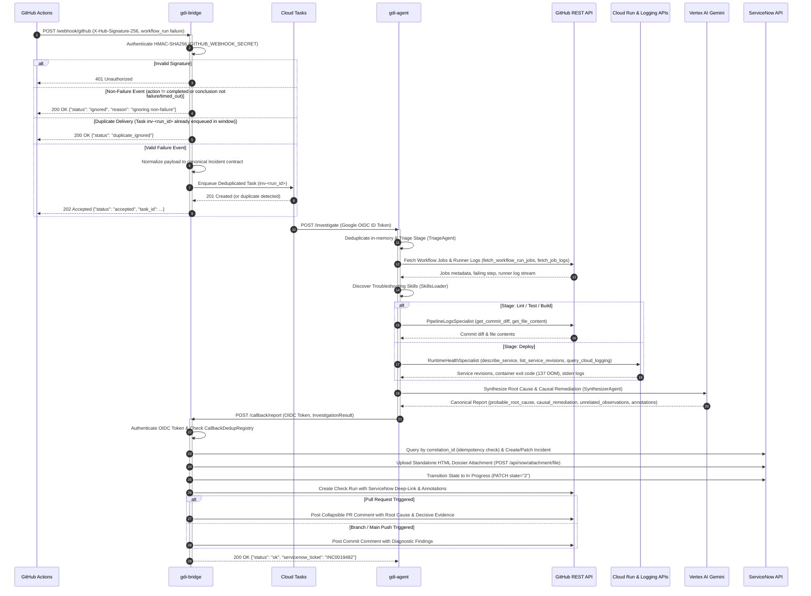

# GitHub Actions Deployment Failure Investigator

[](https://github.com/ssvaidyanathan/autocloud-prototypes/actions/workflows/gha-deploy-investigator-ci.yml)
[](../LICENSE)
[](https://www.python.org/)
[](https://www.terraform.io/)

An autonomous SRE diagnostic platform for continuous integration and delivery. When a GitHub Actions workflow job or run fails, `gha-deploy-investigator` ingests the event via secure webhooks, triages the failed pipeline stage, correlates build logs and runtime telemetry using Vertex AI Gemini reasoning models, opens an enriched ServiceNow incident record, and writes comprehensive diagnostic findings and ticket links directly back to GitHub Check Runs and Pull Requests.

---

## Table of Contents

- [1. System Overview & Problem Statement](#1-system-overview--problem-statement)
- [2. Quick Start](#2-quick-start)
- [3. System Architecture & Request Lifecycle](#3-system-architecture--request-lifecycle)
- [4. Component Breakdown](#4-component-breakdown)
- [5. Configuration](#5-configuration)
- [6. Customizing the Agent with Skills](#6-customizing-the-agent-with-skills)
- [7. Security Model & Production Guardrails](#7-security-model--production-guardrails)
- [8. Prototype Status & Known Limitations](#8-prototype-status--known-limitations)
- [9. Full Step-by-Step GCP Deployment Walkthrough](#9-full-step-by-step-gcp-deployment-walkthrough)
  - [Prerequisites & IAM Requirements](#prerequisites--iam-requirements)
  - [Step 1: Clone Repository and Local Environment Setup](#step-1-clone-repository-and-local-environment-setup)
  - [Step 1b: Configure Terraform State & Backend](#step-1b-configure-terraform-state--backend)
  - [Step 2: Deploy Investigator Agent Infrastructure](#step-2-deploy-investigator-agent-infrastructure)
  - [Step 3: Deploy Ingestion Bridge Infrastructure](#step-3-deploy-ingestion-bridge-infrastructure)
  - [Step 4: Configure GitHub App & ServiceNow Integration](#step-4-configure-github-app--servicenow-integration)
  - [Step 5: Deploy Demo Environment & Workload Identity Federation](#step-5-deploy-demo-environment--workload-identity-federation)
  - [Step 6: End-to-End Verification](#step-6-end-to-end-verification)
- [10. Master Automated Deployment Script](#10-master-automated-deployment-script)
- [11. Terraform Remote State & GCS Backend](#11-terraform-remote-state--gcs-backend)
- [12. Enterprise Organization Policy Considerations](#12-enterprise-organization-policy-considerations)
- [13. Local Development & Quality Gates](#13-local-development--quality-gates)
- [14. Testing Guide & Post-Deploy Smoke Tests](#14-testing-guide--post-deploy-smoke-tests)
- [15. Teardown & Clean Up](#15-teardown--clean-up)
- [16. Repository Layout](#16-repository-layout)

---

## 1. System Overview & Problem Statement

### The Problem
When continuous integration and delivery (CI/CD) pipelines fail, engineers often spend hours performing repetitive manual telemetry triage:
- Digging through thousands of lines of raw runner log streams to locate failing steps and stack traces.
- Correlating ephemeral container build errors, test assertion mismatches, and runtime deployment failures across disconnected tools.
- Manually filing or updating incident tickets in enterprise systems like ServiceNow with relevant error quotes, failing commits, and reproduction contexts.
- Context switching across GitHub, Cloud Run, Cloud Logging, and ticketing dashboards while pull requests and production release trains remain blocked.

### The Solution
`gha-deploy-investigator` automates the entire CI/CD failure diagnostic lifecycle through an asynchronous, decoupled architecture:
1. **Instant Webhook Ingestion & Deduplication**: Receives GitHub Actions `workflow_run` and `workflow_job` completion webhooks with HMAC-SHA256 signature verification and delivery deduplication.
2. **Multi-Stage Diagnostic Coverage**: Triages the failure into one of four core pipeline stages (`lint`, `test`, `build`, `deploy`), assigning specialized diagnostic agents:
   - **Lint / Static Analysis**: Analyzes syntax errors, unused imports, and formatting rule violations (ruff, flake8, black).
   - **Unit / Integration Tests**: Identifies failing test assertions, expected vs. actual values, and stack traces.
   - **Build & Packaging**: Discovers missing build context files, Dockerfile syntax defects, and package installation issues.
   - **Deploy & Runtime**: Inspects Cloud Run deployment failures, startup crashes, and container memory saturation (OOM exit code 137).
3. **Cross-Domain Telemetry Correlation**: Correlates runner logs, commit diffs, and Cloud Run runtime telemetry using Vertex AI Gemini reasoning models (`gemini-2.5-flash`), cleanly segregating decisive causal remediation from incidental warnings.
4. **Reverse ServiceNow Incident Creation**: Opens an enterprise ServiceNow ticket (`POST /api/now/table/incident`) with detailed diagnostic work notes and attaches a full standalone responsive HTML report (`POST /api/now/attachment/file`).
5. **Dual Surface GitHub Write-Back**: Creates or updates a GitHub Check Run linking directly to the ServiceNow ticket, and posts commit comments or collapsible Pull Request comments containing root-cause analysis and copy-paste remediation commands.
6. **Strict Read-Only Guardrails**: 100% of diagnostic tools are decorated with `@readonly_tool` with AST static verification preventing code mutation or unauthorized repository tampering.

---

## 2. Quick Start

### Prerequisites
- **Google Cloud SDK (`gcloud >= 480.0.0`)** installed and authenticated:
  ```bash
  gcloud auth login
  gcloud auth application-default login
  ```
- **Terraform** (`>= 1.5.0`): `terraform version`
- **Docker** daemon active locally OR Google Cloud Build enabled in the target project.
- **Python 3.12+** and `uv` package manager.
- **GitHub CLI (`gh`)** authenticated: `gh auth status`
- **Target GCP Project with Billing Enabled**:
  ```bash
  export PROJECT_ID="<your-target-project-id>"
  export REGION="us-central1"
  export NAME_PREFIX="gdi"
  gcloud config set project "${PROJECT_ID}"
  ```

### Fast Deployment Overview

Deploying `gha-deploy-investigator` follows a staged infrastructure pattern governed by GCP's Cloud Run Secret Dependency Invariant (see [Section 9](#9-full-step-by-step-gcp-deployment-walkthrough) for the complete walkthrough):

```bash
# 1. Clone repository
git clone https://github.com/ssvaidyanathan/autocloud-prototypes
cd autocloud-prototypes/gha-deploy-investigator

# 2. Create local virtual environment and install dependencies
uv venv .venv --python 3.12
source .venv/bin/activate
uv pip install -e "./bridge[dev]" -e "./agent[dev]" -e "./demo[dev]"

# 3. Configure credentials and secrets via helper scripts
# Replicate ServiceNow secrets from existing deployment if available:
./scripts/copy-secrets.sh --project-id "${PROJECT_ID}" --source-prefix isa --target-prefix "${NAME_PREFIX}"

# Upload GitHub App credentials to Secret Manager:
./scripts/upload-github-app-credentials.sh \
  --project-id "${PROJECT_ID}" \
  --app-id "<your-github-app-id>" \
  --private-key-file "/path/to/github-app-private-key.pem" \
  --webhook-secret "<your-github-webhook-secret>" \
  --prefix "${NAME_PREFIX}"
```

### Integration Guides (GitHub App & ServiceNow)

Once deployed, configure the external integration touchpoints:
- **GitHub App Setup**: Configure your personal or organizational GitHub App per [docs/CONFIGURATION.md](docs/CONFIGURATION.md). Subscribe to `workflow_run`, `workflow_job`, and `check_run` events, setting the Webhook URL to `https://${BRIDGE_URL}/webhook/github` with secret matching `${NAME_PREFIX}-github-webhook-secret`.
- **ServiceNow Setup**: Ensure the integration user has the `itil` role and attachment upload permissions. Configure a Business Rule exclusion filter (`correlation_display != "gha-deploy-investigator"`) per [docs/DEPLOY.md](docs/DEPLOY.md) to prevent ticket recursion.

---

## 3. System Architecture & Request Lifecycle

```
┌─────────────────────────────────────────────────────────────────────────────────────────────────┐
│                                       GitHub Platform                                           │
│  - GitHub Actions Workflow Run (lint, test, build, deploy failure)                              │
│  - GitHub Webhook Event (workflow_job.completed / workflow_run.completed)                      │
└───────────────────────────────────────────────┬─────────────────────────────────────────────────┘
                                                │ 1. POST /webhook/github (HMAC SHA-256)
                                                ▼
┌─────────────────────────────────────────────────────────────────────────────────────────────────┐
│ gdi-bridge (Public Ingress Cloud Run Service)                                                   │
│  • Validates X-Hub-Signature-256 using Secret Manager GITHUB_WEBHOOK_SECRET                     │
│  • Deduplicates events using deterministic Cloud Tasks task IDs (HTTP 200 duplicate_ignored)     │
│  • Normalizes GitHub Actions payload into canonical Incident contract                           │
│  • Enqueues asynchronous task to Cloud Tasks queue                                              │
└───────────────────────────────────────────────┬─────────────────────────────────────────────────┘
                                                │ 2. OIDC Authenticated Cloud Tasks Task
                                                ▼
┌─────────────────────────────────────────────────────────────────────────────────────────────────┐
│ gdi-agent (Internal Ingress Cloud Run Service)                                                  │
│  • Dispatcher triages incident & identifies failed pipeline stage (TriageAgent)                 │
│  • Dynamic Skill Discovery loads domain troubleshooting playbooks (SkillsLoader)                │
│  • Diagnostic Specialists inspect telemetry using read-only tools:                              │
│    ├─ PipelineLogsSpecialist: parses GitHub step logs, extracts errors & stack traces           │
│    ├─ RuntimeHealthSpecialist: inspects Cloud Run revisions, OOM exit 137 & container stderr    │
│    └─ IaCConfigSpecialist: analyzes Terraform and build configuration                           │
│  • RootCauseSynthesizer: Vertex AI Gemini reasoning formulates DiagnosticReport                 │
│  • Delivers completed investigation back to Bridge                                              │
└───────────────────────────────────────────────┬─────────────────────────────────────────────────┘
                                                │ 3. POST /callback/report (OIDC Token)
                                                ▼
┌─────────────────────────────────────────────────────────────────────────────────────────────────┐
│ gdi-bridge (Callback Handler & Reverse Write-Back)                                              │
│  • Validates OIDC caller authentication and dedup registry                                      │
│  • ServiceNow Incident Creation (POST /api/now/table/incident) with correlation_id              │
│  • HTML Dossier Attachment (POST /api/now/attachment/file)                                      │
│  • Transitions ServiceNow incident state to In Progress (state="2")                             │
│  • GitHub Check Run Creation (POST /repos/{owner}/{repo}/check-runs) linking to ServiceNow      │
│  • PR / Commit Comment Posting with collapsible root cause & decisive evidence                  │
└───────────────────────────────────────────────┬─────────────────────────────────────────────────┘
                                                │ 4. Deep Links & Ticket Updates
                                                ▼
┌─────────────────────────────────────────────────────────────────────────────────────────────────┐
│ Developer Surfaces: ServiceNow Incident INC0019482 Enriched & GitHub Check Run Linked           │
└─────────────────────────────────────────────────────────────────────────────────────────────────┘
```

### Sequence Flow (Mermaid)



---

## 4. Component Breakdown

### 1. `gdi-bridge` (`bridge/`)
- **Role**: Public-facing integration gateway, webhook receiver, and presentation renderer.
- **Technology**: Python 3.12+, FastAPI, Pydantic v2, Google Cloud Tasks client, Google Secret Manager client, HTTPX.
- **Responsibilities**:
  - Inbound webhook authentication via `X-Hub-Signature-256` HMAC-SHA256 signature verification.
  - Delivery deduplication using deterministic Cloud Tasks task IDs (inv-<run_id>).
  - Payload normalization into byte-identical canonical `Incident` models (`bridge/app/contracts/`).
  - Asynchronous investigation task dispatching to `gdi-tasks-queue` with OIDC service account token impersonation (`gdi-tasks-invoker-sa`).
  - OIDC token authentication and callback handling (`POST /callback/report`).
  - In-memory callback deduplication registry (`CallbackDedupRegistry`).
  - Reverse ServiceNow incident lifecycle: query-before-create idempotency via `correlation_id`, incident creation (`POST /api/now/table/incident`), responsive HTML dossier upload (`POST /api/now/attachment/file`), and transition to `In Progress` (`state="2"`).
  - GitHub write-back: Check Run creation (`POST /repos/{owner}/{repo}/check-runs`) with ServiceNow link and annotations, plus PR/commit comment posting with collapsible diagnostic summaries.

### 2. `gdi-agent` (`agent/`)
- **Role**: Private multi-agent reasoning and diagnostic analysis engine.
- **Technology**: Python 3.12+, FastAPI, Google GenAI ADK, Vertex AI Gemini reasoning, Google Cloud Logging, Google Cloud Run client.
- **Responsibilities**:
  - In-memory deduplication (`InvestigationDeduplicator`) preventing duplicate concurrent runs.
  - Stage triage via `TriageAgent`: inspects workflow jobs and runner logs to classify failure stage (`lint`, `test`, `build`, `deploy`).
  - Dynamic skill discovery via `SkillsLoader`: parses and validates frontmatter runbooks in `agent/skills/`.
  - Specialist investigation:
    - `PipelineLogsSpecialist`: analyzes step logs, commit diffs, and source files for lint, test, and container packaging failures.
    - `RuntimeHealthSpecialist`: queries Cloud Run revision specifications, container lifecycle status, and Cloud Logging streams for deployment crashes and OOM conditions.
    - `IaCConfigSpecialist`: inspects infrastructure definitions and deployment scripts.
  - Read-only tool execution via `@readonly_tool` cached registry (`QueryCache`).
  - Structured synthesis via `SynthesizerAgent`: invokes Vertex AI Gemini (`gemini-2.5-flash`) to generate structured `Report` contracts segregating causal fixes from unrelated warnings.
  - Authenticated callback delivery to `gdi-bridge` (`POST /callback/report`).

### 3. `demo/` Sample Pipeline App & Scenarios (`demo/`)
- **Role**: Customer-grade e-commerce microservice and deterministic failure injection suite.
- **Components**:
  - `demo/sample-pipeline-app/`: Standalone FastAPI microservice with a realistic 4-stage GitHub Actions workflow ([`.github/workflows/pipeline.yml`](demo/sample-pipeline-app/.github/workflows/pipeline.yml)), Dockerfile, unit tests, and Cloud Run deployment scripts.
  - `demo/scenarios/`: Deterministic fault triggers maintained strictly outside the seeded application to prevent evaluation overfitting:
    - `trigger-lint-failure.sh`: Injects unused import (`F401`) and multiple statements (`E702`) into `app/main.py`.
    - `trigger-test-failure.sh`: Injects promotional tier calculation regression into `tests/test_main.py`.
    - `trigger-build-failure.sh`: Injects missing build context asset into `Dockerfile`.
    - `trigger-deploy-failure.sh`: Injects container memory limit exhaustion (OOM exit 137) into `scripts/deploy.sh`.
    - `reset-scenarios.sh`: Idempotently reverts scenario commits and restores working tree cleanliness.
  - `demo/seed-demo-repo.sh`: Automated bootstrap script that seeds the customer repository for live evaluation.
  - `demo/infra/terraform/`: Provisions Workload Identity Federation (WIF) Pool, Provider, Artifact Registry, and least-privilege CI/CD service accounts for keyless GitHub Actions authentication.

---

## 5. Configuration

Configuration is managed strictly through environment variables and Google Secret Manager with **zero hardcoding** in application code:
- **Local Development**: `.env` files or environment variables loaded via `config.py` (`pydantic-settings`).
- **Production**: Terraform variables (`terraform.tfvars`) $\rightarrow$ Cloud Run container environment variables & Secret Manager references $\rightarrow$ `config.py`.

### Key System Settings

#### Bridge Service Settings (`gdi-bridge`)

| Setting | Environment Variable | Default Value | Required | Description |
|---|---|---|---|---|
| **Resource Prefix** | `NAME_PREFIX` | `"gdi"` | No | Prefixes all GCP resources and secrets |
| **GCP Project** | `GCP_PROJECT` | *(ADC / Metadata)* | Yes (in GCP) | Target Google Cloud Platform project ID |
| **GCP Region** | `GCP_REGION` | `"us-central1"` | No | Region for Cloud Run, Cloud Tasks, and Secret Manager |
| **Tasks Queue** | `TASKS_QUEUE` | `"investigations"` | Yes (in GCP) | Cloud Tasks queue name for async dispatch |
| **Invoker SA** | `TASKS_INVOKER_SA` | `""` | Yes (in GCP) | Service account email for Cloud Tasks OIDC invocation of Agent |
| **Agent URL** | `AGENT_SERVICE_URL` | `""` | Yes (in GCP) | Target internal URL of `gdi-agent` Cloud Run service |
| **Callback URL** | `CALLBACK_URL` | `""` | Yes (in GCP) | Public URL where Agent posts completed investigation results |
| **ServiceNow URL** | `SERVICENOW_INSTANCE_URL` | *None* | Yes (in prod) | Base URL of ServiceNow instance (e.g. `https://<your-instance>.service-now.com`) |
| **ServiceNow Caller** | `SERVICENOW_CALLER` | `"admin"` | No | Username/caller assigned to `caller_id` on created incidents |
| **ServiceNow State** | `SERVICENOW_IN_PROGRESS_STATE` | `"2"` | No | State integer assigned to created incidents (`"2"` = In Progress) |
| **Correlation Display** | `SERVICENOW_CORRELATION_DISPLAY` | `"gha-deploy-investigator"` | No | Correlation display tag for bi-directional exclusion filtering |
| **GitHub App ID** | `GITHUB_APP_ID` | *None* | Yes (for App) | Numeric GitHub App ID installed on target repositories |
| **GitHub Write-Back** | `ENABLE_GITHUB_WRITEBACK` | `true` | No | Enables Check Run creation and PR/commit comment posting |
| **GitHub API URL** | `GITHUB_API_URL` | `https://api.github.com` | No | Base URL of the GitHub REST API |

#### Agent Service Settings (`gdi-agent`)

| Setting | Environment Variable | Default Value | Required | Description |
|---|---|---|---|---|
| **Resource Prefix** | `NAME_PREFIX` | `"gdi"` | No | Resource name prefix |
| **GCP Project** | `GCP_PROJECT` | *(ADC / Metadata)* | Yes (in GCP) | Target Google Cloud Platform project ID |
| **Bridge URL** | `BRIDGE_SERVICE_URL` | `""` | Yes (in GCP) | URL of `gdi-bridge` callback endpoint |
| **Gemini Model** | `GEMINI_MODEL` | `gemini-2.5-flash` | No | Vertex AI Gemini model name for diagnostic synthesis |
| **Vertex AI Location** | `VERTEX_AI_LOCATION` | `us-central1` | No | GCP region for Vertex AI Gemini API endpoint |
| **GitHub App ID** | `GITHUB_APP_ID` | *None* | Yes (for App) | Numeric GitHub App ID for authenticated repo API queries |

### Secret Manager Secret Names

Sensitive credentials reside exclusively in Google Secret Manager:

| Stack | Secret Identifier | Consumer | Purpose |
|---|---|---|---|
| **Agent & Bridge** | `${NAME_PREFIX}-github-app-private-key` | `gdi-agent-sa`, `gdi-bridge-sa` | PEM-encoded RSA private key for GitHub App authentication (Agent: repo logs/diffs; Bridge: Check Run & comment write-back) |
| **Bridge** | `${NAME_PREFIX}-github-webhook-secret` | `gdi-bridge-sa` | Shared secret key for verifying inbound `X-Hub-Signature-256` HMAC headers |
| **Bridge** | `${NAME_PREFIX}-servicenow-username` | `gdi-bridge-sa` | Integration user for ServiceNow Table and Attachment REST APIs |
| **Bridge** | `${NAME_PREFIX}-servicenow-password` | `gdi-bridge-sa` | Basic auth password for ServiceNow REST APIs |
| **Bridge** | `${NAME_PREFIX}-servicenow-webhook-token` | `gdi-bridge-sa` | Optional bearer token for verifying inbound ServiceNow webhooks |

For complete variable lists and schema details, see the [Configuration Guide (`docs/CONFIGURATION.md`)](docs/CONFIGURATION.md).

---

## 6. Customizing the Agent with Skills

The diagnostic agent uses an open **Agent Skills** architecture (`agent/skills/`) managed by `SkillsLoader` (`agent/app/skills_loader.py`). Domain knowledge, failure signatures, and remediation playbooks are encapsulated in Markdown skill documents without modifying core agent code.

### Skills Directory Structure & Mapping

Skills are mapped to agent roles in [`agent/skills/skills.yaml`](agent/skills/skills.yaml):

```yaml
# Mapping of agents/specialists to their assigned CI/CD troubleshooting runbook skills
dispatcher:
  - lint-troubleshooting
  - test-failure-triage
  - container-build-troubleshooting
  - cloudrun-deploy-troubleshooting

pipeline_logs:
  - lint-troubleshooting
  - test-failure-triage
  - container-build-troubleshooting

runtime_health:
  - cloudrun-deploy-troubleshooting

iac_config:
  - cloudrun-deploy-troubleshooting
```

### Adding a Pipeline Troubleshooting Skill

To equip the agent with runbook knowledge for a new pipeline failure mode:

1. **Create the Skill Directory**: `agent/skills/<skill-name>/SKILL.md`.
2. **Add YAML Frontmatter & Diagnostic Content**:
   ```markdown
   ---
   name: custom-db-migration-troubleshooting
   description: Diagnostic runbook for database migration and schema deployment failures
   ---

   # Database Migration Troubleshooting Runbook

   ## Diagnostic Workflow
   1. **Identify Migration Tool**: Detect whether Alembic, Flyway, or Liquibase failed.
   2. **Parse Diagnostic Coordinates**: Extract migration revision ID, lock timeout, or SQL syntax error.
   3. **Correlate with Commit Changes**: Check migration files modified in commit diff (`get_commit_diff`).
   4. **Formulate Remediation**: Suggest roll-forward migration scripts or lock clearance commands.
   ```
3. **Register in `skills.yaml`**: Add `- custom-db-migration-troubleshooting` under `pipeline_logs` or `dispatcher`.
4. **Validate**: Run `pytest agent/tests/test_skills_tracking.py` to ensure schema compliance and metadata discovery.

### Architectural Rules & Guardrails
- **No-Scripts Rule**: The skills loader strictly prohibits `scripts/` subdirectories inside skill packages (`ValueError("Security violation: skill ... contains a forbidden 'scripts/' directory")`). Skills contain diagnostic instructions and reference documentation only.
- **De-Overfit Presubmit Guard**: All skills and prompt templates are validated by automated AST guards (`scripts/check-no-demo-overfit.sh`) ensuring skills define general diagnostic patterns rather than hardcoded scenario answers.
- **Read-Only Invariant**: All specialist tools wrap read-only SDK calls decorated with `@readonly_tool`, preventing mutations to client repositories or GCP environments.

---

## 7. Security Model & Production Guardrails

The platform implements zero-trust defense-in-depth across every boundary:

- **Strictly Read-Only IAM Roles**: The runtime service account `gdi-agent-sa` possesses only read-only viewer roles (`roles/logging.viewer`, `roles/run.viewer`) plus `roles/aiplatform.user` for Gemini model invocation. It cannot alter production resources, restart services, or mutate customer repositories.
- **Network Ingress Isolation**: `gdi-agent` is deployed with internal ingress (`INGRESS_TRAFFIC_INTERNAL_ONLY`) and is inaccessible from the public internet. It can only be invoked by Google Cloud Tasks within the same VPC using OIDC authentication.
- **Zero Secrets in Repository or State**: All external tokens, passwords, and private keys reside exclusively in Google Secret Manager. Terraform declares only secret metadata containers.
- **HMAC Webhook Verification**: Inbound webhooks require valid `X-Hub-Signature-256` HMAC signatures calculated with `GITHUB_WEBHOOK_SECRET`. Unsigned or tampered requests are rejected with HTTP 401.
- **Delivery Deduplication**: Deterministic task naming (`inv-<run_id>`) in Cloud Tasks and `CallbackDedupRegistry` in Bridge prevent duplicate runs or concurrent LLM execution.
- **Keyless GitHub Actions Authentication**: The demo pipeline uses Workload Identity Federation (WIF) scoped strictly to `assertion.repository == '${GITHUB_OWNER}/${DEMO_REPO_NAME}' && assertion.ref == 'refs/heads/main'`, eliminating long-lived service account keys.
- **Bi-Directional ServiceNow Loop Exclusion**: All created incidents carry `correlation_display = "gha-deploy-investigator"` and `correlation_id = "gdi:<owner>/<repo>:<run_id>:<run_attempt>"`. Outbound ServiceNow business rules filter on this tag to prevent recursive webhook triggering.
- **AST Static Guardrails**: `scripts/check-no-rootcause-overrides.py` enforces AST invariants guaranteeing post-LLM logic cannot overwrite root-cause findings or synthesize ungrounded explanations.

---

## 8. Prototype Status & Known Limitations

The prototype has been validated through unassisted live evaluation against Google Cloud Platform and ServiceNow.

### Live Scenario Scorecard Summary

| Scenario | Stage | Failing Trigger | Operational Result | Diagnostic Grounding |
|---|---|---|:---:|---|
| **Baseline Failure (Deploy)** | `deploy` | Unconfigured Runtime SA | **PASS** | Identified missing `iam.serviceaccounts.actAs` permission on compute service account during Cloud Run deployment. |
| **Scenario 1: Lint** | `lint` | Ruff style violation | **PASS** | Pinpointed unused import (`F401` `math`) and multiple statements on a single line (`E702`) in `app/main.py` with verbatim line numbers. |
| **Scenario 2: Test** | `test` | Pytest assertion mismatch | **PASS** | Identified assertion failure (`assert 75.5 == 100.0`) in `tests/test_main.py::test_customer_tier_discount_calculation` with expected vs. actual values. |
| **Scenario 3: Build** | `build` | Missing Dockerfile context asset | **PASS** | Diagnosed missing `config/cache-warmup.json` required by `COPY` instruction in `Dockerfile` line 33. |
| **Scenario 4: Deploy** | `deploy` | Container startup OOM crash | **PASS** | Diagnosed container memory saturation (exit code 137 / signal 9) caused by `MEMORY=256Mi` and `CACHE_PREWARM_BUFFER_MB=2048` in `scripts/deploy.sh`. |
| **Unplanned Revert Failure** | `deploy` | Persisted env var memory leak | **PASS (Remediated)** | Diagnosed non-declarative deployment script omitting `--clear-env-vars`; resolved by enforcing declarative deployments across Cloud Run revisions. |

### Known Limitations & Operational Considerations

1. **GitHub App Authentication Requirement**: Creating GitHub Check Runs requires a GitHub App with `checks: write` permissions and an RSA private key. Fallback personal access tokens can only create commit or PR comments.
2. **Cloud Logging Ingestion Latency**: Container stderr/stdout logs in Cloud Run take 5–15 seconds to appear in Cloud Logging. The agent queries telemetry within a temporal window (±15 minutes) around the workflow failure timestamp.
3. **Declarative Cloud Run Deployment Invariant**: Google Cloud Run retains environment variables across revisions by default unless explicitly cleared. Deployment scripts must pass `--clear-env-vars` when deploying without overrides to prevent stale configuration bleed.
4. **ServiceNow Role Requirements**: The integration user configured in `SERVICENOW_USERNAME` must possess `itil` table permissions and attachment upload permissions (`soap_ecc` or equivalent).
5. **Single Execution Scope**: The prototype evaluates individual workflow run failures; cross-run flaky test clustering and global repository trend analysis are queued for future releases.

---

## 9. Full Step-by-Step GCP Deployment Walkthrough

### Prerequisites & IAM Requirements

Before deploying, ensure you have:
1. **Google Cloud SDK (`gcloud`)** installed and authenticated:
   ```bash
   gcloud auth login
   gcloud auth application-default login
   ```
2. **Terraform** (`>= 1.5.0`): `terraform version`
3. **Container Builder**: Docker daemon running locally OR Cloud Build enabled.
4. **Python & Package Manager**: Python 3.12+ and `uv`.
5. **GCP Project with Billing Enabled**:
   ```bash
   export PROJECT_ID="<your-target-project-id>"
   export PROJECT_NUMBER="$(gcloud projects describe ${PROJECT_ID} --format='value(projectNumber)')"
   export REGION="us-central1"
   export NAME_PREFIX="gdi"
   export GITHUB_OWNER="<your-github-user-or-org>"
   export DEMO_REPO_NAME="gdi-sample-pipeline-app"
   gcloud config set project "${PROJECT_ID}"
   ```
6. **Deployer IAM Roles**:
   Your deploying identity requires the following least-privilege roles derived from the Terraform manifests:
   - `roles/iam.workloadIdentityPoolAdmin`
   - `roles/artifactregistry.admin`
   - `roles/run.admin`
   - `roles/iam.serviceAccountAdmin`
   - `roles/iam.serviceAccountUser`
   - `roles/secretmanager.admin`
   - `roles/cloudtasks.admin`
   - `roles/resourcemanager.projectIamAdmin`
   - `roles/cloudbuild.builds.editor`
   - `roles/serviceusage.serviceUsageAdmin`

7. **Enable Required Google Cloud APIs**:
   ```bash
   gcloud services enable \
       run.googleapis.com \
       secretmanager.googleapis.com \
       cloudtasks.googleapis.com \
       artifactregistry.googleapis.com \
       iam.googleapis.com \
       iamcredentials.googleapis.com \
       sts.googleapis.com \
       aiplatform.googleapis.com \
       logging.googleapis.com \
       cloudresourcemanager.googleapis.com \
       cloudbuild.googleapis.com \
       --project="${PROJECT_ID}"
   ```

---

### Step 1: Clone Repository and Local Environment Setup

```bash
git clone https://github.com/ssvaidyanathan/autocloud-prototypes
cd autocloud-prototypes/gha-deploy-investigator

# Set up Python virtual environment
uv venv .venv --python 3.12
source .venv/bin/activate
uv pip install -e "./bridge[dev]" -e "./agent[dev]" -e "./demo[dev]" pytest ruff
```

---

### Step 1b: Configure Terraform State & Backend

By default, the prototype stacks (`agent/infra/terraform`, `bridge/infra/terraform`, and `demo/infra/terraform`) manage state locally for self-contained prototyping. If deploying in a team or CI/CD environment, configure a remote GCS backend as detailed in [Section 11](#11-terraform-remote-state--gcs-backend).

---

### Step 2: Deploy Investigator Agent Infrastructure

The agent infrastructure must be deployed first so its outputs (`agent_url`, `agent_service_account_email`, and `tasks_invoker_service_account_email`) can be supplied to the bridge stack.

> [!IMPORTANT]
> **Strict 3-Stage Deployment Sequencing**: In Cloud Run, services referencing Secret Manager secrets fail to deploy if the secret container has zero enabled versions. Deploy in sequence: Stage A (Secret Containers & SAs) $\rightarrow$ Stage B (Secret Values) $\rightarrow$ Stage C (Build Images) $\rightarrow$ Stage D (Cloud Run Services).

#### 2.1 Provision Agent Secret Container & IAM via Terraform
```bash
cd agent/infra/terraform
terraform init

terraform apply \
    -var="project_id=${PROJECT_ID}" \
    -var="region=${REGION}" \
    -var="name_prefix=${NAME_PREFIX}" \
    -target=google_secret_manager_secret.github_app_private_key \
    -target=google_service_account.agent_sa \
    -target=google_service_account.tasks_invoker_sa \
    -target=google_secret_manager_secret_iam_member.agent_gh_key_access \
    -target=google_project_iam_member.agent_vertex_ai \
    -target=google_project_iam_member.agent_logging_viewer \
    -target=google_project_iam_member.agent_cloud_run_viewer
cd ../../..
```

#### 2.2 Populate GitHub App Private Key in Secret Manager
```bash
gcloud secrets versions add "${NAME_PREFIX}-github-app-private-key" \
    --data-file="/path/to/github-app-private-key.pem" \
    --project="${PROJECT_ID}"
```

#### 2.3 Build and Push Agent Container Image
```bash
# Create shared containers repository if not already created
gcloud artifacts repositories create "${NAME_PREFIX}-containers" \
    --repository-format=docker \
    --location="${REGION}" \
    --project="${PROJECT_ID}" || true

gcloud builds submit agent \
    --tag="${REGION}-docker.pkg.dev/${PROJECT_ID}/${NAME_PREFIX}-containers/${NAME_PREFIX}-agent:latest" \
    --project="${PROJECT_ID}"
```

#### 2.4 Deploy Agent Cloud Run Service
```bash
cd agent/infra/terraform
terraform apply \
    -var="project_id=${PROJECT_ID}" \
    -var="region=${REGION}" \
    -var="name_prefix=${NAME_PREFIX}" \
    -var="repository_id=${NAME_PREFIX}-containers" \
    -var="github_app_id=<your-github-app-id>"
```

#### 2.5 Capture Agent Terraform Outputs
```bash
AGENT_URL=$(terraform output -raw agent_url)
AGENT_SA=$(terraform output -raw agent_service_account_email)
TASKS_INVOKER_SA=$(terraform output -raw tasks_invoker_service_account_email)

echo "Agent URL:        ${AGENT_URL}"
echo "Agent SA:         ${AGENT_SA}"
echo "Tasks Invoker SA: ${TASKS_INVOKER_SA}"
cd ../../..
```

---

### Step 3: Deploy Ingestion Bridge Infrastructure

#### 3.1 Provision Bridge Secret Containers, IAM & Tasks Queue
```bash
cd bridge/infra/terraform
terraform init

terraform apply \
    -var="project_id=${PROJECT_ID}" \
    -var="region=${REGION}" \
    -var="name_prefix=${NAME_PREFIX}" \
    -target=google_secret_manager_secret.github_webhook_secret \
    -target=google_secret_manager_secret.servicenow_username \
    -target=google_secret_manager_secret.servicenow_password \
    -target=google_secret_manager_secret.servicenow_webhook_token \
    -target=google_service_account.bridge_sa \
    -target=google_cloud_tasks_queue.tasks_queue \
    -target=google_cloud_tasks_queue_iam_member.bridge_task_enqueuer \
    -target=google_secret_manager_secret_iam_member.bridge_gh_secret_access \
    -target=google_secret_manager_secret_iam_member.bridge_snow_username_access \
    -target=google_secret_manager_secret_iam_member.bridge_snow_pwd_access \
    -target=google_secret_manager_secret_iam_member.bridge_snow_token_access \
    -target=google_secret_manager_secret_iam_member.bridge_gh_key_access
cd ../../..
```

#### 3.2 Populate Bridge Secrets in Secret Manager
```bash
# Populate webhook secret
gcloud secrets versions add "${NAME_PREFIX}-github-webhook-secret" \
    --data-file=<(printf "%s" "<your-github-webhook-secret>") \
    --project="${PROJECT_ID}"

# Populate ServiceNow credentials (or use ./scripts/copy-secrets.sh)
gcloud secrets versions add "${NAME_PREFIX}-servicenow-username" \
    --data-file=<(printf "%s" "<your-servicenow-username>") \
    --project="${PROJECT_ID}"

gcloud secrets versions add "${NAME_PREFIX}-servicenow-password" \
    --data-file=<(printf "%s" "<your-servicenow-password>") \
    --project="${PROJECT_ID}"

gcloud secrets versions add "${NAME_PREFIX}-servicenow-webhook-token" \
    --data-file=<(printf "%s" "<your-servicenow-token>") \
    --project="${PROJECT_ID}"
```

#### 3.3 Build and Push Bridge Container Image
```bash
gcloud builds submit bridge \
    --tag="${REGION}-docker.pkg.dev/${PROJECT_ID}/${NAME_PREFIX}-containers/${NAME_PREFIX}-bridge:latest" \
    --project="${PROJECT_ID}"
```

#### 3.4 Deploy Bridge Cloud Run Service
```bash
cd bridge/infra/terraform
terraform apply \
    -var="project_id=${PROJECT_ID}" \
    -var="region=${REGION}" \
    -var="name_prefix=${NAME_PREFIX}" \
    -var="repository_id=${NAME_PREFIX}-containers" \
    -var="agent_service_url=${AGENT_URL}" \
    -var="agent_service_account_email=${AGENT_SA}" \
    -var="tasks_invoker_service_account_email=${TASKS_INVOKER_SA}" \
    -var="github_app_id=<your-github-app-id>" \
    -var="servicenow_instance_url=https://<your-instance>.service-now.com"
```

#### 3.5 Capture Bridge Terraform Outputs
```bash
BRIDGE_URL=$(terraform output -raw bridge_url)
BRIDGE_SA=$(terraform output -raw bridge_service_account_email)
TASKS_QUEUE_NAME=$(terraform output -raw tasks_queue_name)

echo "Bridge URL:       ${BRIDGE_URL}"
echo "Bridge SA:        ${BRIDGE_SA}"
echo "Tasks Queue:      ${TASKS_QUEUE_NAME}"
cd ../../..
```

---

### Step 4: Configure GitHub App & ServiceNow Integration

#### 4.1 Configure GitHub App Webhook Settings
1. Open your GitHub App settings in Developer Settings.
2. Set **Webhook URL** to:
   ```
   ${BRIDGE_URL}/webhook/github
   ```
3. Set **Webhook Secret** to the secret string populated into `${NAME_PREFIX}-github-webhook-secret`.
4. Ensure the following permissions are granted:
   - **Repository Permissions**:
     - `Actions`: Read-only
     - `Checks`: Read & write
     - `Pull requests`: Read & write
     - `Contents`: Read-only
5. Ensure the following event subscriptions are checked:
   - `workflow_run`
   - `workflow_job`
   - `check_run`
6. Install the GitHub App on your target customer repository (`${GITHUB_OWNER}/${DEMO_REPO_NAME}`).

#### 4.2 Configure ServiceNow Bi-Directional Exclusion Filter
In your ServiceNow instance, configure an outbound business rule or webhook filter condition:
```
Correlation display [IS NOT] gha-deploy-investigator
AND
Correlation ID [DOES NOT START WITH] gdi:
```
This ensures incidents created by `gha-deploy-investigator` do not trigger external SRE monitoring loops.

---

### Step 5: Deploy Demo Environment & Workload Identity Federation

#### 5.1 Provision Demo WIF Stack via Terraform
```bash
cd demo/infra/terraform
terraform init
terraform apply \
    -var="project_id=${PROJECT_ID}" \
    -var="region=${REGION}" \
    -var="name_prefix=${NAME_PREFIX}"

WIF_PROVIDER=$(terraform output -raw wif_provider_name)
DEPLOYER_SA=$(terraform output -raw service_account_email)
APP_SA=$(terraform output -raw app_service_account_email)
DEMO_GAR=$(terraform output -raw artifact_registry_repo)
cd ../../..
```

#### 5.2 Configure GitHub Repository Secrets
On the demo GitHub repository (`${GITHUB_OWNER}/${DEMO_REPO_NAME}`), configure the 6 required repository secrets:
```bash
gh secret set GCP_PROJECT_ID --body "${PROJECT_ID}" --repo "${GITHUB_OWNER}/${DEMO_REPO_NAME}"
gh secret set GCP_WIF_PROVIDER --body "${WIF_PROVIDER}" --repo "${GITHUB_OWNER}/${DEMO_REPO_NAME}"
gh secret set GCP_SA_EMAIL --body "${DEPLOYER_SA}" --repo "${GITHUB_OWNER}/${DEMO_REPO_NAME}"
gh secret set GCP_APP_SA_EMAIL --body "${APP_SA}" --repo "${GITHUB_OWNER}/${DEMO_REPO_NAME}"
gh secret set GAR_REPOSITORY --body "${DEMO_GAR}" --repo "${GITHUB_OWNER}/${DEMO_REPO_NAME}"
gh secret set GAR_LOCATION --body "${REGION}-docker.pkg.dev" --repo "${GITHUB_OWNER}/${DEMO_REPO_NAME}"
```

#### 5.3 Verify Pipeline Event Gating
Notice that `.github/workflows/pipeline.yml` in the demo application gates GCP deployment to:
```yaml
if: github.event_name == 'push' && github.ref == 'refs/heads/main'
```
This ensures PR builds run tests and local container builds without failing on WIF token exchange.

---

### Step 6: End-to-End Verification

Verify service health, authentication rejection, and signed webhook ping:

```bash
# 1. Health check probe
curl -s -f "${BRIDGE_URL}/health"
# Expected response: {"status":"healthy","service":"gdi-bridge"}

# 2. Unauthenticated webhook rejection (HMAC SHA-256 validation)
curl -i -X POST "${BRIDGE_URL}/webhook/github" \
    -H "Content-Type: application/json" \
    -H "X-GitHub-Event: ping" \
    -d '{"zen": "Mind your posture."}'
# Expected response: HTTP/2 401 Unauthorized

# 3. Signed ping check (GitHub App ping event)
# In GitHub App settings, click "Redeliver" on the ping event.
# Expected response: HTTP/2 200 OK {"status":"pong","message":"GitHub webhook ping received successfully"}
```

---

## 10. Master Automated Deployment Script

Unlike systems that use a single monolithic deployment script, `gha-deploy-investigator` employs a **modular staged deployment architecture** designed to respect Google Cloud Platform's Cloud Run Secret Dependency Invariant:

```
Stage A: Provision Secret Containers & SAs (Terraform)
  ↓
Stage B: Populate Secret Values (gcloud / scripts)
  ↓
Stage C: Build Container Images (Cloud Build)
  ↓
Stage D: Deploy Cloud Run Services (Terraform)
  ↓
Stage E: Provision Demo WIF & Repository Secrets (Terraform & gh)
```

To streamline this workflow, dedicated automation tooling is provided under `scripts/`:

### 1. `scripts/copy-secrets.sh`
Replicates shared ServiceNow credentials from existing deployment secrets (e.g. `isa` prefix) to `gdi` secrets without exposing passwords on stdout or committing to version control:
```bash
./scripts/copy-secrets.sh \
  --project-id "${PROJECT_ID}" \
  --source-prefix "isa" \
  --target-prefix "${NAME_PREFIX}"
```

### 2. `scripts/upload-github-app-credentials.sh`
Uploads the GitHub App RSA private key and webhook secret into Secret Manager and configures Terraform variables:
```bash
./scripts/upload-github-app-credentials.sh \
  --project-id "${PROJECT_ID}" \
  --app-id "<your-github-app-id>" \
  --private-key-file "/path/to/private-key.pem" \
  --webhook-secret "<your-webhook-secret>" \
  --prefix "${NAME_PREFIX}"
```

### 3. `demo/seed-demo-repo.sh`
Bootstraps and seeds a standalone customer demo repository (`gdi-sample-pipeline-app`) with a pristine multi-stage CI/CD pipeline without leaking evaluation triggers:
```bash
./demo/seed-demo-repo.sh /tmp/gdi-sample-pipeline-app
```

---

## 11. Terraform Remote State & GCS Backend

The Terraform stacks in `gha-deploy-investigator` (`agent/infra/terraform`, `bridge/infra/terraform`, `demo/infra/terraform`) default to standard local state for rapid prototyping.

To configure remote state in an enterprise Google Cloud environment:

### 1. Bootstrap GCS State Bucket
```bash
gcloud storage buckets create "gs://${PROJECT_ID}-${NAME_PREFIX}-tfstate" \
    --project="${PROJECT_ID}" \
    --location="${REGION}" \
    --uniform-bucket-level-access
gcloud storage buckets update "gs://${PROJECT_ID}-${NAME_PREFIX}-tfstate" --versioning
```

### 2. Configure Backend Configuration Files
Add a `backend "gcs" {}` block to each stack's `versions.tf` and supply `backend.hcl`:
```hcl
bucket = "<your-project-id>-gdi-tfstate"
prefix = "gdi/agent"
```

Initialize with partial configuration:
```bash
terraform -chdir=agent/infra/terraform init -backend-config=backend.hcl
terraform -chdir=bridge/infra/terraform init -backend-config=backend.hcl
terraform -chdir=demo/infra/terraform init -backend-config=backend.hcl
```

### 3. CI Quality Gate Compatibility
Pre-deployment quality gates and CI pipelines run:
```bash
terraform init -backend=false && terraform validate
```
This validates syntax and configuration without requiring remote storage credentials.

---

## 12. Enterprise Organization Policy Considerations

In enterprise GCP environments, Organization Policies may enforce strict constraints:

1. **Domain Restricted Sharing (`constraints/iam.allowedPolicyMemberDomains`)**:
   - May prevent binding `allUsers` on `gdi-bridge` for public webhook ingress.
   - *Remediation*: Request a project-level policy exemption OR deploy an External Application Load Balancer with Cloud Armor and set Cloud Run ingress to `internal-and-cloud-load-balancing`.
2. **Ingress Controls**:
   - `gdi-bridge`: Requires `all` (or `internal-and-cloud-load-balancing` behind Cloud Load Balancing).
   - `gdi-agent`: Requires `internal` (`INGRESS_TRAFFIC_INTERNAL_ONLY`), accessible exclusively by Cloud Tasks within the project VPC.
3. **Workload Identity Federation Restrictions (`constraints/iam.workloadIdentityPoolProviders`)**:
   - Ensure `https://token.actions.githubusercontent.com` is permitted as an allowed OIDC provider for keyless GitHub Actions authentication.
4. **Service Account Key Creation (`constraints/iam.disableServiceAccountKeyCreation`)**:
   - The platform strictly complies with zero-key policies: no service account JSON keys are created or used in production.

---

## 13. Local Development & Quality Gates

The repository enforces strict verification standards. All checks must pass cleanly:

```bash
# 1. Byte-identical contract verification between Bridge and Agent
bash scripts/check-contracts.sh

# 2. AST static guard against post-LLM root cause template overrides
python3 scripts/check-no-rootcause-overrides.py

# 3. Anti-tamper de-overfitting guard across agent source and skills
bash scripts/check-no-demo-overfit.sh

# 4. Forbidden literal scanner & markdown relative link checker
bash scripts/check-no-literal-projects.sh

# 5. Automated test suite (unit and component tests across all modules)
pytest bridge/tests agent/tests demo/tests

# 6. Linting checks
ruff check bridge agent demo

# 7. Terraform formatting and validation across stacks
for stack in agent/infra/terraform bridge/infra/terraform demo/infra/terraform; do
  (cd "$stack" && terraform fmt -check && terraform init -backend=false && terraform validate)
done
```

### Offline Multi-Service Simulation
Unit and component tests execute 100% offline without external network or cloud dependencies. Tests in `bridge/tests/` and `agent/tests/` utilize local mock servers:
- `fake_github_server.py`: Simulates GitHub Actions jobs, runner log streams, check runs, and issue comments.
- `fake_ticket_server.py`: Simulates ServiceNow Table and Attachment REST APIs.

---

## 14. Testing Guide & Post-Deploy Smoke Tests

The project uses a 4-layer testing approach:

1. **Layer 1: Offline Unit & Component Tests**:
   - Runs fast, hermetic pytest suites in `bridge/tests`, `agent/tests`, and `demo/tests`.
2. **Layer 2: Static Presubmit Guards**:
   - Presubmit scripts in `scripts/` verifying AST invariants, contract byte-level equality, and zero forbidden literals.
3. **Layer 3: Post-Deploy Smoke Probes**:
   - Verifies the deployed Cloud Run service endpoints:
     ```bash
     # Verify bridge health
     curl -s -f "${BRIDGE_URL}/health" | jq .

     # Verify HMAC authentication rejection
     curl -i -X POST "${BRIDGE_URL}/webhook/github" -H "X-GitHub-Event: ping"
     ```
4. **Layer 4: Multi-Stage Failure Simulation**:
   - The repository includes 4 failure scenarios in `demo/scenarios/` with a deterministic execution cycle:
     ```bash
     # 1. Trigger Scenario 1 (Lint failure)
     ./demo/scenarios/trigger-lint-failure.sh demo/sample-pipeline-app --commit

     # 2. Trigger Scenario 2 (Unit test failure)
     ./demo/scenarios/trigger-test-failure.sh demo/sample-pipeline-app --commit

     # 3. Trigger Scenario 3 (Build failure)
     ./demo/scenarios/trigger-build-failure.sh demo/sample-pipeline-app --commit

     # 4. Trigger Scenario 4 (Deploy OOM crash)
     ./demo/scenarios/trigger-deploy-failure.sh demo/sample-pipeline-app --commit

     # 5. Reset target repository
     ./demo/scenarios/reset-scenarios.sh demo/sample-pipeline-app --commit
     ```

For detailed execution runbooks and observation checkpoints, see [demo/DEMO-RUNBOOK.md](demo/DEMO-RUNBOOK.md) and [demo/SCENARIOS.md](demo/SCENARIOS.md).

---

## 15. Teardown & Clean Up

To avoid ongoing GCP charges, review execution plans and destroy resources in reverse dependency order:

```bash
# 1. Teardown Demo WIF Stack
cd demo/infra/terraform
terraform destroy \
    -var="project_id=${PROJECT_ID}" \
    -var="region=${REGION}" \
    -var="name_prefix=${NAME_PREFIX}"
cd ../../..

# 2. Teardown Bridge Stack
cd bridge/infra/terraform
terraform destroy \
    -var="project_id=${PROJECT_ID}" \
    -var="region=${REGION}" \
    -var="name_prefix=${NAME_PREFIX}" \
    -var="repository_id=${NAME_PREFIX}-containers" \
    -var="agent_service_url=${AGENT_URL}" \
    -var="agent_service_account_email=${AGENT_SA}" \
    -var="tasks_invoker_service_account_email=${TASKS_INVOKER_SA}" \
    -var="github_app_id=<your-github-app-id>" \
    -var="servicenow_instance_url=https://<your-instance>.service-now.com"
cd ../../..

# 3. Teardown Agent Stack
cd agent/infra/terraform
terraform destroy \
    -var="project_id=${PROJECT_ID}" \
    -var="region=${REGION}" \
    -var="name_prefix=${NAME_PREFIX}" \
    -var="repository_id=${NAME_PREFIX}-containers" \
    -var="github_app_id=<your-github-app-id>"
cd ../../..

# 4. Remove Artifact Registry Docker Repositories
gcloud artifacts repositories delete "${NAME_PREFIX}-containers" --location="${REGION}" --project="${PROJECT_ID}" --quiet || true
gcloud artifacts repositories delete "${NAME_PREFIX}-demo-app" --location="${REGION}" --project="${PROJECT_ID}" --quiet || true

# 5. Remove Secret Manager Secrets
for secret in github-app-private-key github-webhook-secret servicenow-username servicenow-password servicenow-webhook-token; do
    gcloud secrets delete "${NAME_PREFIX}-${secret}" --project="${PROJECT_ID}" --quiet || true
done
```

---

## 16. Repository Layout

```
gha-deploy-investigator/
├── agent/                         # Autonomous multi-agent diagnostic engine
│   ├── app/                       # Dispatcher, triage, specialists, tools, synthesizer
│   │   ├── github/                # GitHub API authentication and client helpers
│   │   ├── specialists/           # Pipeline logs, runtime health, and IaC specialists
│   │   ├── tools/                 # Read-only GitHub and Cloud Run diagnostic tools
│   │   ├── contracts/             # Data transfer models (byte-identical with bridge)
│   │   ├── dispatcher.py          # Investigation orchestration & callback delivery
│   │   ├── skills_loader.py       # Dynamic skill discovery and runbook loader
│   │   ├── synthesizer.py         # Vertex AI Gemini root cause reasoning
│   │   └── triage.py              # Pipeline stage classifier & planner
│   ├── infra/terraform/           # Agent GCP Cloud Run & IAM infrastructure
│   ├── skills/                    # Diagnostic runbooks & troubleshooting skills
│   │   ├── skills.yaml            # Mapping of specialists to runbooks
│   │   ├── cloudrun-deploy-troubleshooting/
│   │   ├── container-build-troubleshooting/
│   │   ├── lint-troubleshooting/
│   │   └── test-failure-triage/
│   ├── tests/                     # 100% offline agent unit and component tests
│   ├── Dockerfile                 # Multi-stage production container build
│   └── pyproject.toml             # Agent dependencies and dev packages
├── bridge/                        # Ingestion gateway, Cloud Tasks dispatcher & write-back
│   ├── app/                       # FastAPI webhook service, adapters, templates
│   │   ├── adapters/              # GitHub Actions and ServiceNow Table/Attachment adapters
│   │   ├── core/                  # Webhook auth, delivery deduplication, Cloud Tasks
│   │   ├── contracts/             # Data transfer models (byte-identical with agent)
│   │   └── templates/             # Responsive HTML dossier & ServiceNow work notes renderer
│   ├── infra/terraform/           # Bridge Cloud Run, Cloud Tasks queue & IAM infrastructure
│   ├── tests/                     # 100% offline bridge unit and component tests
│   ├── Dockerfile                 # Multi-stage production container build
│   └── pyproject.toml             # Bridge dependencies and dev packages
├── demo/                          # Realistic sample pipeline app & scenario injection tooling
│   ├── sample-pipeline-app/       # Standalone customer FastAPI service with 4-stage CI/CD
│   ├── scenarios/                 # Deterministic failure triggers (lint, test, build, deploy)
│   ├── infra/terraform/           # Workload Identity Federation (WIF) & demo Artifact Registry
│   ├── DEMO-RUNBOOK.md            # Interactive walkthrough for observing investigations
│   ├── SCENARIOS.md               # Failure scenario specifications & invariants
│   └── seed-demo-repo.sh          # Seeder script for standalone customer repository
├── docs/                          # In-depth architectural & operational documentation
│   ├── ARCHITECTURE.md            # System architecture, contract models & isolation
│   ├── CONFIGURATION.md           # Complete environment variable & secret reference
│   └── DEPLOY.md                  # Comprehensive end-to-end GCP deployment guide
├── scripts/                       # Quality gates & deployment automation tooling
│   ├── check-contracts.sh         # Byte-identical contract validator
│   ├── check-markdown-links.py    # Relative markdown link resolver
│   ├── check-no-demo-overfit.sh   # Anti-tamper de-overfitting guard
│   ├── check-no-literal-projects.sh # Forbidden literal & un-externalized model scanner
│   ├── check-no-rootcause-overrides.py # AST guard against post-LLM template overrides
│   ├── copy-secrets.sh            # Secret replication helper from existing deployments
│   └── upload-github-app-credentials.sh # GitHub App credentials uploader
├── pytest.ini                     # Offline pytest test suite configuration
├── ruff.toml                      # Linter & formatter configuration
└── README.md                      # Primary project documentation
```

### In-Depth Documentation Links

- [Architecture Deep Dive (`docs/ARCHITECTURE.md`)](docs/ARCHITECTURE.md)
- [Configuration Reference (`docs/CONFIGURATION.md`)](docs/CONFIGURATION.md)
- [Deployment Guide (`docs/DEPLOY.md`)](docs/DEPLOY.md)
- [Interactive Demo Runbook (`demo/DEMO-RUNBOOK.md`)](demo/DEMO-RUNBOOK.md)
- [Pipeline Failure Scenarios (`demo/SCENARIOS.md`)](demo/SCENARIOS.md)
- [Sample Pipeline Application (`demo/sample-pipeline-app/README.md`)](demo/sample-pipeline-app/README.md)
