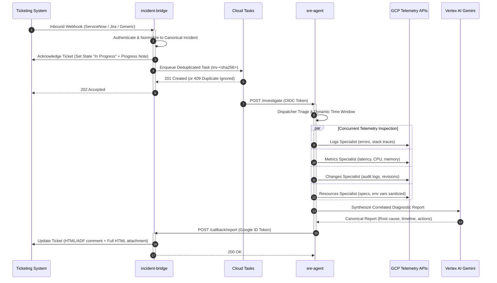

# Incident SRE Agent (Dev In A Box) for Google Cloud Platform

[](https://github.com/ssvaidyanathan/autocloud-prototypes/actions/workflows/incident-sre-agent-dev-in-a-box-ci.yml)
[](../LICENSE)
[](https://www.python.org/)
[](https://www.terraform.io/)

An autonomous, read-only Site Reliability Engineering (SRE) investigation platform for Google Cloud Platform. When an incident ticket is filed in ServiceNow, Jira Cloud, or via an alert webhook, the Incident SRE Agent autonomously correlates multi-dimensional GCP telemetry across Cloud Logging, Cloud Monitoring, Cloud Audit Logs, and Cloud Asset state, diagnoses root causes using Vertex AI Gemini reasoning models, and delivers an executive dossier with full diagnostic evidence back to the incident ticket within minutes.

---

## Dev In A Box: Overview & Architecture

### What is "Dev In A Box"?
`incident-sre-agent-dev-in-a-box/` is a dedicated, self-contained development, prototyping, and testing environment for the Incident SRE Agent suite. It provides a complete, isolated sandbox for developing, validating, and demonstrating advanced Human-In-The-Loop (HITL) incident response capabilities, interactive chat interfaces, and external context integrations.

### Rationale: Why a Copy of `incident-sre-agent/`?
The upstream `incident-sre-agent/` directory houses the stable, standalone autonomous investigation engine. To introduce rapid architectural enhancements—such as interactive HITL gates, Jira ADF template formatting, automatic RCA callbacks, and FastMCP deployment context lookup—without risking regression or disruption to the baseline prototype, this independent copy was created.
- **Isolation:** Changes in `incident-sre-agent-dev-in-a-box/` never destabilize the original `incident-sre-agent/` prototype.
- **Zero Impact on Upstream:** The original `incident-sre-agent/` directory remains 100% untouched with 0 diff against upstream `origin/main`.
- **Comprehensive Sandbox:** Contains its own complete copy of the agent reasoning engine, webhook bridge, demo microservices, documentation, and dedicated CI workflow.

### Folder Layout & Subsystems
The Dev In A Box tree contains the following components:
```text
incident-sre-agent-dev-in-a-box/
├── agent/                         # Multi-agent SRE reasoning engine (DIB SRE agent)
│   ├── app/                       # Dispatcher, sub-agents, tools, synthesizer
│   ├── infra/terraform/           # Agent GCP Cloud Run & IAM infrastructure
│   └── tests/                     # Agent unit and component tests
├── bridge/                        # Incident ingestion bridge & HITL endpoints
│   ├── app/                       # FastAPI bridge, Jira/ServiceNow adapters, templates
│   ├── HITL_ENDPOINTS.md          # HITL bridge endpoint reference & integration guide
│   ├── infra/terraform/           # Bridge GCP Cloud Run & IAM infrastructure
│   └── tests/                     # Bridge unit and integration tests
├── mcp-deploy-context-stub/       # FastMCP Deployment Context Stub server (PR 2)
│   ├── CONTRACT.md                # Protocol specification and JSON schemas
│   ├── app/                       # Streamable HTTP MCP server, indexer, auth
│   ├── fixtures/                  # Sanitized synthetic deployment fixtures
│   └── infra/terraform/           # Cloud Run deployment module
├── hitl-chatbot/                  # Interactive HITL Chatbot (PR 4 & PR 5)
│   ├── app/                       # ADK agent, signed approval gates, /api endpoints
│   ├── app/adapters/cli.py        # CLI interactive interface
│   ├── app/adapters/slack.py      # Slack Bolt event adapter (PR 5)
│   └── docs/                      # Chatbot architecture and integration guides
├── demo/                          # Demo e-commerce microservices and fault injectors
├── docs/                          # Architecture, testing, and operations documentation
└── scripts/                       # Deployment, contract validation, and guard scripts
```

### CI Workflow
Continuous integration for this subtree is executed by [`.github/workflows/incident-sre-agent-dev-in-a-box-ci.yml`](../.github/workflows/incident-sre-agent-dev-in-a-box-ci.yml). The workflow triggers on any push or pull request touching `incident-sre-agent-dev-in-a-box/**` and runs:
1. **Contracts Sync Check:** Verifies byte-level equality of shared contracts between bridge and agent.
2. **No Forbidden Literals Check:** Scans for forbidden environment literals, customer identifiers, and un-externalized models.
3. **De-overfit & Anti-tamper Guards:** Verifies zero demo overfit and runs AST checks for prompt externalization.
4. **Lint & Typecheck:** Runs `ruff check`, `ruff format --check`, and `mypy` across bridge, agent, and demo.
5. **Unit & Component Tests:** Executes `pytest` test suites across bridge, agent, and demo.
6. **Terraform Format & Validate:** Verifies formatting and configuration validity for all Terraform modules.

### PR Stack & Merge Order
The Human-In-The-Loop capability suite is delivered via a clean, linear, 4-PR stack targeting upstream `main` (with Slack integration in follow-up PR 5):
1. **PR 1: `refactor/incident-sre-agent-dev-in-a-box`** (This PR)
   - Baseline repository copy of `incident-sre-agent/` into `incident-sre-agent-dev-in-a-box/`.
   - Addition of `.github/workflows/incident-sre-agent-dev-in-a-box-ci.yml`.
   - Dev In A Box documentation and root index registration.
2. **PR 2: `feat/mcp-deploy-context-stub`**
   - Standalone FastMCP deployment context stub server under `mcp-deploy-context-stub/`.
   - Contract schemas, sanitized synthetic fixtures, Cloud Run Terraform module, and dedicated CI workflow.
3. **PR 3: `feat/isa-bridge-hitl-endpoints`**
   - Incident bridge HITL Jira endpoints (`POST /api/jira/issue`), ADF template renderer, and issue properties.
   - Automatic RCA forward callback with Google OIDC ID tokens.
   - Violation `opened_at` propagation and DIB SRE agent fixes (synthesizer timestamp handling, root logging, 15m lookback).
   - Reference documentation in `bridge/HITL_ENDPOINTS.md`.
4. **PR 4: `feat/hitl-chatbot-core`**
   - Core HITL Chatbot engine, interactive CLI runner, authenticated `/api/*` REST endpoints.
   - Cloud Monitoring alert resolution, ticket drafting, and HMAC-signed requester-only approval gates.
   - Automatic RCA callback receiver (`/internal/rca-callback`).
   - Pure core package with zero Slack dependencies.
5. **PR 5: `feat/hitl-chatbot-slack`** (Follow-up)
   - Slack Bolt event adapter (`app/adapters/slack.py`) and `/slack/events` routing.
   - Slack interactive message cards, requester-only approval button gates, and thread-scoped RCA delivery.
   - Comprehensive Slack setup guide (`docs/slack_integration.md`).

---

## Original System Overview & Reference

*(The original Incident SRE Agent documentation is preserved below for reference)*

---

## Table of Contents

- [1. System Overview & Problem Statement](#1-system-overview--problem-statement)
- [2. Quick Start](#2-quick-start)
- [3. System Architecture & Request Lifecycle](#3-system-architecture--request-lifecycle)
- [4. Component Breakdown](#4-component-breakdown)
  - [GKE Workload Investigation](#gke-workload-investigation)
- [5. Configuration](#5-configuration)
- [6. Customizing the Agent with Skills](#6-customizing-the-agent-with-skills)
- [7. Security Model & Production Guardrails](#7-security-model--production-guardrails)
- [8. Prototype Status & Known Limitations](#8-prototype-status--known-limitations)
- [9. Full Step-by-Step GCP Deployment Walkthrough](#9-full-step-by-step-gcp-deployment-walkthrough)
  - [Prerequisites & IAM Requirements](#prerequisites--iam-requirements)
  - [Step 1: Clone Repository and Local Environment Setup](#step-1-clone-repository-and-local-environment-setup)
  - [Step 1b: Bootstrap GCS Remote State & Configure Backend](#step-1b-bootstrap-gcs-remote-state--configure-backend)
  - [Step 2: Deploy SRE Agent Infrastructure](#step-2-deploy-sre-agent-infrastructure)
  - [Step 3: Deploy Incident Bridge Infrastructure](#step-3-deploy-incident-bridge-infrastructure)
  - [Step 4: Configure Ticketing Platform Webhooks](#step-4-configure-ticketing-platform-webhooks)
  - [Step 5: Deploy Demo Environment & Simulate Incidents](#step-5-deploy-demo-environment--simulate-incidents)
  - [Step 6: End-to-End Verification](#step-6-end-to-end-verification)
- [10. Master Automated Deployment Script](#10-master-automated-deployment-script)
- [11. Terraform Remote State & GCS Backend](#11-terraform-remote-state--gcs-backend)
- [12. Enterprise Organization Policy Considerations](#12-enterprise-organization-policy-considerations)
- [13. Local Development & Quality Gates](#13-local-development--quality-gates)
- [14. Testing Guide & Post-Deploy Smoke Tests](#14-testing-guide--post-deploy-smoke-tests)
- [15. Teardown & Clean Up](#15-teardown--clean-up)
- [16. Repository Layout](#16-repository-layout)

---

## 1. System Overview & Problem Statement

### The Problem
During production outages, on-call engineers spend critical early minutes performing repetitive manual telemetry triage: logging into multiple dashboards, cross-referencing recent deployments and configuration changes, searching through high-volume log streams for stack traces, and piecing together failure timelines while under pressure to communicate status updates to stakeholders.

### The Solution
The **Incident SRE Agent** automates early-stage incident investigation through an asynchronous, decoupled architecture:
1. **Instant Acknowledgment**: Acknowledges incident tickets in ServiceNow or Jira within seconds, marking them "In Progress" and reassuring responders that automated investigation is underway.
2. **Parallel Specialist Telemetry Querying**: Deploys four specialized sub-agents (`Logs`, `Metrics`, `Changes`, `Resources`) that concurrently inspect GCP telemetry within a focused dynamic time window.
3. **Cross-Telemetry Reasoning**: Correlates anomalies across silos (e.g., tying a 5xx error spike to a memory leak triggered by a new container revision rollout).
4. **Rich Ticket Delivery**: Posts executive summaries, root cause hypotheses with confidence ratings, reconstructed timelines, and remediation playbooks back into the incident notes, and uploads a complete standalone HTML dossier as an attachment.

---

## 2. Quick Start

Deploy the full stack in minutes using the master deployment script.

### Prerequisites
- **Google Cloud SDK (`gcloud`)** authenticated: `gcloud auth login && gcloud auth application-default login`
- **Terraform** (`>= 1.5.0`): `terraform version`
- **Docker** daemon active locally OR Google Cloud Build enabled
- **Python 3.12+** and `uv`

### Fast Deployment with `deploy-all.sh`

```bash
# 1. Clone and enter directory
git clone https://github.com/ssvaidyanathan/autocloud-prototypes.git
cd autocloud-prototypes/incident-sre-agent-dev-in-a-box

# 2. Set target GCP project and deployment prefix
export PROJECT_ID="your-target-project-id"
export REGION="us-central1"
export NAME_PREFIX="isa" # or customize e.g. "acme"

# 3. Execute master automated deployment
./scripts/deploy-all.sh --project-id "${PROJECT_ID}" --region "${REGION}" --name-prefix "${NAME_PREFIX}" --with-demo
```

### Ticketing Platform Integration Guides
Once deployed, configure your ticketing platform webhook triggers:
- **ServiceNow Setup**: [bridge/integrations/servicenow/SETUP.md](bridge/integrations/servicenow/SETUP.md) (Flow Designer REST actions, Connection & Credential Aliases, HTML work notes).
- **Jira Cloud Setup**: [bridge/integrations/jira/SETUP.md](bridge/integrations/jira/SETUP.md) (Jira Automation rules, smart value quoting, ADF rich comments).

---

## 3. System Architecture & Request Lifecycle

```
┌───────────────────────────────────────────────────────────────────────────────────────────────────┐
│ External Ticketing Platforms (ServiceNow / Jira Cloud / Alert Webhook)                            │
└───────────────────────────────────────────────┬───────────────────────────────────────────────────┘
                                                │ 1. POST /webhook/{snow,jira,generic}
                                                ▼
┌───────────────────────────────────────────────────────────────────────────────────────────────────┐
│ incident-bridge (Public Cloud Run Service)                                                        │
│  • Validates webhook signature / bearer token                                                     │
│  • Normalizes payload to canonical Incident model (UTC timestamps, standardized severity)         │
│  • Acknowledges ticket immediately (status -> "In Progress", initial progress note posted)        │
│  • Enqueues deduplicated Cloud Task [inv-<sha256(incident_id:opened_at)>]                         │
└───────────────────────────────────────────────┬───────────────────────────────────────────────────┘
                                                │ 2. Cloud Tasks HTTP Invocation (OIDC Google Token)
                                                ▼
┌───────────────────────────────────────────────────────────────────────────────────────────────────┐
│ sre-agent (Private Internal Cloud Run Service)                                                    │
│  • Validates Google OIDC ID token audience                                                        │
│  • Dispatcher Triage: computes dynamic window [opened_at - 60m, now] (clamped to 24h)              │
│  • Parallel Specialist Sub-Agents:                                                                │
│      ├── Logs Specialist: Queries error logs, stack traces, and 5xx response rates                │
│      ├── Metrics Specialist: Queries latency percentiles (p50/p95/p99), CPU/memory, instances    │
│      ├── Changes Specialist: Queries Cloud Audit Logs for deployments, revisions, IAM updates     │
│      └── Resources Specialist: Inspects service configuration (sensitive env vars redacted)       │
│  • Iterative Review: Triggers optional targeted follow-up query round if necessary (round <= 1)   │
│  • Synthesizer: Vertex AI Gemini reasoning correlates findings into canonical Report contract     │
│  • Mints Google ID token with audience matching bridge callback URL                               │
└───────────────────────────────────────────────┬───────────────────────────────────────────────────┘
                                                │ 3. POST /callback/report (Bearer Google ID Token)
                                                ▼
┌───────────────────────────────────────────────────────────────────────────────────────────────────┐
│ incident-bridge                                                                                   │
│  • Authenticates ID token audience and caller identity (agent-sa@<project>.iam.gserviceaccount.com) │
│  • Multi-platform rendering: ServiceNow HTML [code] work notes / Jira ADF rich comments           │
│  • Uploads standalone responsive HTML diagnostic dossier as file attachment                       │
└───────────────────────────────────────────────────────────────────────────────────────────────────┘
```

### Sequence Flow (Mermaid)



---

## 4. Component Breakdown

### 1. `incident-bridge` (`bridge/`)
- **Role**: Public-facing integration and presentation gateway.
- **Technology**: Python 3.12+, FastAPI, Pydantic v2, Google Cloud Tasks client, Google Secret Manager client.
- **Responsibilities**:
  - Webhook authentication (ServiceNow bearer/basic auth, Jira token, Generic HMAC-SHA256).
  - Data normalization into byte-identical canonical `Incident` models.
  - Deterministic task deduplication preventing duplicate investigations via Cloud Tasks.
  - In-memory callback deduplication registry (`CallbackDedupRegistry`) preventing redundant ticket updates upon agent retry attempts.
  - Ticket lifecycle management (initial acknowledgement, status updates).
  - Rich document rendering (ServiceNow HTML work notes, Jira Atlassian Document Format, standalone responsive HTML reports).

### 2. `sre-agent` (`agent/`)
- **Role**: Private multi-agent reasoning and telemetry analysis engine.
- **Technology**: Python 3.12+, FastAPI, Google GenAI / Vertex AI, Google Cloud Logging, Google Cloud Monitoring, Google Cloud Asset Inventory.
- **Responsibilities**:
  - Triage and time-window calculation: `[opened_at - 60m, min(opened_at + 30m, now)]` clamped to 24 hours.
  - Domain-specific specialist sub-agents operating concurrently.
  - Dynamic skill loading and runbook application from `agent/skills/`.
  - Targeted follow-up rounds (capped at 1 round) to pursue emergent leads.
  - Vertex AI Gemini prompt synthesis into structured `Report` contracts.
  - Agent instructions & configuration: System instructions, prompt templates, and agent hierarchies are externalized in [`agent/app/agent.yaml`](agent/app/agent.yaml) and loaded via [`agent/app/agent_config.py`](agent/app/agent_config.py). AI assistant conventions and developer guardrails are defined in [`AGENTS.md`](AGENTS.md).
  - Zero-trust callback delivery with Google ID token authentication.

#### GKE Workload Investigation
The SRE Agent autonomously investigates Google Kubernetes Engine (GKE) standard and Autopilot workloads alongside Cloud Run. During triage, external IP addresses and Uptime Check URLs are dynamically resolved through Google Cloud Forwarding Rules, Target Pools, Backend Services, and NEGs to the backing Kubernetes service and cluster. Domain specialists concurrently inspect structured pod lifecycle events (`logs/events`), container and autoscaler metrics, live control-plane workload health, and `k8s.io` Cloud Audit Logs using dedicated operational skills (`gke-troubleshooting` and `k8s-change-correlation`). For complete architecture details, tool reference, and troubleshooting runbooks, see the [GKE Investigation Guide](docs/GKE_INVESTIGATION.md).

### 3. `demo/` Microservices Stack
- **Role**: Realistic e-commerce storefront for incident simulation and fault injection.
- **Components**:
  - `demo/shop-api`: Public customer-facing FastAPI catalog and checkout service.
  - `demo/inventory-svc`: Private Cloud Run stock reservation service requiring IAM authentication.
  - `demo/loadgen`: Asynchronous traffic generator simulating baseline user traffic.
  - `demo/scripts/`: Fault injection scripts simulating 5 realistic production failure scenarios (error spikes, latency degradation, bad release, memory leaks, and IAM permission revocation).
  - **Telemetry Realism & Fault Exclusion**: Fault injection endpoints (`/fault/*`) are decoupled from project telemetry via application-level access log filtering on stdout (`uvicorn.access`), silent application handlers, and a Cloud Logging exclusion (`<prefix>-demo-fault-control`). Autonomous SRE agents must diagnose incidents strictly through authentic operational symptoms (stack traces, metrics, container lifecycle events, downstream auth failures) rather than detecting test-harness control calls.


---

## 5. Configuration

Configuration flows strictly through documented settings with **zero hardcoding** in application code:

- **Local Development**: `.env` files or environment variables loaded via `config.py` (`pydantic-settings`).
- **Production**: Terraform variables (`terraform.tfvars`) $\rightarrow$ Cloud Run container environment variables & Secret Manager secret references $\rightarrow$ `config.py`.

### Key System Settings

| Setting | Environment Variable | Default Value | Description & Rationale |
|---|---|---|---|
| **Resource Prefix** | `NAME_PREFIX` | `"isa"` | Prefixes all GCP resources (`${NAME_PREFIX}-${base_name}`) to isolate multiple deployments in one GCP project. |
| **Compute Region** | `GCP_REGION` | `"us-central1"` | Target region hosting Cloud Run services, Cloud Tasks queues, and Artifact Registry. |
| **Vertex AI Location** | `VERTEX_LOCATION` | `"global"` | **Required**: Gemini 3.x models (`gemini-3.8-flash`) on Vertex AI are served **exclusively** via the `global` endpoint; calling regional endpoints like `us-central1` returns HTTP 404. |
| **Dispatcher Model** | `MODEL_DISPATCHER` | *None* | **Required**: Gemini model used by Dispatcher Triage for planning and specialist routing. No code default; Terraform supplies the value. |
| **Specialist Model** | `MODEL_SPECIALIST` | *None* | **Required**: Gemini model used by domain specialists for log parsing and metric analysis. No code default; Terraform supplies the value. |
| **Synthesizer Model** | `MODEL_SYNTHESIZER` | *None* | **Required**: Gemini model used by Synthesizer for root cause reasoning and report formulation. No code default; Terraform supplies the value. |
| **ServiceNow URL** | `SERVICENOW_INSTANCE_URL` | *None* | Base URL of ServiceNow instance (e.g. `https://your-instance.service-now.com`). |
| **Jira Cloud URL** | `JIRA_INSTANCE_URL` | *None* | Base URL of Jira Cloud instance (e.g. `https://your-domain.atlassian.net`). |

### Secret Manager Secret Names
Sensitive credentials reside exclusively in Secret Manager:
- `bridge-servicenow-webhook-token`: Inbound bearer token for ServiceNow webhooks.
- `bridge-jira-webhook-token`: Inbound token for Jira Automation webhooks.
- `bridge-generic-hmac-key`: HMAC-SHA256 signing secret for generic alert webhooks.
- `bridge-servicenow-api-token`: Outbound credentials (Basic Auth or Bearer) for ServiceNow REST API.
- `bridge-jira-api-token`: Outbound Basic Auth token (`email:api_token`) for Jira Cloud REST API.

For complete variable lists and schema details, see the [Configuration Guide (`docs/CONFIGURATION.md`)](docs/CONFIGURATION.md).

---

## 6. Customizing the Agent with Skills

The SRE Agent uses an open **Agent Skills** architecture (`agent/skills/`) powered by the Google GenAI ADK `SkillToolset`. Domain knowledge, SLO targets, diagnostic recipes, and remediation runbooks are encapsulated in Markdown skill documents without modifying core agent code.

### Skills Directory Structure & Mapping
Skills are mapped to agent roles in [`agent/skills/skills.yaml`](agent/skills/skills.yaml):

```yaml
dispatcher:
  - triage-playbook
  - cloud-run-troubleshooting
  - gke-troubleshooting
  - k8s-change-correlation
  - cloud-sql-troubleshooting
logs:
  - cloud-logging-queries
  - gke-troubleshooting
metrics:
  - cloud-monitoring-metrics
  - gke-troubleshooting
changes:
  - change-correlation
  - k8s-change-correlation
resources:
  - cloud-run-troubleshooting
  - gke-troubleshooting
  - cloud-sql-troubleshooting
synthesizer:
  - report-style
all:
  - service-shop-api
```

### Adding a Service Runbook Skill (`service-<name>`)
To equip the agent with runbook knowledge for a new service:

1. **Create the Skill Directory**: `agent/skills/service-<name>/SKILL.md`.
2. **Add YAML Frontmatter & Content**:
   ```markdown
   ---
   name: service-payment-gateway
   service: payment-gateway
   version: "1.0.0"
   description: Diagnostic runbook and failure signatures for Payment Gateway.
   tags: [payments, checkout]
   slos:
     availability: "99.95%"
     p95_latency: "300ms"
   ---

   # Payment Gateway SRE Runbook

   ## Failure Signatures & Diagnostic Queries
   - **Timeout**: `severity>=ERROR "ConnectTimeout to processor"`
   - **Secret Rotation**: `severity>=ERROR "401 Unauthorized"`

   ## Remediation Actions
   - Rotate payment provider API credentials via Secret Manager.
   ```
3. **Register in `skills.yaml`**: Add `- service-payment-gateway` under the appropriate agent target or `all:`.
4. **Validate**: Run `pytest agent/tests/test_skills_loader.py` to ensure schema compliance.

### Architectural Rules & Guardrails
- **No-Scripts Rule**: The skills loader strictly prohibits `scripts/` subdirectories inside skill packages. Skills contain diagnostic instructions and reference documentation only, preventing arbitrary or unvalidated code execution.
- **De-Overfit Presubmit Guard**: All skills and prompt templates are validated by automated AST guards (`scripts/check-no-demo-overfit.sh`) ensuring skills define general diagnostic patterns rather than canned demo scenario answers.

For authoring workflows and style guides, consult [docs/OPERATIONS.md Section 4](docs/OPERATIONS.md).

---

## 7. Security Model & Production Guardrails

The Incident SRE Agent is designed with zero-trust security and defense-in-depth:

- **Strictly Read-Only IAM Roles**: The `agent-sa` service account possesses only read-only viewer roles (`roles/logging.viewer`, `roles/monitoring.viewer`, `roles/run.viewer`, `roles/compute.viewer`, `roles/container.viewer`, `roles/cloudsql.viewer`, `roles/cloudbuild.builds.viewer`) plus `roles/aiplatform.user` for Gemini model invocation. It cannot modify, reboot, or alter any production resources.
- **Tool Registry Immutability**: All specialist tools in `agent/app/tools/` wrap read-only SDK calls. Mutating API methods are strictly excluded from the tool registry.
- **Automatic Configuration Redaction**: When inspecting environment variables or configuration files, the `ResourcesTool` automatically masks sensitive values (`KEY`, `SECRET`, `TOKEN`, `PASSWORD`, `AUTH`) with `[REDACTED]`.
- **Zero-Trust Mutual Authentication**:
  - Cloud Tasks invokes the private SRE Agent using an OIDC token minted via `tasks-invoker-sa`.
  - The SRE Agent calls back into the Incident Bridge using a Google ID token minted for the bridge's audience, verified against `agent-sa`.
- **Callback Destination Whitelist**: Outbound callbacks are validated against `ALLOWED_CALLBACK_HOSTS` to prevent SSRF vulnerabilities.
- **Zero Secrets in Repository or State**: All external passwords and tokens reside exclusively in Google Secret Manager; Terraform only declares the secret metadata containers.

For complete threat modeling and trust boundary details, see [docs/SECURITY.md](docs/SECURITY.md).

---

## 8. Prototype Status & Known Limitations

The Incident SRE Agent has been evaluated through unassisted, honest scenario testing against live Google Cloud infrastructure. Detailed findings, scorecards, and engineering specifications are published in [docs/EVALUATION.md](docs/EVALUATION.md).

### Live Scenario Scorecard Summary

| Scenario | Result | Key Operational Finding |
|---|:---:|---|
| **1: Error Spike** | **PASS** | Grounded identification of database connection pool exhaustion in asyncpg on `/checkout` driving HTTP 500 errors. |
| **2: Latency Spike** | **PARTIAL [Overlap]** | Accurately captured extreme latency degradation (+66,108%, 98.7s p95); attributed delay to residual Scenario 1 errors in overlapping lookback window. |
| **3: Bad Release** | **PARTIAL** | Captured 503 errors on `/readyz` and `/checkout`; missed specific missing env var string and cited historical revision. |
| **4: Memory Leak** | **PASS (mechanism)** | Diagnosed container memory saturation (1043 MiB vs 1024 MiB limit) and kernel OOM crash from Cloud Run infrastructure logs. |
| **5: Dependency Failure** | **FAIL / PARTIAL** | Captured 502 Bad Gateway symptoms; plain-text stderr logs received `DEFAULT` severity (filtered by `severity >= WARNING`), omitting downstream 403 logs. |

### Known Limitations & Backlog Reference
1. **Single-Service Focus**: Telemetry gathering currently prioritizes the primary service named in ticket metadata; multi-tier downstream trace correlation requires implementation of Backlog Item 3.
2. **Rolling Window Telemetry Bleed**: Rapid consecutive scenario tests share rolling telemetry windows; resolved error groups and metric spikes may still be cited unless filtered per Backlog Items 4 and 12.
3. **In-Memory Callback Deduplication**: Multi-instance deployments require Redis/Firestore backend per Backlog Item 8.
4. **Log Format Severity Sensitivity**: Unstructured logs on Cloud Run default to `DEFAULT` severity and are ignored by `severity >= WARNING` filters; JSON logging is required per Backlog Item 1.

For the full 12-item engineering backlog and technical specifications, see the [Scenario Evaluation Scorecard & Backlog (`docs/EVALUATION.md`)](docs/EVALUATION.md).

---

## 9. Full Step-by-Step GCP Deployment Walkthrough

### Prerequisites & IAM Requirements

Before deploying, ensure you have:
1. **Google Cloud SDK (`gcloud`)** installed and authenticated:
   ```bash
   gcloud auth login
   gcloud auth application-default login
   ```
2. **Terraform** (`>= 1.5.0`): `terraform version`
3. **Container Builder**: Docker daemon running locally OR Cloud Build enabled in the project.
4. **Python & Package Manager**: Python 3.12+ and `uv`.
5. **GCP Project with Billing Enabled**:
   ```bash
   export PROJECT_ID="your-target-project-id"
   export REGION="us-central1"
   gcloud config set project "${PROJECT_ID}"
   ```
6. **Deployer IAM Roles**:
   Your deploying identity requires the following roles (or `roles/owner`):
   - `roles/resourcemanager.projectIamAdmin`
   - `roles/serviceusage.serviceUsageAdmin`
   - `roles/run.admin`
   - `roles/cloudtasks.admin`
   - `roles/artifactregistry.admin`
   - `roles/secretmanager.admin`

---

### Step 1: Clone Repository and Local Environment Setup

```bash
git clone https://github.com/ssvaidyanathan/autocloud-prototypes.git
cd autocloud-prototypes/incident-sre-agent-dev-in-a-box

# Set up Python virtual environment
uv venv .venv --python 3.12
source .venv/bin/activate
uv pip install -e "./bridge[dev]" -e "./agent[dev]" -e "./demo[dev]" pytest ruff mypy

# Set deployment configuration (NAME_PREFIX defaults to 'isa'; override e.g. to 'acme')
export PROJECT_ID="your-project-id"
export REGION="us-central1"
export NAME_PREFIX="${NAME_PREFIX:-isa}"
```

---

### Step 1b: Bootstrap GCS Remote State & Configure Backend

Before applying Terraform resources, bootstrap the Google Cloud Storage remote state bucket and configure partial backends:

```bash
# 1. Bootstrap GCS remote state bucket with security guardrails
./scripts/bootstrap-tfstate.sh \
  --project-id "${PROJECT_ID}" \
  --name-prefix "${NAME_PREFIX}" \
  --region "${REGION}"

# 2. Configure partial backend for Agent stack
cd agent/infra/terraform
cp backend.hcl.example backend.hcl
cat <<EOF > backend.hcl
bucket = "${PROJECT_ID}-${NAME_PREFIX}-tfstate"
prefix = "${NAME_PREFIX}/agent"
EOF

# Initialize Terraform with partial backend configuration
terraform init -backend-config=backend.hcl
cd ../../..
```

---

### Step 2: Deploy SRE Agent Infrastructure

The agent must be deployed first so its outputs (Service URL, Service Account, and Cloud Tasks Queue) can be supplied to the bridge.

#### 2.1 Deploy Agent Base Resources
Base resources (APIs, IAM, Artifact Registry, and Cloud Tasks Queue) are applied before building the container image:

```bash
cd agent/infra/terraform

# Generate execution plan for base modules
terraform plan \
  -var="project_id=${PROJECT_ID}" \
  -var="region=${REGION}" \
  -var="name_prefix=${NAME_PREFIX}" \
  -target=module.apis \
  -target=module.iam \
  -target=module.artifact_registry \
  -target=module.tasks_queue \
  -out=tfplan-base

# Review plan and apply
terraform apply tfplan-base
```

#### 2.2 Build and Push Agent Container Image
```bash
cd ../../..
bash agent/scripts/build-push.sh
```

#### 2.3 Deploy Agent Cloud Run Service
Apply the complete agent Terraform configuration to deploy the private Cloud Run service:

```bash
cd agent/infra/terraform

terraform plan \
  -var="project_id=${PROJECT_ID}" \
  -var="region=${REGION}" \
  -var="name_prefix=${NAME_PREFIX}" \
  -out=tfplan-agent

# Review plan and apply
terraform apply tfplan-agent
```

#### 2.4 Capture Agent Terraform Outputs
```bash
AGENT_SERVICE_URL=$(terraform output -raw agent_service_url)
AGENT_SA_EMAIL=$(terraform output -raw agent_service_account_email)
TASKS_INVOKER_SA_EMAIL=$(terraform output -raw tasks_invoker_service_account_email)
TASKS_QUEUE_NAME=$(terraform output -raw tasks_queue_name)

echo "Agent URL:     ${AGENT_SERVICE_URL}"
echo "Agent SA:      ${AGENT_SA_EMAIL}"
echo "Invoker SA:    ${TASKS_INVOKER_SA_EMAIL}"
echo "Queue Name:    ${TASKS_QUEUE_NAME}"
cd ../../..
```

---

### Step 3: Deploy Incident Bridge Infrastructure

#### 3.1 Configure Bridge Backend & Base Resources
```bash
cd bridge/infra/terraform
cp backend.hcl.example backend.hcl
cat <<EOF > backend.hcl
bucket = "${PROJECT_ID}-${NAME_PREFIX}-tfstate"
prefix = "${NAME_PREFIX}/bridge"
EOF
terraform init -backend-config=backend.hcl

terraform plan \
  -var="project_id=${PROJECT_ID}" \
  -var="region=${REGION}" \
  -var="name_prefix=${NAME_PREFIX}" \
  -var="tasks_queue_name=${TASKS_QUEUE_NAME}" \
  -var="tasks_invoker_service_account_email=${TASKS_INVOKER_SA_EMAIL}" \
  -var="agent_service_url=${AGENT_SERVICE_URL}" \
  -var="agent_service_account_email=${AGENT_SA_EMAIL}" \
  -target=module.apis \
  -target=module.iam \
  -target=module.artifact_registry \
  -target=module.secrets \
  -out=tfplan-bridge-base

# Review plan and apply
terraform apply tfplan-bridge-base
cd ../../..
```

#### 3.2 Populate Secret Manager Secrets
Configure webhook tokens and ticketing system credentials in Secret Manager:

```bash
bash bridge/scripts/set-secrets.sh
```

#### 3.3 Build and Push Bridge Container Image
```bash
bash bridge/scripts/build-push.sh
```

#### 3.4 Deploy Bridge Cloud Run Service
```bash
cd bridge/infra/terraform

terraform plan \
  -var="project_id=${PROJECT_ID}" \
  -var="region=${REGION}" \
  -var="name_prefix=${NAME_PREFIX}" \
  -var="tasks_queue_name=${TASKS_QUEUE_NAME}" \
  -var="tasks_invoker_service_account_email=${TASKS_INVOKER_SA_EMAIL}" \
  -var="agent_service_url=${AGENT_SERVICE_URL}" \
  -var="agent_service_account_email=${AGENT_SA_EMAIL}" \
  -out=tfplan-bridge

# Review plan and apply
terraform apply tfplan-bridge

BRIDGE_SERVICE_URL=$(terraform output -raw bridge_service_url)
echo "Bridge URL: ${BRIDGE_SERVICE_URL}"
cd ../../..
```

---

### Step 4: Configure Ticketing Platform Webhooks

Follow the detailed integration guides to establish outbound webhook triggers:
- **ServiceNow Setup**: [bridge/integrations/servicenow/SETUP.md](bridge/integrations/servicenow/SETUP.md)
- **Jira Cloud Setup**: [bridge/integrations/jira/SETUP.md](bridge/integrations/jira/SETUP.md)

---

### Step 5: Deploy Demo Environment & Simulate Incidents

#### 5.1 Configure Demo Backend & Deploy Microservices
```bash
cd demo/infra/terraform
cp backend.hcl.example backend.hcl
cat <<EOF > backend.hcl
bucket = "${PROJECT_ID}-${NAME_PREFIX}-tfstate"
prefix = "${NAME_PREFIX}/demo"
EOF
terraform init -backend-config=backend.hcl

# Create Artifact Registry repo for demo
gcloud artifacts repositories create "${NAME_PREFIX}-incident-demo" \
  --repository-format=docker \
  --location="${REGION}" \
  --project="${PROJECT_ID}" || true

# Build and push demo container images
gcloud builds submit ../../shop-api \
  --tag="${REGION}-docker.pkg.dev/${PROJECT_ID}/${NAME_PREFIX}-incident-demo/${NAME_PREFIX}-shop-api:latest" \
  --project="${PROJECT_ID}"

gcloud builds submit ../../inventory-svc \
  --tag="${REGION}-docker.pkg.dev/${PROJECT_ID}/${NAME_PREFIX}-incident-demo/${NAME_PREFIX}-inventory-svc:latest" \
  --project="${PROJECT_ID}"

# Plan and apply demo stack
terraform plan \
  -var="project_id=${PROJECT_ID}" \
  -var="region=${REGION}" \
  -var="name_prefix=${NAME_PREFIX}" \
  -out=tfplan-demo

terraform apply tfplan-demo

SHOP_API_URL=$(terraform output -raw shop_api_url)
echo "Shop API URL: ${SHOP_API_URL}"
cd ../../..
```

---

### Step 6: End-to-End Verification

Execute the automated smoke test suite to validate bridge health, authentication rejection, duplicate idempotency, and read-only probe dispatch:

```bash
./scripts/smoke-test.sh \
  --name-prefix "${NAME_PREFIX}" \
  --bridge-url "${BRIDGE_SERVICE_URL}" \
  --agent-url "${AGENT_SERVICE_URL}" \
  --generic-hmac-key "${GENERIC_HMAC_KEY}"
```

> [!NOTE]
> `GET /health` serves as the health check endpoint across all services. Google Frontend (GFE) edge proxies on Cloud Run reserve and intercept `GET /healthz`, returning a Google 404 HTML error page before requests reach container instances.

For complete multi-layer testing guidelines and the results template, see [docs/TESTING.md](docs/TESTING.md).

---

## 10. Master Automated Deployment Script

The complete deployment sequence is automated via `scripts/deploy-all.sh`:

```bash
# Full deployment of agent and bridge with name prefix
./scripts/deploy-all.sh --project-id "${PROJECT_ID}" --region "${REGION}" --name-prefix "${NAME_PREFIX}"

# Full deployment including the demo microservice stack
./scripts/deploy-all.sh --project-id "${PROJECT_ID}" --region "${REGION}" --name-prefix "${NAME_PREFIX}" --with-demo

# Dry-run mode to inspect execution plan without making changes
./scripts/deploy-all.sh --project-id "${PROJECT_ID}" --name-prefix "${NAME_PREFIX}" --dry-run
```

---

## 11. Terraform Remote State & GCS Backend

All three Terraform stacks define a partial GCS backend:
```hcl
terraform {
  backend "gcs" {}
}
```

- **Bootstrapping**: Initialized via `scripts/bootstrap-tfstate.sh` with uniform bucket-level access, public access prevention, object versioning, and enterprise labels.
- **CI Compatibility**: Pre-deployment quality gates and CI use `terraform init -backend=false && terraform validate`, verifying syntax and configuration without remote dependencies or credentials.
- **Disaster Recovery**: Previous state generations can be downloaded and restored using GCS object versioning.

---

## 12. Enterprise Organization Policy Considerations

In enterprise GCP environments, Organization Policies may restrict certain default settings:

1. **Domain Restricted Sharing (`constraints/iam.allowedPolicyMemberDomains`)**:
   - Prevents binding `allUsers` on `incident-bridge` or `shop-api`.
   - *Solution*: Request a project-level exemption OR deploy an External Application Load Balancer with Cloud Armor and set Cloud Run ingress to `internal-and-cloud-load-balancing`.
2. **Ingress Controls**:
   - `incident-bridge`: Requires `all` (or `internal-and-cloud-load-balancing` with Load Balancer).
   - `sre-agent`: Requires `internal` (`INGRESS_TRAFFIC_INTERNAL_ONLY`), accessible exclusively by Cloud Tasks within the project.

---

## 13. Local Development & Quality Gates

The repository enforces strict verification standards. All checks must pass cleanly:

```bash
# 1. Byte-identical contract verification
bash scripts/check-contracts.sh

# 2. No forbidden literals and model scanner (reads FORBIDDEN_LITERALS env var)
bash scripts/check-no-literal-projects.sh

# 3. De-overfitting, AST root cause, and AST log hint guards
bash scripts/check-no-demo-overfit.sh

# 4. Automated test suite (309+ unit and component tests)
pytest bridge/tests agent/tests demo/tests

# 5. Linting and formatting checks
ruff check bridge agent demo
ruff format --check bridge agent demo

# 6. Strict static type analysis
mypy bridge agent demo

# 7. Terraform formatting and validation
for stack in agent/infra/terraform bridge/infra/terraform demo/infra/terraform; do
  (cd "$stack" && terraform fmt -check && terraform init -backend=false && terraform validate)
done

# 8. Secret scanning
gitleaks detect --source . -v
```

### Local Multi-Container Development
To run the complete system locally with mock ticketing endpoints:
```bash
docker-compose up --build
```
This launches `incident-bridge`, `sre-agent`, and `fake-ticket-server` on `localhost:8080`, `localhost:8081`, and `localhost:8082`.

---

## 14. Testing Guide & Post-Deploy Smoke Tests

The repository includes a comprehensive 5-layer testing strategy documented in [docs/TESTING.md](docs/TESTING.md):
1. **Layer 1: Unit & Component Tests**: 309+ pytest tests across `bridge`, `agent`, and `demo` running fully offline in ~5.9s.
2. **Layer 2: Local Docker Compose E2E Testing**: Multi-service simulation with `fake-ticket-server`.
3. **Layer 3: Per-Step Post-Deploy Verification**: Step-by-step verification commands corresponding to deployment steps.
4. **Layer 4: Negative & Security Verification**: Rejection checks for unauthenticated webhooks, forged tokens, and unauthorized agent calls.
5. **Layer 5: End-to-End Scenario Testing**: 5 realistic failure scenarios with a standardized results tracking template.

---

## 15. Teardown & Clean Up

To avoid ongoing GCP charges, review execution plans and destroy resources in reverse order:

```bash
# 1. Teardown Demo Stack (if deployed)
cd demo/infra/terraform
terraform plan -destroy -var="project_id=${PROJECT_ID}" -var="region=${REGION}" -var="name_prefix=${NAME_PREFIX}" -out=tfplan-destroy-demo
terraform apply tfplan-destroy-demo
cd ../../..

# 2. Teardown Incident Bridge Stack
cd bridge/infra/terraform
terraform plan -destroy \
  -var="project_id=${PROJECT_ID}" \
  -var="region=${REGION}" \
  -var="name_prefix=${NAME_PREFIX}" \
  -var="tasks_queue_name=${TASKS_QUEUE_NAME}" \
  -var="tasks_invoker_service_account_email=${TASKS_INVOKER_SA_EMAIL}" \
  -var="agent_service_url=${AGENT_SERVICE_URL}" \
  -var="agent_service_account_email=${AGENT_SA_EMAIL}" \
  -out=tfplan-destroy-bridge
terraform apply tfplan-destroy-bridge
cd ../../..

# 3. Teardown SRE Agent Stack
cd agent/infra/terraform
terraform plan -destroy -var="project_id=${PROJECT_ID}" -var="region=${REGION}" -var="name_prefix=${NAME_PREFIX}" -out=tfplan-destroy-agent
terraform apply tfplan-destroy-agent
cd ../../..

# 4. Remove Artifact Registry Images
gcloud artifacts repositories delete "${NAME_PREFIX}-sre-agent" --location="${REGION}" --project="${PROJECT_ID}" --quiet || true
gcloud artifacts repositories delete "${NAME_PREFIX}-incident-bridge" --location="${REGION}" --project="${PROJECT_ID}" --quiet || true
gcloud artifacts repositories delete "${NAME_PREFIX}-incident-demo" --location="${REGION}" --project="${PROJECT_ID}" --quiet || true

# 5. Remove Terraform Remote State Bucket
gcloud storage rm --recursive "gs://${PROJECT_ID}-${NAME_PREFIX}-tfstate/**" || true
gcloud storage rm "gs://${PROJECT_ID}-${NAME_PREFIX}-tfstate" || true
```

---

## 16. Repository Layout

```
incident-sre-agent-dev-in-a-box/
├── agent/                         # Multi-agent SRE reasoning engine
│   ├── app/                       # Dispatcher, sub-agents, tools, synthesizer
│   ├── infra/terraform/           # Agent GCP infrastructure
│   ├── scripts/                   # Agent build and deploy scripts
│   └── skills/                    # SRE runbooks & domain playbooks
├── bridge/                        # Inbound webhook gateway & report renderer
│   ├── app/                       # FastAPI service, adapters, templates
│   ├── infra/terraform/           # Bridge GCP infrastructure
│   ├── integrations/              # ServiceNow and Jira setup guides
│   └── scripts/                   # Secret management and deploy scripts
├── demo/                          # Realistic shop-api microservices & fault injection
│   ├── infra/terraform/           # Demo Cloud Run infrastructure
│   ├── scripts/                   # Fault injector & incident simulator
│   └── SCENARIOS.md               # Detailed failure scenario specifications
├── docs/                          # In-depth architectural & operational documentation
│   ├── ARCHITECTURE.md            # Deep-dive design, sequences, and contracts
│   ├── CONFIGURATION.md           # Complete configuration and environment variable reference
│   ├── DESIGN.md                  # Baseline architectural specification
│   ├── EVALUATION.md              # Live GCP evaluation scorecard, known limitations & backlog
│   ├── OPERATIONS.md              # Day-2 runbooks, monitoring, skill authoring, teardown
│   ├── SECURITY.md                # Threat model, IAM architecture, and guardrails
│   └── TESTING.md                 # 5 test layers, offline simulation, smoke tests, CI
├── scripts/                       # Repository-wide automation
│   ├── bootstrap-tfstate.sh       # Remote state bucket bootstrapper
│   ├── check-contracts.sh         # Byte-identical contract validator
│   ├── check-no-demo-log-hints.py # AST guard against demo log hints
│   ├── check-no-demo-overfit.sh   # Anti-tamper de-overfitting guard
│   ├── check-no-literal-projects.sh # Forbidden literal & un-externalized model scanner
│   ├── check-no-rootcause-overrides.py # AST guard against post-LLM template overrides
│   ├── deploy-all.sh              # Master end-to-end deployment script
│   └── smoke-test.sh              # Post-deployment automated smoke test suite
├── docker-compose.yml             # Local multi-service development environment
└── README.md                      # Primary project documentation
```

### In-Depth Documentation Links
- [Configuration Reference (`docs/CONFIGURATION.md`)](docs/CONFIGURATION.md)
- [Testing & Quality Assurance Guide (`docs/TESTING.md`)](docs/TESTING.md)
- [Scenario Evaluation Scorecard & Backlog (`docs/EVALUATION.md`)](docs/EVALUATION.md)
- [Architecture Deep Dive (`docs/ARCHITECTURE.md`)](docs/ARCHITECTURE.md)
- [Security Model & Threat Model (`docs/SECURITY.md`)](docs/SECURITY.md)
- [Day-2 Operations & Runbooks (`docs/OPERATIONS.md`)](docs/OPERATIONS.md)
- [ServiceNow Setup Guide (`bridge/integrations/servicenow/SETUP.md`)](bridge/integrations/servicenow/SETUP.md)
- [Jira Cloud Setup Guide (`bridge/integrations/jira/SETUP.md`)](bridge/integrations/jira/SETUP.md)
- [Demo Failure Scenarios (`demo/SCENARIOS.md`)](demo/SCENARIOS.md)
