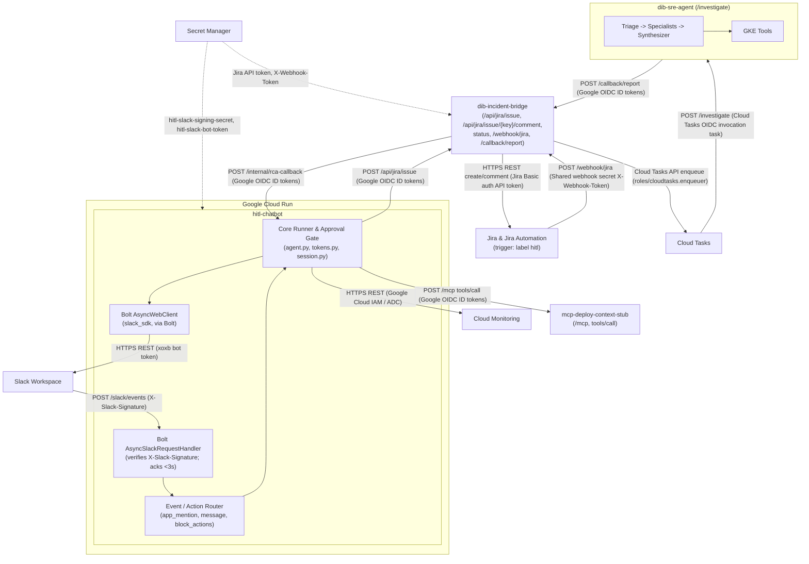
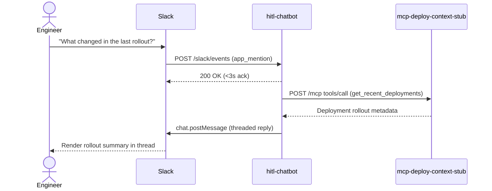
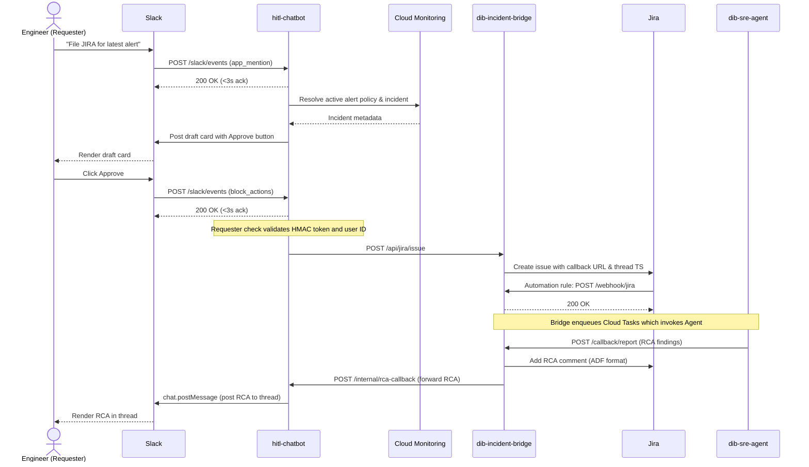
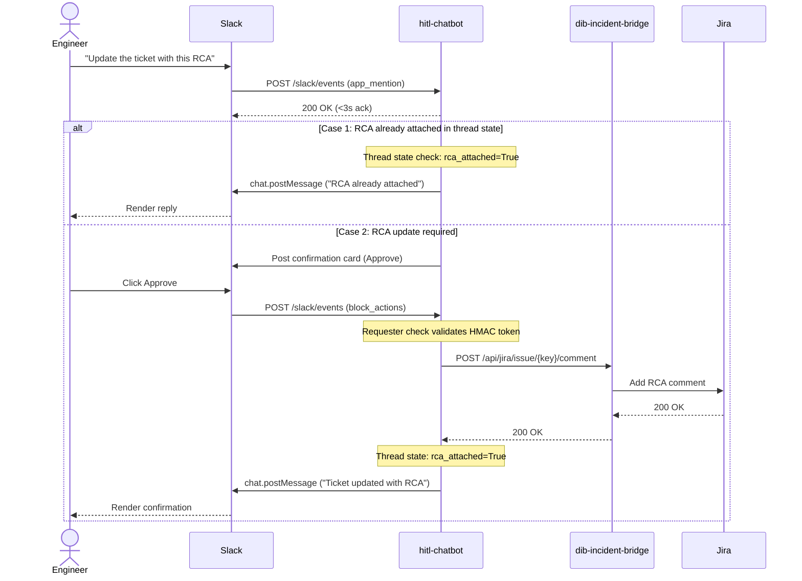

# Dev-In-A-Box HITL Incident Response Architecture

## 1. Scope

This document specifies the Dev-In-A-Box (`incident-sre-agent-dev-in-a-box`) Human-In-The-Loop (HITL) incident response architecture across conversational Slack interactions, deployment context retrieval, incident ticket lifecycle, asynchronous queueing, and automated root cause analysis (RCA). Components include the Slack conversational bot (`hitl-chatbot`), the deployment context server (`mcp-deploy-context-stub`), the incident bridge (`dib-incident-bridge`), Jira integration and automation rules, Cloud Tasks asynchronous queue, and the multi-specialist SRE investigation agent (`dib-sre-agent`).

## 2. Full System Topology

## 3. Security & Authentication Matrix

| Hop / Boundary | Protocol | Credential / Identity | Secret Storage |
|---|---|---|---|
| Slack -> `hitl-chatbot` | HTTPS POST | Slack HMAC (`X-Slack-Signature`) | Secret Manager (`hitl-slack-signing-secret`) |
| `hitl-chatbot` -> Slack | HTTPS REST | Bot token (`xoxb`) | Secret Manager (`hitl-slack-bot-token`) |
| Approval Gate | Block Kit payload | HMAC-SHA256 token (requester-bound) | In-memory / payload (`HMAC_SECRET_KEY`, 600s TTL) |
| `hitl-chatbot` -> Cloud Monitoring | HTTPS REST | Google Cloud IAM / ADC | Compute metadata server |
| `hitl-chatbot` -> `mcp-deploy-context-stub` | HTTPS POST | Google OIDC ID tokens | Compute metadata server (1h TTL) |
| `hitl-chatbot` -> `dib-incident-bridge` | HTTPS POST | Google OIDC ID tokens | Compute metadata server (1h TTL) |
| `dib-incident-bridge` -> Jira | HTTPS REST | Jira Basic auth (API token) | Secret Manager (`jira-api-token`) |
| Jira -> `dib-incident-bridge` | HTTPS POST | Shared webhook secret (`X-Webhook-Token`) | Secret Manager (`jira-webhook-token`) |
| `dib-incident-bridge` -> Cloud Tasks | HTTPS REST | Cloud Tasks IAM (`roles/cloudtasks.enqueuer`) | Workload IAM / metadata server |
| Cloud Tasks -> `dib-sre-agent` | HTTPS POST | Cloud Tasks OIDC invocation task | Cloud Tasks task queue service account |
| `dib-sre-agent` -> `dib-incident-bridge` | HTTPS POST | Google OIDC ID tokens | Compute metadata server (1h TTL) |
| `dib-incident-bridge` -> `hitl-chatbot` | HTTPS POST | Google OIDC ID tokens | Compute metadata server (1h TTL) |

## 4. Execution Sequences

### 4.1 Sequence A: "What changed in the last rollout?"

### 4.2 Sequence B: "Create JIRA for alert" (includes investigation)

### 4.3 Sequence C: "Update JIRA with RCA"

## 5. Component Table

| Service | Role | Ingress / Protocol | Identity & Auth |
|---|---|---|---|
| `hitl-chatbot` | Slack conversational interface, intent routing, approval gating, and thread state management | HTTPS POST (`/slack/events`, `/internal/rca-callback`) | Slack HMAC (`X-Slack-Signature`), Google OIDC ID tokens, Bot token (`xoxb`) |
| `mcp-deploy-context-stub` | Deployment rollout context provider implementing Model Context Protocol | HTTPS POST (`/mcp`, `tools/call`) | Google OIDC ID tokens |
| `dib-incident-bridge` | Jira lifecycle management, webhook ingestion, Cloud Tasks dispatch, and RCA callback broker | HTTPS REST (`/api/jira/issue`, `/api/jira/issue/{key}/comment`, status, `/webhook/jira`, `/callback/report`) | Google OIDC ID tokens, Shared webhook secret (`X-Webhook-Token`), Jira Basic auth (API token) |
| `dib-sre-agent` | Multi-specialist investigation engine (triage, specialists, synthesizer, GKE tools) | HTTPS POST (`/investigate`) | Cloud Tasks OIDC invocation task, Google Cloud IAM |
| `Cloud Tasks` | Asynchronous decoupled dispatch queue for agent investigations | Cloud Tasks API / HTTPS | Cloud Tasks IAM (`roles/cloudtasks.enqueuer`), Cloud Tasks OIDC invocation task |
| Jira | Issue tracking, ADF comment rendering, and automation rule dispatch (trigger: label `hitl`) | HTTPS REST API | Jira Basic auth (API token), Shared webhook secret (`X-Webhook-Token`) |

## 6. Edge Cases & Operational Invariants

- **Slack Event Acknowledgment:** Bolt handlers ack all inbound events within 3 seconds; background calls to Cloud Monitoring, MCP, and Bridge run asynchronously after acknowledgment.
- **Approval Gate Security:** Block Kit approval buttons embed a 600s TTL HMAC-SHA256 token signed with requester ID; non-requesters attempting approval receive an ephemeral rejection.
- **Webhook Ingress Verification:** `/webhook/jira` drops payloads failing `X-Webhook-Token` validation with 401 Unauthorized before task queue dispatch.
- **Investigation Decoupling:** Long-running investigations execute out-of-band via Cloud Tasks queues to insulate Jira Automation from agent timeouts.
- **Idempotent In-Thread Updates:** Thread state tracks `rca_attached=True` once an RCA report is delivered to prevent redundant ticket updates on follow-up mentions.

## 7. Reference

- [`slack_arch.md`](../hitl-chatbot/docs/slack_arch.md): Detailed Slack adapter architecture, Bolt request verification, HMAC approval tokens, and thread session state.

## 8. Out of Scope / Future Work

- **Jira MCP Connection:** Exposing Jira through a dedicated Model Context Protocol (MCP) server instead of direct REST API integration from `dib-incident-bridge`.
- **Slack OAuth Integration:** Implementing Slack OAuth v2 installation flow with token rotation and Enterprise Grid organization-level app distribution, replacing the static workspace bot token (`xoxb`).
- **Durable Chat Session State:** Backing thread conversation state with an external durable store (e.g., Cloud Firestore or Cloud SQL) instead of in-memory process memory (`app/session.py`).
- **Slack Socket Mode:** Supporting Slack Socket Mode for local development or private networks without public HTTPS ingress.

## 9. Glossary

- **ADC (Application Default Credentials):** Google Cloud authentication strategy that automatically resolves credentials from local environments or compute metadata servers.
- **ADF (Atlassian Document Format):** Structured JSON representation used by Jira REST APIs for rich-text issue descriptions and comments.
- **Bolt:** Slack's official foundational framework (`slack_bolt`) for building event-driven Slack apps in Python.
- **HITL (Human-In-The-Loop):** Operational workflow where automated triage generates recommendations requiring explicit human engineer approval before mutating external systems.
- **HMAC (Hash-based Message Authentication Code):** Cryptographic verification mechanism (HMAC-SHA256) used for Slack request signatures and single-use, requester-bound approval tokens.
- **IAM (Identity and Access Management):** Google Cloud service defining fine-grained access control and role permissions across cloud resources.
- **MCP (Model Context Protocol):** Open standard protocol for language models and agents to discover tools and query structured operational context.
- **OIDC / Google OIDC ID token:** A Google-signed OpenID Connect identity token presented between Cloud Run services, verified for target audience and caller service account identity.
- **RCA (Root Cause Analysis):** Synthesized technical diagnosis identifying the trigger, impacted components, and remediation steps for an incident.
- **SA (Service Account):** Dedicated Google Cloud IAM identity used by container workloads and Cloud Tasks for automated machine-to-machine authentication.
- **xoxb:** Static workspace-level Slack bot user OAuth token prefix granting permissions defined in the app manifest.
