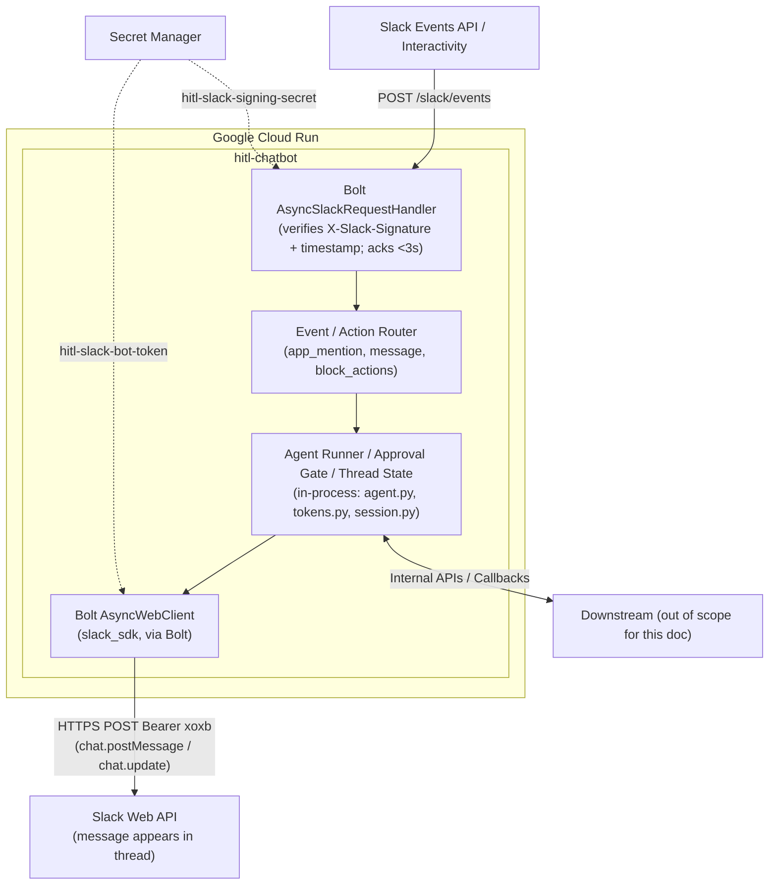
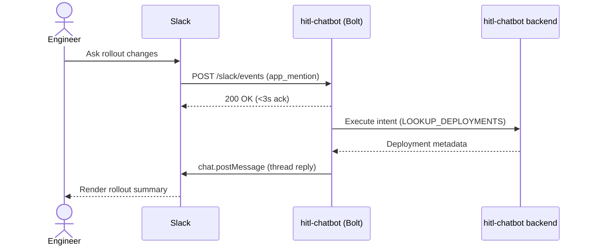
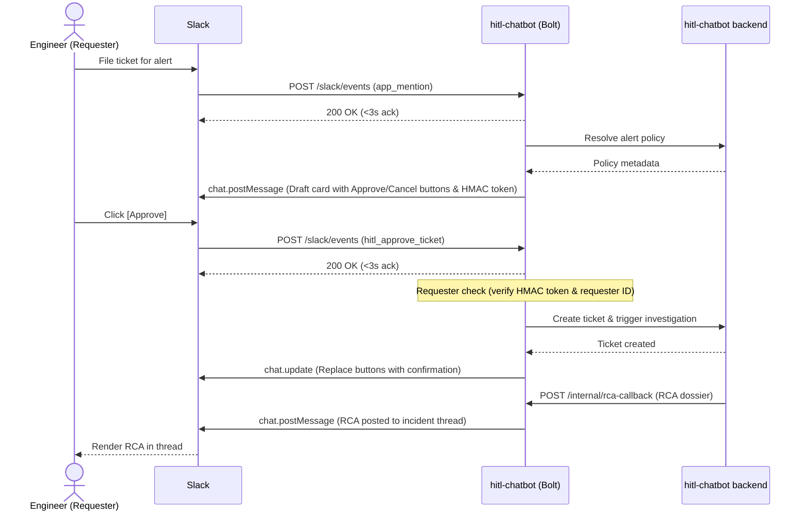
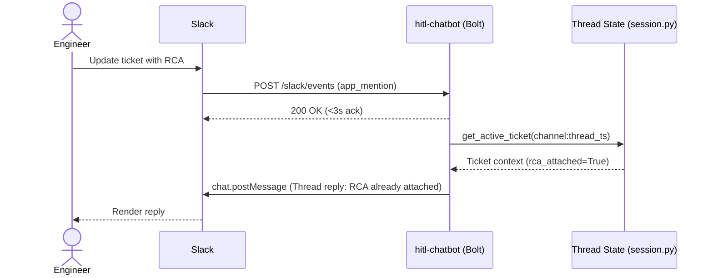

# Slack Integration Architecture: hitl-chatbot

Slack integrates only with hitl-chatbot. hitl-chatbot calls the MCP stub and Cloud Monitoring directly, and reaches Jira only through dib-incident-bridge, which owns all Jira communication and the investigation pipeline.

Architecture, authorization model, and execution sequences for `hitl-chatbot` Slack integration.

## 1. System Topology

## 2. Authorization/Authentication

Inbound Slack requests use HMAC-SHA256 request signing (`X-Slack-Signature`), not OAuth. Outbound API calls to Slack use a workspace bot token (`xoxb`) without user delegation. Interactive approvals use single-use HMAC-SHA256 tokens bound to the requester ID. Downstream service communication uses Google Cloud IAM OIDC (out of scope for this document).

- **OAuth Status:** Static workspace bot token (`xoxb`) is used; full Slack OAuth v2 install flow with token rotation is not required for single-workspace deployment.

| Hop | Protocol | Credential | Storage | Rotation |
|---|---|---|---|---|
| Slack -> Bot | HTTPS | HMAC-SHA256 (`X-Slack-Signature`) | Secret Manager (`hitl-slack-signing-secret`) | Slack console re-issue |
| Bot -> Slack | HTTPS REST | Bot token (`xoxb`) | Secret Manager (`hitl-slack-bot-token`) | Slack app reinstall |
| Approval Gate | Block Kit payload | HMAC-SHA256 token (requester-bound) | Memory / Block Kit payload | `HMAC_SECRET_KEY` (600s TTL) |
| Bot <-> Downstream | HTTPS POST | Google Cloud IAM OIDC ID Token | Metadata Server (1h TTL) | Automatic (GCP IAM) |

## 3. Sequence A: Rollout Query

## 4. Sequence B: Alert Ticket & RCA Delivery

## 5. Sequence C: In-Thread Ticket Update

## 6. Edge Cases & Failure Modes

- **Invalid Signature (401):** Requests with missing, invalid, or >5m timestamp HMAC signature (`X-Slack-Signature`) return 401.
- **Non-Requester (403):** If approver ID != `requester_id` in approval token, returns ephemeral 403; draft remains valid for requester.
- **Duplicate Ticket Warning:** In threads with an active ticket, ticket creation intents inject a warning to update the existing ticket.
- **Callback Network Fallback:** If `/internal/rca-callback` fails, RCA is retained downstream and can be queried via backend API.
