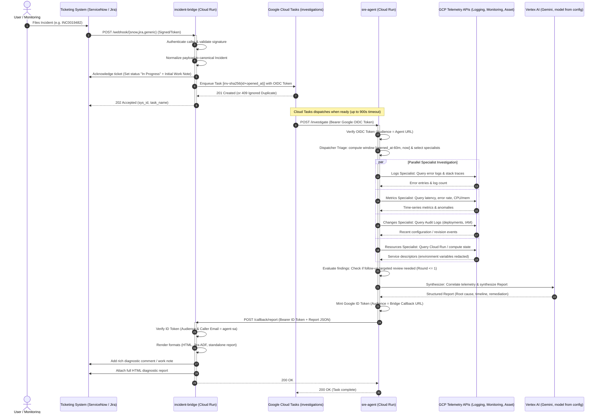

# Incident SRE Agent — Architectural Deep Dive

This document details the architectural principles, component topology, sequence flows, data contracts, and operational resiliency strategies of the Google Cloud Incident SRE Agent.

---

## 1. Design Philosophy & Guiding Principles

The Incident SRE Agent is architected around four core pillars:

1. **Decoupled Ingestion & Reasoning**:
   Ticketing platforms require immediate HTTP 200/202 acknowledgements within strict timeout budgets (typically 3–5 seconds). Autonomous multi-agent telemetry investigations, in contrast, require multi-step reasoning, large-scale log filtering, and LLM synthesis taking 2 to 10 minutes. Decoupling the ingestion boundary (`incident-bridge`) from the analytical engine (`sre-agent`) via Google Cloud Tasks guarantees that webhook callers are never blocked, queued tasks survive transient failures, and each subsystem scales independently according to its load profile.

2. **Deterministic Deduplication & Idempotency**:
   Ticketing webhooks frequently fire duplicate events upon status changes, reassignment, or network retries. Using deterministic task naming (`inv-<sha256(incident_id + opened_at)>`), Cloud Tasks natively discards duplicate task creation attempts (returning HTTP 409 Conflict / ALREADY_EXISTS), preventing redundant agent executions and eliminating noisy or conflicting reports.

3. **Strict Least-Privilege & Read-Only Inspection**:
   Automated agents investigating critical production outages must never introduce state changes or exacerbate incidents. The `sre-agent` service account holds strictly read-only IAM viewer roles (`roles/logging.viewer`, `roles/monitoring.viewer`, `roles/run.viewer`, `roles/compute.viewer`, `roles/container.viewer`, `roles/cloudsql.viewer`, `roles/cloudbuild.builds.viewer`) plus `roles/aiplatform.user` for Gemini model invocation. All specialist tools are hardcoded to read-only API calls, and mutating methods are structurally prohibited by design.

4. **Structured Multi-Agent Specialization**:
   Rather than asking a single generalist LLM prompt to digest massive volumes of telemetry, the agent employs a **hub-and-spoke multi-agent topology**. A central Dispatcher triages the incident description and fans out targeted queries to four domain-specific specialists (`Logs`, `Metrics`, `Changes`, `Resources`), allowing parallel execution, localized error handling, and synthesized cross-telemetry correlation.

---

## 2. End-to-End Sequence Diagram

The following Mermaid sequence diagram illustrates the lifecycle of an incident investigation from the initial customer ticket to the final diagnostic delivery:



---

## 3. Component Architecture & Deep Dive

```
+---------------------------------------------------------------------------------------------------+
|                                      INCIDENT BRIDGE SERVICE                                      |
|                                                                                                   |
|  +---------------------------+    +-----------------------+    +-------------------------------+  |
|  |   Webhook Ingestion       |    |  Contract Normalizer  |    |     Cloud Tasks Enqueuer      |  |
|  | - /webhook/servicenow     |--->| - ServiceNow Adapter  |--->| - Deterministic Task Naming   |  |
|  | - /webhook/jira           |    | - Jira Adapter        |    | - OIDC Token Configuration    |  |
|  | - /webhook/generic        |    | - Generic HMAC Adapter|    | - Retry Backoff & Deadline    |  |
|  +---------------------------+    +-----------------------+    +---------------+---------------+  |
|                                                                                |                  |
+--------------------------------------------------------------------------------|------------------+
                                                                                 | HTTP Invocation
                                                                                 | OIDC (Bearer)
                                                                                 v
+---------------------------------------------------------------------------------------------------+
|                                         SRE AGENT SERVICE                                         |
|                                                                                                   |
|  +---------------------------------------------------------------------------------------------+  |
|  |                                  Dispatcher & Triage Engine                                 |  |
|  | - Validates OIDC Token Audience                                                             |  |
|  | - Computes Dynamic Investigation Window: [opened_at - 60 min, now] (clamped to 24h)         |  |
|  | - Loads SRE Runbook Skills (agent/skills/*) & selects active specialists                    |  |
|  +----------------------------------------------+----------------------------------------------+  |
|                                                 |                                                 |
|                        +------------------------+------------------------+                        |
|                        |                        |                        |                        |
|                        v                        v                        v                        v
|                 +--------------+         +--------------+         +--------------+         +--------------+
|                 |     Logs     |         |   Metrics    |         |   Changes    |         |  Resources   |
|                 |  Specialist  |         |  Specialist  |         |  Specialist  |         |  Specialist  |
|                 +-------+------+         +-------+------+         +-------+------+         +-------+------+
|                         |                        |                        |                        |
|                         +------------------------+------------------------+                        |
|                                                  |                                                 |
|                                                  v                                                 |
|  +---------------------------------------------------------------------------------------------+  |
|  |                                 Reviewer & Synthesizer Engine                               |  |
|  | - Evaluates specialist findings sufficiency; triggers optional targeted follow-up (max 1)    |  |
|  | - Vertex AI Gemini synthesis: correlates signals across logs, metrics, changes, resources   |  |
|  | - Formulates Root Cause hypothesis, Confidence level, Diagnostic Timeline, Remediation Steps |  |
|  | - Validates Pydantic Report contract schema                                                 |  |
|  +----------------------------------------------+----------------------------------------------+  |
|                                                 |                                                 |
|                                                 v                                                 |
|  +---------------------------------------------------------------------------------------------+  |
|  |                                 Outbound Callback Client                                    |  |
|  | - Mints Google-signed ID Token for Bridge Audience                                          |  |
|  | - Verifies destination host against ALLOWED_CALLBACK_HOSTS                                  |  |
|  | - Transmits Report to POST /callback/report                                                 |  |
|  +---------------------------------------------------------------------------------------------+  |
+---------------------------------------------------------------------------------------------------+
```

### 3.1 Inbound Webhook Ingestion & Adapter Pattern

The bridge provides a unified entry point accepting heterogenous vendor formats:
- **ServiceNow Adapter** (`bridge/app/adapters/servicenow.py`): Ingests JSON records from Flow Designer REST steps. Normalizes numeric priorities (`1` through `5`) to canonical severity levels (`critical`, `high`, `medium`, `low`). Parses UTC strings and local date formats.
- **Jira Cloud Adapter** (`bridge/app/adapters/jira.py`): Processes Jira Automation `Send web request` JSON payloads. Resolves Jira issue keys (e.g. `OPS-101`), summaries, descriptions, priority objects, and label arrays.
- **Generic Adapter** (`bridge/app/adapters/generic.py`): Handles generic webhook callers using an HMAC-SHA256 signature in the `X-Hub-Signature-256` header, validated with constant-time comparison against `GENERIC_HMAC_KEY`.

All adapters normalize payloads into the shared `Incident` Pydantic model (`contracts/incident.py`):
```python
class Incident(BaseModel):
    incident_id: str
    title: str
    description: str
    severity: IncidentSeverity
    opened_at: datetime
    platform: PlatformType
    metadata: dict[str, Any] = Field(default_factory=dict)
```

### 3.2 Cloud Tasks Queue & Deduplication

Cloud Tasks acts as an asynchronous, reliable queue decoupling the bridge from the agent:
- **Deterministic Task Naming**:
  ```python
  task_hash = hashlib.sha256(
      f"{incident.incident_id}:{incident.opened_at.isoformat()}".encode()
  ).hexdigest()
  task_id = f"inv-{task_hash[:32]}"
  task_name = f"projects/{project}/locations/{region}/queues/{queue}/tasks/{task_id}"
  ```
  If an incident is re-sent by ServiceNow or Jira retries, Cloud Tasks returns `ALREADY_EXISTS` (409 Conflict). The bridge traps this error and returns HTTP 200 without creating a duplicate investigation.
- **Queue Configuration**:
  - `dispatch_deadline`: `900s` (15 minutes), matching the maximum Cloud Run execution timeout.
  - `max_attempts`: `2` (single retry on transient 5xx errors; avoids cascading quota exhaustion).
  - `min_backoff`: `10s`, `max_backoff`: `60s`.

### 3.3 SRE Agent Service (`sre-agent`)

The SRE Agent is packaged as a containerized FastAPI application running in Cloud Run:
- **Endpoints**:
  - `POST /investigate`: Accepts canonical `InvestigationRequest` contract containing the `Incident` payload and callback coordinates.
  - `GET /health`: Fast liveness check returning service status, registered specialists, and active skills.
- **Service Properties**:
  - Ingress: `internal-only` (accessible exclusively via Cloud Tasks or authorized project VPC).
  - Authentication: Unauthenticated invocations rejected; requires valid Google OIDC token signed for the agent URL.
  - Compute Sizing: 2 vCPU, 2 GiB memory, `concurrency=10`, `timeout=900s`.

### 3.4 Dispatcher & Triage Logic

When `/investigate` is invoked, the Dispatcher initializes the investigation context:
1. **Dynamic Time Window Calculation**:
   - Start time: `opened_at - 60 minutes` (captures preceding deploys, metric drifts, or canary anomalies).
   - End time: `min(opened_at + 30 minutes, current_time_utc)`.
   - Max Window Cap: Clamped to `24 hours` maximum to prevent unbounded query scanning.
2. **Skill Matching & Runbook Loading**:
   - Scans `agent/skills/` for registered service runbooks (e.g. `service-shop-api/SKILL.md`).
   - If the incident title or CMDB CI matches a known service, the skill's specific SLOs, diagnostic queries, and failure mode playbooks are injected into specialist prompts.
3. **Specialist Selection**:
   - By default, all 4 specialists (`logs`, `metrics`, `changes`, `resources`) are dispatched in parallel. If the incident description explicitly indicates a pure metric alert or isolated deploy issue, the Dispatcher can focus specialist selection accordingly.

### 3.5 Specialist Sub-Agents & Execution Model

Each specialist operates as an independent ADK `LlmAgent` endowed with domain-specific toolkits and progressive skill loading:

| Specialist | Target Telemetry | Tool Modules | Assigned Skills | Typical Queries / Responsibilities |
|---|---|---|---|---|
| **Logs Specialist** | Google Cloud Logging | `tools/logs.py` | `cloud-logging-queries`, `service-<name>` | Query `severity>=ERROR`, parse stack traces, count error frequency, extract HTTP 5xx log entries, identify first/last occurrence, query request logs via `query_request_logs` (and `aggregate_requests` alias) for status breakdown and latency percentiles. |
| **Metrics Specialist** | Google Cloud Monitoring | `tools/metrics.py` | `cloud-monitoring-metrics`, `service-<name>` | Fetch time-series for Cloud Run request latencies (p50, p95, p99), container CPU/memory utilization, instance auto-scaling counts. |
| **Changes Specialist** | Cloud Audit Logs | `tools/changes.py` | `change-correlation`, `service-<name>` | Query `cloudaudit.googleapis.com` for service updates, new Cloud Run revisions, IAM policy modifications, deployment rollout timestamps, and compute configuration diffs via `diff_revisions` (with zero secret leakage). |
| **Resources Specialist** | Cloud Asset / Run API | `tools/resources.py` | `cloud-run-troubleshooting`, `gke-troubleshooting`, `cloud-sql-troubleshooting`, `service-<name>` | Inspect service specifications, ingress settings, env var names (with automated secret redaction), scaling limits, dependency URLs, and inspect container restarts / OOM kills / probe failures via `get_platform_events`. |

Key architectural execution characteristics:
- **Skill-First Progressive Loading**: Each specialist loads its assigned skills first via ADK `SkillToolset` (`skill_first=True`) before executing diagnostic investigations.
- **Concurrent Baseline Safety Net**: A deterministic baseline sweep runs concurrently with the agentic LLM drill-down via `asyncio.gather`, serving as a safety net that guarantees standard telemetry (CPU, memory, 5xx baseline comparison, revisions) is captured even if LLM reasoning degrades or times out.
- **Configurable Execution Budgets**: Per-specialist turn and tool limits are enforced from configuration via `SPECIALIST_MAX_LLM_CALLS` (default: 8) and `SPECIALIST_MAX_TOOL_CALLS` (default: 5), alongside a per-agent wall-clock timeout.
- **Structured Tool Arguments**: To prevent hallucinated or malicious query syntax, the LLM passes only typed, structured tool arguments (`service`, `severity`, `status_code_range`, `text_contains`, `lookback_minutes`); the tool modules internally construct and sanitize the underlying GCP query and filter strings.
- **Verifiable Skill Tracking**: Callbacks record and report per-agent `skills_used` and the `skill_first` boolean flag in `Findings` and the final investigation result.

### 3.6 Reasoning, Review & Synthesis

1. **Targeted Follow-Up Review**:
   - The Reviewer examines the initial findings across all specialists.
   - If a specialist discovered an anomaly pointing to an adjacent subsystem (e.g., the Logs specialist finds `503 Bad Gateway` pointing to `inventory-svc`, but the Metrics specialist only queried `shop-api`), the Reviewer initiates **one targeted follow-up query round** (`max_rounds = 1`).
2. **LLM Synthesis**:
   - Gemini correlates evidence across telemetry boundaries:
     - *Correlating a sudden spike in 5xx errors (Logs) with a new container revision rollout (Changes) and elevated memory consumption (Metrics).*
   - Assigns a root cause hypothesis with an explicit confidence rating: `HIGH`, `MEDIUM`, or `LOW`.
   - Reconstructs a chronological investigation timeline.
   - Extracts recommended remediation playbooks from the matched SRE skill.
3. **Pydantic Contract Enforcement**:
   - Output is strictly validated against the `Report` contract (`contracts/report.py`).
   - Includes partial failure handling: if one specialist times out or fails, the report marks that specialist as degraded but completes the synthesis using remaining available signals.

### 3.7 Temporal Reasoning, Dependency Traversal & Attribution (Roadmap Item 8.3)

To prevent misattributions, timeline discrepancies, and cascade diagnostic failures, the agent incorporates advanced temporal reasoning and dependency traversal:

1. **Onset Detection & Window Anchoring**:
   - Before specialist fan-out, recent telemetry (request logs, error logs, and metric anomalies) for the affected service is scanned across `onset_window_minutes` (default: 60m).
   - The engine determines the precise symptom onset timestamp (`onset_time`): the earliest timestamp where error rates (HTTP 5xx, 403) or latency percentiles deviated from baseline.
   - The investigation window is anchored to `start_time = onset_time - onset_pre_buffer_minutes` (default 10m buffer to capture triggering deployments and pre-incident baselines).
   - If telemetry exhibits zero error spikes, the agent falls back safely to ticket-stated time (`opened_at - lookback`).
   - `onset_time` is recorded in `InvestigationPlan` and propagated across all specialist contexts and the unified timeline.

2. **Prior-Incident Separation**:
   - If an error spike occurred earlier in the lookback window but completely recovered with >= 10 minutes of normal healthy traffic before onset, it is classified as a prior resolved incident.
   - Prior incidents are documented in the timeline with `[PRIOR_INCIDENT]` tags and caveats, and are strictly prevented from being attributed as the cause of the active incident.

3. **Revision-Causality Rule**:
   - When evaluating recent changes, revision creation timestamps are matched against `onset_time`.
   - Only revisions deployed within `revision_causality_window_minutes` (default: 30m) prior to or during symptom onset are treated as plausible causal candidates.
   - Long-running baseline revisions deployed hours or days prior to onset with steady healthy traffic are marked as benign baseline deployments.
   - If no revisions were deployed within the causality window, confidence is calibrated downward and caveats note the absence of proximate deployments.

4. **Dependency Traversal & Downstream Attribution**:
   - Primary specialist findings are parsed for downstream failure signals (e.g. calls to other services returning HTTP 403 Forbidden, 502 Bad Gateway, 504 Gateway Timeout, connection timeouts).
   - Downstream service names are extracted generically from URLs, hostnames, and error logs, fanning out bounded specialist investigations (`dependency_max_services: 3`, `dependency_fanout_max_depth: 2`).
   - If evidence demonstrates that the downstream dependency failed (e.g. downstream service returned 403 due to IAM permissions or crashed), the Synthesizer attributes probable root cause to the downstream dependency failure rather than the upstream caller's application code.

5. **Unified Chronological Timeline**:
   - `Report.timeline` reflects detected onset (`[ONSET]`), causal changes (`[CHANGES]`), downstream dependency events (`[DEPENDENCY: <service>]`), and ticket opening in strict chronological order with normalized UTC timestamps.

### 3.8 Outbound Callback & ID Token Authentication

When synthesis completes:
1. `sre-agent` queries the Google Cloud Metadata Server to obtain an OpenID Connect (OIDC) identity token:
   ```text
   GET http://metadata.google.internal/computeMetadata/v1/instance/service-accounts/default/identity?audience=https://incident-bridge-xyz-uc.a.run.app/callback/report
   ```
2. Validates that the callback destination host is present in `ALLOWED_CALLBACK_HOSTS`.
3. Transmits the final `Report` via `POST /callback/report` with `Authorization: Bearer <ID_TOKEN>`.
4. `incident-bridge` verifies:
   - The token signature against Google's public OIDC certs.
   - The `aud` claim matches its callback URL.
   - The `email` claim matches `agent-sa@<project>.iam.gserviceaccount.com`.

### 3.9 Ticketing Delivery & Report Rendering

Upon receiving the verified callback, the bridge renders the findings into vendor-native formats:
- **ServiceNow**:
  - Compiles an HTML executive summary enclosed in `[code]...[/code]` tags for the incident work notes journal.
  - Uploads a standalone, responsive HTML report file (`sre_investigation_report_INCxxxxxx.html`) containing full collapsible diagnostic logs, metric charts, and timeline badges.
- **Jira Cloud**:
  - Builds a structured Atlassian Document Format (ADF) document featuring:
    - An `alert` panel styled with the incident severity color.
    - A summary table displaying affected components, confidence level, and error rates.
    - Monospaced code blocks showcasing sanitized stack traces.
  - Uploads the HTML report file (`sre_investigation_<KEY>.html`) as an attachment to the Jira issue.

### 3.9 Declarative Agent Architecture & Instruction Externalization

System instructions, prompt templates, and hierarchical agent definitions are externalized from Python code into declarative configuration:
- **`agent/app/agent.yaml`**: Declarative configuration defining the root orchestrator (`Dispatcher`), specialist hierarchy (`changes_specialist`, `logs_specialist`, `metrics_specialist`, `resources_specialist`), `triage`, and `synthesizer`. System instructions reside directly in YAML `instruction` fields, referencing models via environment expressions (`${MODEL_SPECIALIST}`).
- **`agent/app/agent_config.py`**: A typed loader using `yaml.safe_load` with schema validation. Enforces fail-fast startup: missing or malformed YAML raises `AgentConfigError` immediately at startup with zero silent defaults.
- **Repository Guide (`AGENTS.md`)**: Full operational guide for AI coding assistants working on the repository, covering architecture maps, test execution, and non-negotiable guardrails.

---

## 4. Failure Modes & Resiliency Strategies

| Scenario / Failure Mode | Detection Point | Mitigation / Resiliency Behavior |
|---|---|---|
| **Duplicate Webhook Delivery** | Bridge Cloud Tasks enqueuer | Task creation returns HTTP 409 Conflict (`ALREADY_EXISTS`). Bridge logs warning and returns HTTP 200 without duplicate execution. |
| **Agent Execution Timeout (15m)** | Cloud Run container deadline | Cloud Run terminates container at 900s. Cloud Tasks retries once after backoff. Reviewer caps query windows to prevent hanging. |
| **GCP API / Telemetry Quota (429)** | Specialist tool client | Exponential backoff retry with jitter up to 3 attempts. If exhausted, tool returns partial error findings; Synthesizer completes report with available telemetry. |
| **Gemini LLM Quota / 429** | Synthesizer Vertex client | Configured with automatic retry and model fallback. If synthesis fails entirely, fallback heuristic synthesizes raw specialist findings into structured report. |
| **Single Specialist Failure** | Specialist execution runner | Exceptions in one specialist (e.g. Metrics API down) are captured as `Findings(status="failed", error="...")`. Remaining specialists complete normally. |
| **Ticketing API Outage (ServiceNow/Jira)** | Bridge callback handler | Bridge logs error and returns 502/503. Cloud Tasks retry logic redelivers task. Full findings remain accessible in Cloud Logging structured logs. |

For complete multi-layer verification procedures and testing strategies corresponding to these architectural resiliency mechanisms, see the [Testing & Quality Assurance Guide (`docs/TESTING.md`)](TESTING.md).

