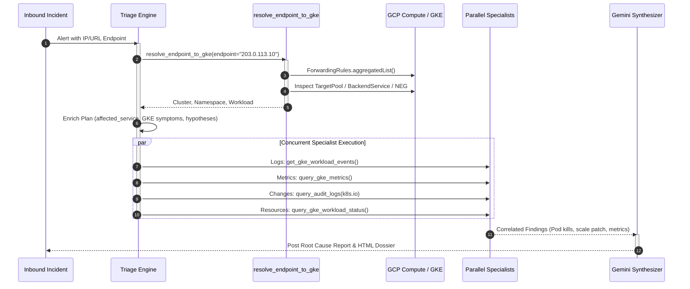

# Google Kubernetes Engine (GKE) Investigation Guide

## 1. Overview

The GKE investigation capability extends the incident SRE agent to investigate workloads on Google Kubernetes Engine (GKE) Standard and Autopilot clusters by:
- Enabling multi-region cluster discovery across all locations by default.
- Dynamically resolving external IP and Uptime Check endpoints through Google Cloud Compute Forwarding Rules, Target Pools, Regional/Global Backend Services, and Network Endpoint Groups (NEGs) directly to backing Kubernetes Services, clusters, and namespaces.
- Supplying domain specialists with tools to inspect structured Kubernetes lifecycle events (`logs/events`), container metrics, autoscaler telemetry, and live Kubernetes control-plane workload statuses (Deployments, StatefulSets, Pods, probe configurations).
- Equipping agents with operational playbooks for pod termination gaps, scaling churn, crash loops, and Kubernetes administrative audit correlation.

---

## Table of Contents

- [1. Overview](#1-overview)
- [2. How It Works End-to-End](#2-how-it-works-end-to-end)
  - [Pre-Fanout Triage Endpoint Resolution](#pre-fanout-triage-endpoint-resolution)
  - [Specialist Fan-Out & Context Propagation](#specialist-fan-out--context-propagation)
  - [Architecture Flow Diagram](#architecture-flow-diagram)
- [3. Tools Reference](#3-tools-reference)
  - [`describe_gke_clusters`](#describe_gke_clusters)
  - [`get_gke_workload_events`](#get_gke_workload_events)
  - [`query_gke_metrics`](#query_gke_metrics)
  - [`query_gke_workload_status`](#query_gke_workload_status)
  - [`resolve_endpoint_to_gke`](#resolve_endpoint_to_gke)
  - [`query_audit_logs` (Kubernetes Audit Activity)](#query_audit_logs-kubernetes-audit-activity)
- [4. Operational Skills](#4-operational-skills)
  - [`gke-troubleshooting`](#gke-troubleshooting)
  - [`k8s-change-correlation`](#k8s-change-correlation)
- [5. Prerequisites, IAM & Network Architecture](#5-prerequisites-iam--network-architecture)
  - [IAM Permissions](#iam-permissions)
  - [Control Plane Reachability (Private Clusters & Authorized Networks)](#control-plane-reachability-private-clusters--authorized-networks)
  - [Kubernetes RBAC](#kubernetes-rbac)
  - [TLS CA Certificate Verification](#tls-ca-certificate-verification)
  - [Logging & Telemetry Sources](#logging--telemetry-sources)
- [6. Security Architecture & Guardrails](#6-security-architecture--guardrails)
- [7. Testing & Verification](#7-testing--verification)
  - [Automated Tests](#automated-tests)
  - [Live Read-Only Verification Snippet](#live-read-only-verification-snippet)
- [8. Troubleshooting Guide](#8-troubleshooting-guide)
- [9. Known Limitations & Future Work](#9-known-limitations--future-work)

---

## 2. How It Works End-to-End

### Pre-Fanout Triage Endpoint Resolution

When an incident ticket arrives from ServiceNow, Jira, or an alert webhook:

1. **Endpoint Detection**: During plan synthesis (`_enrich_plan_with_endpoint_resolution` in [`agent/app/triage.py`](../agent/app/triage.py)), triage scans the incident title, description, and labels for IPv4 patterns (`\b(\d{1,3}\.\d{1,3}\.\d{1,3}\.\d{1,3})\b`).
2. **Dynamic Infrastructure Traversal**: If an external IP is detected, triage invokes `resolve_endpoint_to_gke` *prior to specialist dispatch*:
   - Queries Compute Engine Forwarding Rules across all regions (`aggregated_list`).
   - Follows forwarding targets into Target Pools, Regional/Global Backend Services, or Network Endpoint Groups (NEGs).
   - Extracts the backing Kubernetes Service identifier from load balancer metadata annotations (`kubernetes.io/service-name` or `networking.gke.io/service-name`, stripping ingress proxies such as `-envoy` when appropriate).
   - Identifies the backing GKE cluster name and Kubernetes namespace.
3. **Plan Enrichment**:
   - `plan.affected_service` is updated with the resolved workload name.
   - `plan.symptoms` receives an entry documenting the resolved cluster, namespace, and workload.
   - `plan.initial_hypotheses` is prepended with a GKE-specific hypothesis (e.g., pod terminations, scale-down, or restart loops).
4. **Fallback Safety**: If the endpoint is not backed by GKE or fails resolution, triage gracefully falls through to standard heuristic/LLM service name extraction without error, leaving Cloud Run workflows unaffected.

### Specialist Fan-Out & Context Propagation

Because endpoint resolution executes before dispatching the `ParallelAgent`, all four specialists inherit full GKE context simultaneously:

```
                                  [ Inbound Incident ]
                                           │
                                           ▼
                             [ Triage: Endpoint Resolution ]
                               (resolve_endpoint_to_gke)
                                           │
                    ┌──────────────────────┴──────────────────────┐
                    ▼                                             ▼
        [ GKE Workload Detected ]                     [ Cloud Run / Other ]
                    │                                             │
      ┌─────────────┼─────────────┬─────────────┐                 │
      ▼             ▼             ▼             ▼                 ▼
 [ Logs ]      [ Metrics ]   [ Changes ]  [ Resources ]      [ Standard ]
Specialist    Specialist    Specialist    Specialist          Cloud Run
      │             │             │             │             Workflows
      ▼             ▼             ▼             ▼
get_gke_      query_gke_    query_audit_  query_gke_
workload_     metrics       logs          workload_status,
events                      (k8s.io)      describe_gke_clusters
```

- **Turn 1 (Skill Loading)**:
  - `LogsSpecialist` and `MetricsSpecialist` load `gke-troubleshooting` when GKE evidence is present.
  - `ChangesSpecialist` loads `k8s-change-correlation`.
  - `ResourcesSpecialist` loads `gke-troubleshooting`.
- **Turn 2 (Diagnostic Execution)**:
  - `LogsSpecialist` calls `get_gke_workload_events` to retrieve pod lifecycle warnings, `Killing`, `OOMKilling`, and rollout events.
  - `MetricsSpecialist` calls `query_gke_metrics` to check container restart counts, memory utilization, and autoscaler telemetry.
  - `ChangesSpecialist` calls `query_audit_logs` capturing `k8s.io` administrative mutations (e.g. scale patches, deployment updates).
  - `ResourcesSpecialist` calls `query_gke_workload_status` to inspect live desired vs. ready replicas, pod phases, exit codes, and probe definitions.
- **Synthesis**: The Synthesizer (`gemini-3.8-flash`) correlates findings across all specialists (e.g. correlating an automated scale-down patch with pod termination, target pool connection drops, and uptime probe failure) and delivers an executive report to the ticketing system.

### Architecture Flow Diagram



---

## 3. Tools Reference

### `describe_gke_clusters`

- **Owning Specialist**: `ResourcesSpecialist` (also accessible to Dispatcher).
- **Module**: [`agent/app/tools/resources.py`](../agent/app/tools/resources.py)
- **Data Source / API**: Google Cloud Container API (`google.cloud.container_v1.ClusterManagerClient.list_clusters`).
- **Purpose**: List GKE clusters across all GCP regions or within a specific location, identifying cluster health status, node counts, and Autopilot enablement.
- **Parameters**:
  - `project_id` (*Optional[str]*, default: `None`): Target GCP project ID (falls back to pinned project).
  - `location` (*Optional[str]*, default: `None`): Specific GCP region/zone or `None` / `"-"` for all locations wildcard.
  - `client` (*Any*, default: `None`): Optional client instance for unit testing.
- **Result Shape**:
  ```json
  [
    {
      "name": "<CLUSTER>",
      "status": "RUNNING",
      "current_node_count": 3,
      "location": "us-west1",
      "autopilot": false,
      "console_url": "https://console.cloud.google.com/kubernetes/clusters/details/us-west1/<CLUSTER>?project=<PROJECT_ID>"
    }
  ]
  ```
- **Statuses**: Formats status enum integers into human-readable strings (`RUNNING`, `PROVISIONING`, `STOPPING`, `ERROR`, `DEGRADED`).
- **Result Caps**: Unbounded across cluster counts; returns all clusters in the specified parent scope.

---

### `get_gke_workload_events`

- **Owning Specialist**: `LogsSpecialist`.
- **Module**: [`agent/app/tools/logs.py`](../agent/app/tools/logs.py)
- **Data Source / API**: Google Cloud Logging API (`google.cloud.logging.Client.list_entries`).
- **Purpose**: Retrieve structured Kubernetes lifecycle events (`logs/events`) and `k8s.io` Cloud Audit Logs (`cloudaudit.googleapis.com/activity`) for a specified cluster, namespace, and workload.
- **Parameters**:
  - `cluster_name` (*str*, required): Validated Kubernetes cluster identifier.
  - `namespace` (*Optional[str]*, default: `None`): Kubernetes namespace name.
  - `workload_name` (*Optional[str]*, default: `None`): Workload name to filter involved objects or audit resource paths.
  - `start_time` (*Optional[Union[datetime, str]]*, default: `None`): Investigation start timestamp (UTC).
  - `end_time` (*Optional[Union[datetime, str]]*, default: `None`): Investigation end timestamp (UTC).
  - `lookback_minutes` (*Optional[int]*, default: `None`): Dynamic lookback relative to end time (clamped between 1 and 1440 minutes).
  - `include_normal_events` (*bool*, default: `False`): When `False`, filters to Warning events, termination reasons (`Killing`, `OOMKilling`, `OOMKilled`, `FailedScheduling`, `Unhealthy`, `BackOff`, `CrashLoopBackOff`), and audit actions. When `True`, includes `Normal` events.
  - `max_events` (*int*, default: `50`): Maximum events to return (clamped between 1 and 200).
  - `project_id` (*Optional[str]*, default: `None`): GCP project ID.
  - `client` (*Any*, default: `None`): Test client override.
- **Payload Extraction Details**:
  In Google Cloud Logging, structured log entries store payload dictionaries under `entry.payload` (`LogEntry`/`StructEntry`). The tool inspects `getattr(entry, "payload", None)` with fallback to `.to_dict()` and `json_payload`, ensuring event attributes (`reason`, `message`, `involved_object`, `involved_kind`) are correctly populated.
- **Result Shape**:
  ```json
  {
    "cluster_name": "<CLUSTER>",
    "namespace": "<NAMESPACE>",
    "workload_name": "<WORKLOAD>",
    "total_events": 2,
    "events": [
      {
        "timestamp": "2026-10-27T01:00:32+00:00",
        "event_type": "k8s_event",
        "severity": "INFO",
        "reason": "Killing",
        "involved_object": "<WORKLOAD>-59b969db59-p57nf",
        "involved_kind": "Pod",
        "message": "Stopping container app"
      },
      {
        "timestamp": "2026-10-27T01:00:32.017018+00:00",
        "event_type": "audit_activity",
        "action": "scale",
        "method_name": "io.k8s.apps.v1.deployments.scale.patch",
        "resource_name": "apps/v1/namespaces/<NAMESPACE>/deployments/<WORKLOAD>/scale",
        "principal_email": "scaler-sa@<PROJECT_ID>.iam.gserviceaccount.com",
        "message": "scaler-sa@<PROJECT_ID>.iam.gserviceaccount.com executed io.k8s.apps.v1.deployments.scale.patch on apps/v1/namespaces/<NAMESPACE>/deployments/<WORKLOAD>/scale"
      }
    ],
    "truncated": false,
    "query_filter": "timestamp >= ... AND resource.labels.cluster_name = ...",
    "console_url": "https://console.cloud.google.com/logs/query;..."
  }
  ```
- **Result Caps**: Capped at `max_events` (up to 200); reports `truncated: true` when matching event volume exceeds the limit.

---

### `query_gke_metrics`

- **Owning Specialist**: `MetricsSpecialist`.
- **Module**: [`agent/app/tools/metrics.py`](../agent/app/tools/metrics.py)
- **Data Source / API**: Google Cloud Monitoring API (`google.cloud.monitoring_v3.MetricServiceClient.list_time_series`).
- **Purpose**: Query time-series telemetry for container restart rates, memory utilization, CPU limits, and cluster autoscaler metrics.
- **Parameters**:
  - `metric_type` (*str*, default: `"restart_count"`): Logical metric key or full GCP metric descriptor. Supported keys:
    - `"restart_count"`: `kubernetes.io/container/restart_count`
    - `"memory_limit_utilization"`: `kubernetes.io/container/memory/limit_utilization`
    - `"memory_used_bytes"`: `kubernetes.io/container/memory/used_bytes`
    - `"cpu_core_usage"`: `kubernetes.io/container/cpu/core_usage_time`
    - `"cpu_limit_utilization"`: `kubernetes.io/container/cpu/limit_utilization`
    - `"autoscaler_pending_pods"`: `kubernetes.io/autoscaler/cluster_pending_pods_per_ccc`
    - `"autoscaler_failures"`: `kubernetes.io/autoscaler/cluster_node_provisioning_failed_attempts_count_per_ccc`
  - `cluster_name` (*Optional[str]*, default: `None`): Cluster identifier filter.
  - `namespace` (*Optional[str]*, default: `None`): Namespace filter (omitted automatically for autoscaler metrics).
  - `container_name` (*Optional[str]*, default: `None`): Container name filter.
  - `pod_name` (*Optional[str]*, default: `None`): Pod name filter.
  - `start_time` (*Optional[Union[datetime, str]]*, default: `None`): Window start.
  - `end_time` (*Optional[Union[datetime, str]]*, default: `None`): Window end.
  - `lookback_minutes` (*Optional[int]*, default: `None`): Lookback duration (clamped 1-1440 minutes, default 30).
  - `max_series` (*int*, default: `50`): Maximum time series to return (clamped 1-200).
  - `project_id` (*Optional[str]*, default: `None`): GCP project ID.
- **Resource Typing**: Automatically targets `resource.type = "k8s_container"` for container metrics and `resource.type = "k8s_entity"` for cluster autoscaler metrics.
- **Result Shape**:
  ```json
  {
    "metric_type": "restart_count",
    "gcp_metric": "kubernetes.io/container/restart_count",
    "cluster_name": "<CLUSTER>",
    "namespace": "<NAMESPACE>",
    "total_series": 1,
    "series": [
      {
        "cluster_name": "<CLUSTER>",
        "namespace_name": "<NAMESPACE>",
        "pod_name": "<WORKLOAD>-59b969db59-mw4rm",
        "container_name": "app",
        "points_count": 5,
        "latest_value": 1.0,
        "max_value": 1.0,
        "mean_value": 0.8,
        "points": [
          {"timestamp": "2026-10-27T01:05:00+00:00", "value": 1.0}
        ]
      }
    ],
    "truncated": false,
    "query_filter": "metric.type = \"kubernetes.io/container/restart_count\" AND resource.type = \"k8s_container\" ...",
    "console_url": "https://console.cloud.google.com/monitoring/metrics-explorer?..."
  }
  ```
- **Result Caps**: `max_series` capped at 200 (default 50); individual points per series capped at 20.

---

### `query_gke_workload_status`

- **Owning Specialist**: `ResourcesSpecialist`.
- **Module**: [`agent/app/tools/resources.py`](../agent/app/tools/resources.py)
- **Data Source / API**: Kubernetes REST API via GKE Master Endpoint (`/apis/apps/v1` and `/api/v1`) using `google.auth.transport.requests.AuthorizedSession`.
- **Purpose**: Inspect live Deployments, StatefulSets, and Pods directly from the Kubernetes control plane. Gathers replica desired, current, ready, updated, and available counts, workload conditions, pod phase details, container restart counters, previous container termination states and exit codes, and readiness/liveness/startup probe definitions.
- **Parameters**:
  - `namespace` (*str*, required): Kubernetes namespace name.
  - `cluster_name` (*Optional[str]*, default: `None`): Cluster name. Discovered automatically across project clusters if omitted.
  - `location` (*Optional[str]*, default: `None`): Cluster location (falls back to discovered cluster location or `settings.gcp_region`).
  - `workload_name` (*Optional[str]*, default: `None`): Specific deployment or workload name to inspect.
  - `workload_type` (*Optional[str]*, default: `None`): Workload kind (`"Deployment"` or `"StatefulSet"`).
  - `max_pods` (*int*, default: `50`): Maximum pods to retrieve (clamped 1-200).
  - `project_id` (*Optional[str]*, default: `None`): GCP project ID.
- **Result Statuses**:
  - `SUCCESS`: Workloads and pods successfully retrieved over verified TLS connection.
  - `NOT_FOUND`: Specified cluster or namespace does not exist in project.
  - `UNREACHABLE`: Connection timed out or refused. Common for private clusters or Master Authorized Networks where agent egress is not peered/routed. Provides diagnostic remediation hints.
  - `FORBIDDEN`: HTTP 403 Forbidden returned by Kubernetes API. Indicates agent service account lacks Kubernetes RBAC permissions (e.g. `view` ClusterRoleBinding).
  - `UNAUTHORIZED`: HTTP 401 Unauthorized from GKE master.
  - `ERROR`: General API or transport exception.
- **Result Shape (on `SUCCESS`)**:
  ```json
  {
    "status": "SUCCESS",
    "cluster_name": "<CLUSTER>",
    "location": "us-west1",
    "namespace": "<NAMESPACE>",
    "deployments_count": 1,
    "deployments": [
      {
        "name": "<WORKLOAD>",
        "namespace": "<NAMESPACE>",
        "desired_replicas": 1,
        "current_replicas": 1,
        "ready_replicas": 1,
        "updated_replicas": 1,
        "available_replicas": 1,
        "conditions": [
          {
            "type": "Available",
            "status": "True",
            "reason": "MinimumReplicasAvailable",
            "message": "Deployment has minimum availability."
          }
        ],
        "containers": [
          {
            "name": "app",
            "image": "gcr.io/<PROJECT_ID>/app:v1.0.0",
            "readiness_probe": {"httpGet": {"path": "/healthz", "port": 8501}},
            "liveness_probe": {"httpGet": {"path": "/healthz", "port": 8501}},
            "startup_probe": null,
            "resources": {}
          }
        ]
      }
    ],
    "statefulsets_count": 0,
    "statefulsets": [],
    "pods_count": 1,
    "pods": [
      {
        "name": "<WORKLOAD>-59b969db59-mw4rm",
        "namespace": "<NAMESPACE>",
        "phase": "Running",
        "node_name": "gk3-<CLUSTER>-nap-pool-node-1",
        "pod_ip": "10.125.128.216",
        "start_time": "2026-10-27T01:03:33Z",
        "container_statuses": [
          {
            "name": "app",
            "ready": true,
            "restart_count": 0,
            "state": {
              "state": "running",
              "started_at": "2026-10-27T01:03:34Z"
            },
            "last_state": {}
          }
        ]
      }
    ],
    "truncated": false,
    "console_url": "https://console.cloud.google.com/kubernetes/workload/overview?project=<PROJECT_ID>"
  }
  ```
- **Schema Details & StatefulSets**:
  - `last_state`: When a container has not previously terminated, `last_state` is an empty dictionary `{}`. If a prior termination occurred (e.g. crash or OOM), `last_state` contains:
    ```json
    {
      "state": "terminated",
      "exit_code": 137,
      "reason": "OOMKilled",
      "started_at": "2026-10-27T01:00:00Z",
      "finished_at": "2026-10-27T01:02:50Z"
    }
    ```
  - `state`: Container state is an unnested dictionary containing `"state"` (`"running"`, `"waiting"`, or `"terminated"`), along with corresponding lifecycle fields (`started_at`, `reason`, `message`, `exit_code`, `finished_at`).
  - `statefulsets`: When present, each item has `"name"`, `"namespace"`, `"desired_replicas"`, `"current_replicas"`, `"ready_replicas"`, `"updated_replicas"`, and `"containers"` (StatefulSets do not return `available_replicas` or `conditions`).
- **Result Caps**: Pod collection bounded by `max_pods` (up to 200). `truncated: true` indicates additional pods exist.

---

### `resolve_endpoint_to_gke`

- **Owning Specialist**: `ResourcesSpecialist` (and pre-fanout Triage).
- **Module**: [`agent/app/tools/resources.py`](../agent/app/tools/resources.py)
- **Data Source / API**: Google Cloud Compute Engine API (`ForwardingRulesClient.aggregated_list`, `TargetPoolsClient.get`, `BackendServicesClient.get`, `RegionBackendServicesClient.get`, `NetworkEndpointGroupsClient.get`, `list_network_endpoints`).
- **Purpose**: Maps an external IPv4 address or Uptime Check URL through Compute Engine load balancing infrastructure to determine the backing Kubernetes Service and GKE cluster.
- **Parameters**:
  - `endpoint` (*str*, required): External IPv4 string (e.g. `203.0.113.10` or `203.0.113.10:8501`) or URL (`http://203.0.113.10/`).
  - `project_id` (*Optional[str]*, default: `None`): GCP project ID.
- **Result Shape**:
  ```json
  {
    "endpoint": "203.0.113.10:8501",
    "ip_address": "203.0.113.10",
    "found": true,
    "forwarding_rule": "a815fd2ed7eee448f9abd63e6a6c7c6e",
    "region": "us-west1",
    "target": "https://www.googleapis.com/compute/v1/projects/<PROJECT_ID>/regions/us-west1/targetPools/a815fd...",
    "target_pool": "a815fd2ed7eee448f9abd63e6a6c7c6e",
    "backend_service": null,
    "is_kubernetes_service": true,
    "kubernetes_service": "<NAMESPACE>/<WORKLOAD>-envoy",
    "k8s_namespace": "<NAMESPACE>",
    "k8s_service_name": "<WORKLOAD>-envoy",
    "cluster_name": "<CLUSTER>",
    "target_instances": [
      "https://www.googleapis.com/compute/v1/projects/<PROJECT_ID>/zones/us-west1-c/instances/gk3-<CLUSTER>-nap-wp0v95mh-72bb8fc6-h74k"
    ],
    "console_url": "https://console.cloud.google.com/net-services/loadbalancing/loadBalancers/list?project=<PROJECT_ID>"
  }
  ```
- **Result Caps**: `target_instances` is bounded to the first 5 instance URIs. If the IP is not found in forwarding rules, returns `{"found": false, "message": "..."}`.

---

### `query_audit_logs` (Kubernetes Audit Activity)

- **Owning Specialist**: `ChangesSpecialist`.
- **Module**: [`agent/app/tools/changes.py`](../agent/app/tools/changes.py)
- **Data Source / API**: Google Cloud Logging API (`projects/<PROJECT_ID>/logs/cloudaudit.googleapis.com%2Factivity`).
- **Purpose**: Retrieves administrative mutations and configuration changes across Google Cloud and Kubernetes resources.
- **Kubernetes Integration**: Automatically queries `protoPayload.serviceName = "k8s.io"` alongside candidate service names. Filters out high-volume internal Kubernetes coordination noise (e.g. `kube-system`, `leases`, `endpointslices`, `system:cluster-autoscaler`, `anet-controller-manager`, `coordination.k8s.io`) while retaining administrative operations:
  - Scale modifications: `io.k8s.apps.v1.deployments.scale.patch`, `io.k8s.apps.v1.deployments.scale.update`.
  - Workload rollouts: `io.k8s.apps.v1.deployments.patch`, `io.k8s.apps.v1.deployments.update`.
  - Configuration changes: `io.k8s.core.v1.configmaps.patch`, `io.k8s.core.v1.secrets.patch`.
- **Result Shape**:
  ```json
  [
    {
      "timestamp": "2026-10-27T01:00:32.017018+00:00",
      "principal_email": "scaler-sa@<PROJECT_ID>.iam.gserviceaccount.com",
      "method_name": "io.k8s.apps.v1.deployments.scale.patch",
      "resource_name": "apps/v1/namespaces/<NAMESPACE>/deployments/<WORKLOAD>/scale",
      "status_code": 0,
      "console_url": "https://console.cloud.google.com/logs/query;..."
    }
  ]
  ```

---

## 4. Operational Skills

The agent ships with two dedicated operational playbooks under `agent/skills/` registered in [`agent/skills/skills.yaml`](../agent/skills/skills.yaml):

### `gke-troubleshooting`

- **Assigned Agents**: `dispatcher`, `logs`, `metrics`, `resources`.
- **Documentation**: [`agent/skills/gke-troubleshooting/SKILL.md`](../agent/skills/gke-troubleshooting/SKILL.md)
- **Guidance & Playbooks**:
  1. **Pod Termination & Rescheduling Gaps**: Diagnoses outages where single-replica workloads (`replicas: 1`) are terminated by automated scalers or rollouts before replacements are ready, leaving availability gaps. Recommends `PodDisruptionBudget` (`minAvailable: 1`) and rolling update tuning (`maxUnavailable: 0`).
  2. **CrashLoopBackOff & Application Termination**: Analyzes exit codes (0 = job completion, 1 = unhandled exception, 137 = SIGKILL / OOM, 143 = SIGTERM / graceful shutdown) and container restart rate spikes.
  3. **Out of Memory (OOMKilled)**: Correlates `OOMKilling` warning events with container memory limit utilization reaching 1.0 (100%).
  4. **Probe Misconfigurations**: Detects missing `startupProbe` causing liveness probes to prematurely kill slow-starting applications, or missing readiness probes forwarding traffic before web servers bind.
  5. **Failed Scheduling & Autopilot Limits**: Diagnoses `FailedScheduling` events, node pool capacity exhaustion, and cluster autoscaler pending pod failures.
  6. **Endpoint to Ingress Resolution**: Guides specialists on using `resolve_endpoint_to_gke` to map bare IP endpoints to backing workloads.

### `k8s-change-correlation`

- **Assigned Agents**: `dispatcher`, `changes`.
- **Documentation**: [`agent/skills/k8s-change-correlation/SKILL.md`](../agent/skills/k8s-change-correlation/SKILL.md)
- **Guidance & Playbooks**:
  1. **Workload Scaling Correlation**: Identifies whether a scale patch reduced replicas to zero, recording the duration between pod termination ($T_{\text{kill}}$) and replacement readiness ($T_{\text{ready}}$).
  2. **Rollout Correlation**: Correlates new ReplicaSet hashes and container image updates with the onset of elevated 5xx error rates or probe drops.
  3. **ConfigMap & Secret Drift**: Identifies configuration updates that triggered hot-reload errors or crash loops.
  4. **Actor Attribution**: Differentiates between automated service accounts (e.g. `*-scaler@...iam.gserviceaccount.com`), CI/CD pipelines (Cloud Build), and manual engineer commands.

---

## 5. Prerequisites, IAM & Network Architecture

### IAM Permissions

All GKE investigation tools operate strictly within the existing read-only IAM viewer roles granted to `agent-sa` in the agent's Terraform infrastructure ([`agent/infra/terraform/main.tf`](../agent/infra/terraform/main.tf)). **Zero new IAM roles or permissions are required:**

| IAM Role | Resource Scope | Purpose |
|---|---|---|
| `roles/container.viewer` | GCP Project | Cluster listing, node count inspection, Autopilot discovery |
| `roles/logging.viewer` | GCP Project | Querying `/logs/events` and `cloudaudit.googleapis.com/activity` |
| `roles/monitoring.viewer` | GCP Project | Querying `kubernetes.io/*` container and autoscaler time-series |
| `roles/compute.viewer` | GCP Project | Traversing forwarding rules, target pools, backend services, NEGs |

### Control Plane Reachability (Private Clusters & Authorized Networks)

The tool `query_gke_workload_status` connects directly to the Kubernetes control plane endpoint over HTTPS REST (`/apis/apps/v1`, `/api/v1`).

- **Public Clusters**: Reachable directly using Google OAuth2 bearer tokens.
- **Private Clusters & Master Authorized Networks (MAN)**:
  - If the GKE cluster has private endpoints only or restricts access via Master Authorized Networks, the agent's Cloud Run environment must have VPC connectivity (e.g. Serverless VPC Access connector or Direct VPC Egress) routed to the master CIDR block, or the egress IP must be included in the authorized networks list.
  - **Graceful Failure**: If the control plane is unreachable, `query_gke_workload_status` does **not** crash. It catches timeout and connection errors, returns `{"status": "UNREACHABLE", "message": "..."}`, and provides actionable diagnostic notes.
  - **Telemetry Independence**: Even if direct master access is blocked (`UNREACHABLE`), `get_gke_workload_events`, `query_gke_metrics`, `query_audit_logs`, and `resolve_endpoint_to_gke` continue to function without degradation via Google Cloud Logging and Monitoring APIs.

### Kubernetes RBAC

When `query_gke_workload_status` calls the Kubernetes master REST API, Kubernetes RBAC evaluates the calling Google Service Account identity:

- **Required RBAC**: The agent service account (`agent-sa@<PROJECT_ID>.iam.gserviceaccount.com`) needs read permissions on deployments, statefulsets, and pods. This is fulfilled by binding the standard Kubernetes `view` ClusterRole:
  ```bash
  kubectl create clusterrolebinding isa-agent-view \
    --clusterrole=view \
    --user="agent-sa@<PROJECT_ID>.iam.gserviceaccount.com"
  ```
- **Status Handling**: If RBAC permissions are absent, the Kubernetes API server responds with HTTP 403 Forbidden. The tool cleanly catches this response and returns `status: "FORBIDDEN"` with guidance to establish the binding.

### TLS CA Certificate Verification

To protect against man-in-the-middle attacks when communicating with the Kubernetes master endpoint:
1. `query_gke_workload_status` retrieves the cluster's base64-encoded Certificate Authority certificate (`master_auth.cluster_ca_certificate`) from the GKE cluster metadata.
2. If the cluster CA certificate is unavailable, the tool **refuses unverified TLS connections** and aborts with `status: "ERROR"`.
3. The certificate is decoded and written into a temporary trusted CA file.
4. The requests session executes all calls with `verify=temp_ca_path`.
5. The temporary file is securely deleted in a `finally:` block upon completion.

### Logging & Telemetry Sources

- **GKE System Logging**: Enabled by default on GKE clusters. Sends pod lifecycle and Kubernetes events to Cloud Logging under log name `projects/<PROJECT_ID>/logs/events`.
- **Cloud Audit Logging**: `Admin Activity` audit logs for `k8s.io` are enabled by default across all Google Cloud projects at zero ingestion cost.

---

## 6. Security Architecture & Guardrails

The GKE tools adhere to strict zero-trust security principles:

1. **Read-Only Enforcement**: Every tool function is decorated with `@readonly_tool` and wrapped in read-only API calls. No tool implements `POST`, `PUT`, `DELETE`, or `PATCH` on Kubernetes or GCP resources.
2. **Input Identifier Validation**: All user-supplied or ticket-supplied names (`cluster_name`, `namespace`, `workload_name`, `container_name`, `pod_name`) are strictly sanitized via `validate_k8s_identifier` against regex `^[a-z0-9]([-a-z0-9]*[a-z0-9])?(\.[a-z0-9]([-a-z0-9]*[a-z0-9])?)*$` (max 253 characters). This prevents query injection or filter manipulation in Cloud Logging and Monitoring filter strings.
3. **Bound Limits & Memory Protection**: All query operations enforce clamped caps:
   - `max_events`: Default 50, maximum 200.
   - `max_series`: Default 50, maximum 200.
   - `max_pods`: Default 50, maximum 200.
   - `target_instances`: Maximum 5.
   All responses report a `truncated: bool` flag when records exceed caps.
4. **Zero Forbidden Literals**: Source code, prompt templates, and documentation are strictly audited against hardcoded demo project names, cluster names, or test identifiers.

---

## 7. Testing & Verification

### Automated Tests

The toolchain and skills are covered by comprehensive unit and integration tests under `agent/tests/`:

```bash
# Enter agent directory
cd incident-sre-agent

# Run GKE and endpoint tool unit tests
uv run pytest agent/tests/test_tools.py -k "gke or endpoint"

# Run skills loader and tracking tests
uv run pytest agent/tests/test_skills_loader.py agent/tests/test_skills_tracking.py

# Run prompt wiring and configuration tests
uv run pytest agent/tests/test_agent_config.py agent/tests/test_adk_wiring.py

# Run full project test suite (518 tests)
uv run pytest bridge/tests agent/tests demo/tests
```

### Live Read-Only Verification Snippet

To verify live connectivity against a GCP project using read-only credentials, run the following Python snippet:

```python
"""Live read-only verification for GKE investigation tools."""
from agent.app.tools.resources import (
    describe_gke_clusters,
    resolve_endpoint_to_gke,
    query_gke_workload_status,
)
from agent.app.tools.logs import get_gke_workload_events
from agent.app.tools.metrics import query_gke_metrics

PROJECT_ID = "<PROJECT_ID>"
CLUSTER_NAME = "<CLUSTER>"
NAMESPACE = "<NAMESPACE>"
TEST_ENDPOINT_IP = "203.0.113.10"

# 1. Discover clusters across all regions
clusters = describe_gke_clusters(project_id=PROJECT_ID)
print(f"Found {len(clusters)} cluster(s): {[c['name'] for c in clusters]}")

# 2. Resolve external IP endpoint to backing GKE workload
endpoint_info = resolve_endpoint_to_gke(endpoint=TEST_ENDPOINT_IP, project_id=PROJECT_ID)
if endpoint_info.get("found"):
    print(f"Resolved {TEST_ENDPOINT_IP} -> Service: {endpoint_info.get('k8s_service_name')}, Cluster: {endpoint_info.get('cluster_name')}")
else:
    print(f"Endpoint not mapped to GKE: {endpoint_info.get('message')}")

# 3. Query live workload status via verified TLS master connection
status = query_gke_workload_status(
    cluster_name=CLUSTER_NAME,
    namespace=NAMESPACE,
    project_id=PROJECT_ID,
)
print(f"Workload status: {status['status']} (Deployments: {status.get('deployments_count')}, Pods: {status.get('pods_count')})")

# 4. Query structured lifecycle events
events = get_gke_workload_events(
    cluster_name=CLUSTER_NAME,
    namespace=NAMESPACE,
    lookback_minutes=60,
    project_id=PROJECT_ID,
)
print(f"Events captured: {events['total_events']} (Truncated: {events['truncated']})")

# 5. Query container metrics
metrics = query_gke_metrics(
    metric_type="restart_count",
    cluster_name=CLUSTER_NAME,
    namespace=NAMESPACE,
    project_id=PROJECT_ID,
)
print(f"Metric series captured: {metrics['total_series']}")
```

---

## 8. Troubleshooting Guide

| Symptom / Status | Probable Cause | Diagnostic & Remediation Steps |
|---|---|---|
| **`status: "UNREACHABLE"`** | Control plane network barrier (private cluster or Master Authorized Networks). | 1. Check if the cluster has Master Authorized Networks enabled.<br>2. Verify whether agent environment has VPC peering or Serverless VPC Access to the master CIDR.<br>3. Add the agent egress IP or CIDR to the cluster's authorized networks: `gcloud container clusters update <CLUSTER> --enable-master-authorized-networks --master-authorized-networks=<AGENT_CIDR>`.<br>4. Note: Logging and Monitoring telemetry tools continue to function even when direct master REST access is unreachable. |
| **`status: "FORBIDDEN"`** | Missing Kubernetes RBAC permissions. | 1. The agent service account lacks RBAC viewer permissions in Kubernetes.<br>2. Create a ClusterRoleBinding granting the `view` role: `kubectl create clusterrolebinding isa-agent-view --clusterrole=view --user="agent-sa@<PROJECT_ID>.iam.gserviceaccount.com"`. |
| **`status: "NOT_FOUND"`** | Cluster or location mismatch. | 1. Verify `cluster_name` spelling.<br>2. `describe_gke_clusters` defaults to `"-"` (all locations wildcard); if specifying `location`, ensure the region/zone matches the cluster's location. |
| **IP endpoint not resolving (`found: false`)** | Endpoint is not backed by a GCP Forwarding Rule, or targets a non-GKE backend. | 1. Verify the IP address matches an active Compute Forwarding Rule in the project.<br>2. If the IP is backed by Cloud Run or external services, triage automatically falls through to standard service extraction without impact. |
| **Zero events returned in `get_gke_workload_events`** | Event window elapsed or GKE system logging disabled. | 1. Increase `lookback_minutes` or verify `start_time` covers the incident onset.<br>2. Set `include_normal_events=True` to view `Normal` scheduling events.<br>3. Verify GKE system logging is enabled: `gcloud container clusters describe <CLUSTER> --format="value(loggingConfig.componentConfig.enableComponents)"` (should include `SYSTEM_COMPONENTS`). |
| **Autoscaler metrics return 0 series** | Metric queried with container resource type instead of entity resource type. | 1. `query_gke_metrics` automatically handles `resource.type = "k8s_entity"` for `autoscaler_*` metrics and `resource.type = "k8s_container"` for container metrics.<br>2. Ensure the cluster has cluster autoscaling or node autoprovisioning enabled. |

---

## 9. Known Limitations & Future Work

1. **Direct Master REST Network Requirements**:
   `query_gke_workload_status` communicates directly with the Kubernetes master IP. In organizations with strict Master Authorized Networks that block external egress from Cloud Run without a VPC connector, direct workload status returns `UNREACHABLE`. (As noted, Cloud Logging events, audit logs, and Cloud Monitoring metrics are fully decoupled and remain available.)
2. **Ingress Topology Breadth**:
   `resolve_endpoint_to_gke` traverses standard Compute Forwarding Rules, Target Pools, Regional/Global Backend Services, and Network Endpoint Groups (NEGs) generated by GKE Ingress and Service controllers. Custom third-party ingress controllers that do not populate standard Kubernetes Service annotations (`kubernetes.io/service-name` or `networking.gke.io/service-name`) on load balancers may require explicit service hints in the ticket.
3. **Supported Workload Kinds in Direct Status Tool**:
   `query_gke_workload_status` currently inspects `Deployments`, `StatefulSets`, and `Pods`. While `DaemonSets`, `Jobs`, and `CronJobs` are captured in structured events and audit logs, expanding direct REST status inspection to additional workload kinds is planned for future releases.
